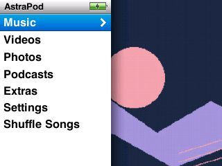
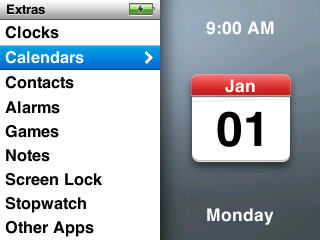
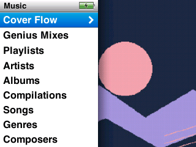
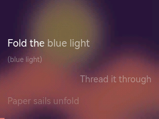

# AstraPod

Rockbox optimized for iPod classic.

This guide covers the sixth-generation iPod classic (S5L8702, build target `ipod6g`). Confirm your model and back up your music and `.rockbox` before installing.

## Features

| Feature | What you can do |
| --- | --- |
| Native interface | Choose from four [built-in native themes](#native-themes). Scrim fills the screen with Now Playing. Classic and the Fruit Company family use the original iPod playback layout with its status bar. |
| Cover Flow | Browse albums in 3D or flat view. Flip an album to see its tracks. Cover Flow loads the highlighted album first and shares its blurred artwork with Now Playing. [Cover Flow navigation](docs/podbox/covers-navigation.md) |
| Lyrics | Follow TTML or LRC lyrics with word-by-word timing, duets and backing vocals. Scroll through lyrics or seek to a line. Classic and the Fruit Company family highlight the current line in blue by default. [Lyrics guide](docs/podbox/lyrics.md) |
| Fonts | Scrim uses HarmonyOS Sans with additional glyphs from Noto and other fonts. Classic and the Fruit Company family use the original Helvetica and CJK bitmap glyphs where available. |
| Remote playback | Use HerdRemote to control Cider, browse its library and follow timed lyrics. You can also hand off playback. [Remote playback protocol](docs/podbox/cider-remote-protocol.md) |
| Agents and Usage | Use the click wheel to browse herdr workspaces, agents and usage. Answer questions or use voice recording and keyboard controls when the host enables them. [HerdRemote](https://github.com/gfhdhytghd/AstraPod-Desktop/blob/master/herdremote/README.md) |
| PodLink and reliability | PodLink connects over USB CDC serial. If an iAP accessory session fails to start, you can retry the connection. |
| SM1 DSP | Hardware decoding supports some FLAC and ALAC files. |

## Native themes

- **Scrim (default)** uses AstraPod's menus and a full-screen Now Playing layout.
- **Classic** keeps AstraPod's menus and uses the original iPod classic fonts, icons and playback layout. Split menus show options on the left and an image preview on the right.
- **Fruit Company** pairs Classic's look with the original main menu layout. The default rows are Music, Videos, Photos, Podcasts, Extras, Settings and Shuffle Songs. Choose which rows appear in **Settings → Main Menu**.
- **Fruit Company Ultra** shares Fruit Company's menus and split layout. The selection bar springs into place, overlapping pages cast shadows, and covers catch the light as they slide into Cover Flow. Turn off **Appearance → Animations** for the same motion as Fruit Company with animations off. Agents uses standard motion in either theme.

In the Fruit Company family, **Extras** includes Clocks, Calendars, Contacts, Alarms, Notes, Screen Lock and Stopwatch. It also gives you access to games, other apps, files and the System menu. Use **Photos** to browse synced albums and thumbnails or play a slideshow. Open **Videos → Movies** to find your films. For H.264 movies, Fruit Company uses the original-style playback overlay. Ultra uses AstraPod's overlay.

In Fruit Company and Ultra menus and browsing lists, turn the wheel to highlight an item, press **Select** to open it and press **Menu** to go back. Tap **Previous** or **Next** to skip tracks, or hold either button to seek. Tap **Play/Pause** to toggle playback. In apps, the controls follow the current screen. For example, turn the wheel to move between pictures in the photo viewer.

In Classic and the Fruit Company family, hold **Menu** to open the full-screen Control Centre. With the default controls, **Previous** changes Shuffle and **Next** changes Repeat. Press **Menu** to raise brightness and **Play/Pause** to lower it. Turn the wheel to adjust volume and press **Select** to close.

Switch themes in **Settings → Theme Settings → Native theme**. In the Fruit Company family, use **Settings → Advanced Settings → Theme Settings → Native theme**. Extract the full release ZIP when updating to install the theme fonts and artwork.

## Local audio sample rates

The iPod classic's audio hardware limits local playback to **48 kHz**. If you try to play a track above 48 kHz, AstraPod prompts you to convert it to **48 kHz or 44.1 kHz FLAC** first.

Open **Settings → Playback → Convert library to 48 kHz FLAC** to scan and convert your library in batches. The converter keeps your originals. After conversion, select a track as usual to play its converted copy automatically.

## Screenshots

### Fruit Company and Fruit Company Ultra

\
Fruit Company's split main menu shows the highlighted Music row beside an album cover preview.

\
Fruit Company's Extras menu shows a calendar preview beside the Calendars row.

\
In Fruit Company Ultra, covers slide into view and reflect below the carousel.

\
Select a track in Fruit Company Ultra to see the album cover turn into the Now Playing view.

### Scrim

\
Scroll through covers, flip an album to see its tracks, then close the panel.

\
Words light up in time with playback. Duet parts appear on opposite sides, with backing vocals and dots for instrumental breaks.

\
Open the file list from the main menu to see the rows slide in. Press **Menu** to return.

\
Spin the wheel to open the letter index. Each detent jumps to the next group. Lift your finger to close the index.

\
Choose a track in Cover Flow to open Scrim's Now Playing screen with the status bar hidden.

\
Browse an Agents workspace using a simulated HerdRemote connection and switch across to Usage.

## Shortcuts and button combinations

For the full mappings, see the [default button map](apps-ipod/input/keymap_ipod.c) and [SDL simulator button map](uisimulator/buttonmap/ipod.c).

### Global and recovery shortcuts

| Where | Buttons | Action |
| --- | --- | --- |
| Global | `Select + Menu` | Toggle Cover Flow. Opens the remote album browser when a remote source is available. |
| Now Playing, Lyrics or Agents | `Select + Play` | Open Agents from Now Playing or Lyrics. Return to Now Playing from Agents. |
| Menus and browsing lists | `Select + Play` | Open Now Playing in the Fruit Company family. In Scrim and Classic, open Agents when a PodLink host is connected. Otherwise, open Now Playing. |
| Hardware | Hold `Menu + Select` | Force a restart. |
| Bootloader | Hold `Select + Play` after restarting | Enter Apple Disk Mode. |
| Bootloader | Hold `Select + Left` or `Select + Right` at startup | Enter Apple Diagnostics with `Left` or Rockbox bootloader USB mode with `Right`. |
| Bootloader | Hold `Menu` at startup | Attempt to start the Apple firmware. Check LBA48 compatibility for drives larger than 128 GB. |

[Bootloader installation and DFU](tools/bootloader-installer/README.txt) · [Bootloader button map](bootloader/ipod-s5l87xx.c)

### Press-and-hold and dock remote shortcuts

| Where | Buttons | Action |
| --- | --- | --- |
| Standard screens | Hold `Menu` or `Select` | Hold `Menu` for Quick Settings in Scrim or Control Centre in Classic and the Fruit Company family. Hold `Select` for the context menu. |
| Now Playing or Lyrics | Hold `Play` for one second and release | Switch between Now Playing and Lyrics. |
| Lists with multiple selection | Hold `Select` and turn the wheel | Tick consecutive items. Turn back to untick them. To open the batch actions menu, tap `Play` in Scrim and Classic or hold `Menu` in the Fruit Company family. |
| Text entry | Hold `Left`, `Right` or `Menu` | In Scrim and Classic, use `Left` or `Right` to delete in that direction. In the Fruit Company family, hold `Menu` to delete to the left. |
| Cover Flow | Hold `Play` | Spin to a random album cover. |
| Agents | Hold `Play` | Record while held and stop on release. Enable voice recording on the host first. |
| Usage or agent details (Scrim or Classic connected to a herdr workspace) | Turn the wheel or press `Left` | The wheel sends arrow keys to the host. Spin faster to jump by words. Press or hold `Left` to send Backspace. |
| Dock remote | Double- or triple-press `Play` | Double-press to switch between Agents and Now Playing. Triple-press to toggle Cover Flow. |
| Dock remote | Hold `Play` | Toggle lyrics from the playback screen. In Scrim and Classic, hold to talk while in Agents. |

[Dock and host button routing](docs/podbox/covers-navigation.md) · [Agents controls and voice recording](https://github.com/gfhdhytghd/AstraPod-Desktop/blob/master/herdremote/README.md)

## Connecting to a computer

### USB Disk Mode, installation and updates

1. Start AstraPod, then connect the USB cable. When prompted, press **Select** to allow disk access or **Menu** to keep the connection without mounting the disk. Charge-only USB does not start PodLink. To enter Disk Mode manually, use the bootloader shortcut in the table above.
2. **On firmware earlier than FU114, start the player before connecting USB.**
3. For a first installation, follow the Rockbox manual to install the bootloader for your model. Choose the release ZIP for your model. For iPod classic, use `rockbox-ipod6g.zip`. Update any additional themes you have enabled as well. [Rockbox installation manual](https://www.rockbox.org/manual.shtml) · [AstraPod releases](https://github.com/gfhdhytghd/AstraPod/releases)
4. Back up `.rockbox` and any important files. Extract the ZIP to the root of the player's disk and replace `/.rockbox/rockbox.ipod` and the other matching files in `/.rockbox/`. Keep existing settings, library data and music that the ZIP does not replace. Eject the disk from your computer before unplugging.

For development packages, use the complete `fast_swap.py` command from the build report. Supply the new ZIP, its SHA-256, the baseline ZIP, the old firmware SHA-256 and the new firmware SHA-256 in that order. The tool checks the baseline, backs up changed files, writes and verifies the update, then ejects the disk. If the package removes files, use the `fast_swap_rm.py` command in the report.

While a compatible HerdRemote service is running, run `python3 herdremote/podlink_disk.py --timeout 20` from the AstraPod-Desktop checkout to request Disk Mode. In Disk Mode, hold **Menu** on the iPod to ask the host to unmount the disk and restore the non-disk connection. [Disk Mode](https://github.com/gfhdhytghd/AstraPod-Desktop/blob/master/docs/herdremote-usage.md#disk-mode-control-fu42)

### PodLink and HerdRemote

PodLink carries messages over USB CDC serial. Open **System → PodLink** on the player, connect USB and choose the connection without disk access. On Linux, the serial device usually appears as `/dev/ttyACM*`. Use diagnostic scripts and HerdRemote one at a time so each can access the port. [PodLink guide](docs/podlink.md)

AstraPod-Desktop includes the desktop app, the PodLink command-line tool, HerdRemote and input plugins. Start HerdRemote, connect the iPod and open **System → Agents**. In the Fruit Company family, open **Extras → System → Agents**. [AstraPod-Desktop](https://github.com/gfhdhytghd/AstraPod-Desktop) · [Remote playback protocol](docs/podbox/cider-remote-protocol.md)

### Troubleshooting

| Symptom | What to check or record |
| --- | --- |
| Crash screen | Record the firmware version, exact error and program counter (PC). After restarting, save `/.rockbox/crash-native.txt` if the player wrote it. |
| Slow album panel | Create an empty `perf.enable` file in `/.rockbox/podbox/` and restart. Album panel timings appear in `perf.log` in the same folder. Remove `perf.enable` and restart to stop logging. |
| Host cannot find the iPod | Check that USB is connected without disk access. Check serial port permissions and the HerdRemote service log. |

[Settings guide](docs/podbox/settings-guide.md) · [Music menu](docs/podbox/music-menu-guide.md) · [Artwork settings](docs/podbox/artwork-guide.md) · [Connection tests](docs/podbox/connectivity-testing-guide.md)

## Credits and licence

## Licence

Rockbox, RockPod and additions by AstraPod are licensed under the [GNU General Public License v2.0](https://www.gnu.org/licenses/old-licenses/gpl-2.0.html).

See [licences for imported code](docs/LICENSES) and the theme and font credits below.

## Development credits

This project has been developed with extensive AI assistance. I am a software developer, 
although C is not my primary language. I have driven the project's architecture, feature 
design, specifications, implementation approach, testing, debugging, and iteration. AI 
has been used as a development tool to assist with the C implementation, generate and 
explore solutions, and accelerate development. The resulting code is reviewed, tested, 
and iterated by me rather than being accepted as unreviewed generated output.

This is a hobby project, built because I wanted a version of Rockbox that better suited 
how I use my iPod. I'm sharing it in the hope that others might find it useful too.

Built on the work of:
- the [Rockbox](https://www.rockbox.org/) project
- the [RockPod](https://github.com/nuxcodes/rockpod) project (Nux Li: aka [@nuxcodes](https://github.com/nuxcodes)),
  the starting point for the app layer, the iPod hardware work in `firmware/`, and much of
  the serial accessory protocol
- the [Spun](https://github.com/majorsiebe/Stats_for_iPod) project (Siebe Majoor: aka [@majorsiebe](https://github.com/majorsiebe))

## Other credits

### Themes

- Classic, Fruit Company and Fruit Company Ultra use interface artwork and
  Helvetica and CJK glyphs from Apple's iPod classic firmware.
- Themify 2
  - Created by: Evan Kenny aka [Dook](https://d00k.net/)
  - License: CC BY-SA 3.0 (https://creativecommons.org/licenses/by-sa/3.0/deed.en)
- Obsede' 2
  - Created by: Serge Fahnenstell
  - License: CC BY-SA 3.0 (https://creativecommons.org/licenses/by-sa/3.0/deed.en)
- Bony
  - Based on BONES created by: Chuck Lardo
  - License: CC BY-SA 4.0 (https://creativecommons.org/licenses/by-sa/4.0/deed.en)
- iClassic Square (and its Dark and Light versions)
  - Created by: Humberto Santana
  - License: CC BY-SA 3.0 (https://creativecommons.org/licenses/by-sa/3.0/deed.en)
- Jive
  - Created by: James Stevenson
  - License: CC BY-SA 3.0 (https://creativecommons.org/licenses/by-sa/3.0/deed.en)

### Fonts

Font licence files and notices ship with the corresponding fonts.

- HarmonyOS Sans and HarmonyOS Sans SC
  - Copyright 2021–2024 Huawei Device Co., Ltd.
  - [Font terms](https://github.com/openharmony/global_system_resources/blob/master/LICENSE_Fonts)
- Material Design Icons
  - Created by Google (https://fonts.google.com/icons)
  - Licensed under the Apache License Version 2.0 —
    [full text](apps-ipod/fonts/LICENSE-Material-Design-Icons.txt)
- Noto Sans/Serif Font
  - Copyright 2022 The Noto Project Authors (https://github.com/notofonts/latin-greek-cyrillic)
  - Noto Sans built from MicroNotoSans - a fork of Noto Sans by Evan Kenny aka [Dook](https://d00k.net/)
  - Copyright 2026 Micro Noto Sans Authors (https://github.com/D0-0K/MicroNotoSans)
  - Licensed under the SIL Open Font License, Version 1.1 —
    [full text](apps-ipod/fonts/LICENSE-Noto.txt)
- Seven Fifteen Font
  - Copyright Douglas Vautour (https://burpyfresh.itch.io/seven-fifteen-font)
  - Bundled together with UnifontEX, a fork of GNU Unifont maintained by stgiga
    (https://github.com/stgiga/UnifontEX), which draws the scripts Seven Fifteen
    does not cover
  - Seven Fifteen licensed under CC BY-SA 4.0; UnifontEX under the GNU General
    Public License version 2 or later with the GNU font embedding exception, or
    the SIL Open Font License version 1.1 —
    [full text](apps-ipod/fonts/LICENSE-Seven-Fifteen.txt)
### Docks, receivers and remotes (iAP)

Thank you to the following, whose code or findings the dock and remote support is built on.
Which came from where is in [`iap-sources.md`](docs/podbox/iap-sources.md).

- RockPod by Nux Li aka [@nuxcodes](https://github.com/nuxcodes) (https://github.com/nuxcodes/rockpod)
  - The serial accessory protocol overhaul: identification, playback control, notifications,
    volume, chapters, authentication and album art
- Paul Sauro's Rockbox changes 7900, 7906, 7938 and 7940 (https://gerrit.rockbox.org)
  - Digital audio to docks: rate changes, charge-only mode and seeking from a remote
- libiap by mojyack (https://github.com/mojyack/libiap)
  - The USB accessory protocol core
- ipod-gadget and ipod by Andrew Onyshchuk aka [@oandrew](https://github.com/oandrew)
  (https://github.com/oandrew/ipod-gadget)
  - How cars behave, and the identities behind `Identify As`

### Modern cars (iAP2)

Thank you to the following sources, which supplied facts about the protocol - message numbers,
layouts and behaviour to support the iAP2 development. Which fact came from where is in
[`iap2-sources.md`](docs/podbox/iap2-sources.md).

- carplayd by lvalen91 (https://github.com/lvalen91/carplayd)
  - The message table and the order of authentication and identification
- Nocturne by the Nocturne team (https://github.com/usenocturne/nocturne)
  - Now playing, the car's buttons and file transfers
- carplay-wifi-extractor by HaToan (https://github.com/HaToan/carplay-wifi-extractor)
  - The phone's side of the conversation
- JJTech0130's iAP2 gists (`carkit_iap2.py`, the `iap2.lua` Wireshark dissector)
  - The message names, and how to talk iAP2 to a real iPhone
- Adam Bell, "McLarens and CarPlay" (https://blog.adambell.ca)
  - Showed that a device can stand in for an iPhone in a car
- usbmuxd from libimobiledevice (https://github.com/libimobiledevice/usbmuxd)
  - Apple's USB mode requests
- pymobiledevice3 by doronz88 (https://github.com/doronz88/pymobiledevice3)
  - Fetched the iPhone's logs of its conversation with the car

### iPod Video display

- ProkBox5g by prokopto-dev (https://github.com/prokbox/prokbox5g), GPL v2 or later
  - The PP5022's second DMA engine, which sends the 5G's screen to its video chip while
    the CPU decodes music

### Speech

- NV Speech Player by NV Access (https://github.com/nvaccess/NVSpeechPlayer), GPL v2
  - The synthesiser and its rules for rhythm, ported to whole-number arithmetic for the iPod;
    based on Dennis Klatt's formant synthesiser
- The CMU Pronouncing Dictionary by Carnegie Mellon University
  (https://github.com/cmusphinx/cmudict), BSD licence, shipped as
  `.rockbox/speech/LICENSE-cmudict.txt`
  - How the words it holds are said
- "Automatic Translation of English Text to Phonetics by Means of Letter-to-Sound Rules", NRL
  Report 7948 (Elovitz, Johnson, McHugh and Shore, 1976), in John A. Wasser's public-domain
  transcription
  - How the words the dictionary lacks are said

### Spike Video

- Song: Gabriawll - Recall
- Music provided by NoCopyrightSounds
- Free Download/Stream: http://ncs.io/Recall
- Watch: http://ncs.lnk.to/RecallAT/youtube

### Album Artwork

- Angine de Poitrine - Vol.II - [Website](https://anginedepoitrine.com/)
  - Artwork: Arielle Corbeau - [Website](https://www.instagram.com/ariellecorbeau)
- Battles - Glass Drop - [Website](https://battles.warp.net/)
  - Artwork: Lesley Unruh - [Website](http://www.unruhphoto.com)
- Everything Everything - Get To Heaven - [Website](https://everything-everything.co.uk/)
  - Artwork: Andrew Archer - [Website](https://www.andrewarcher.com)
- Kowloon - Come Over - [Website](https://www.kowloonkowloon.com/)
  - Artwork: Ram Han - [Website](https://www.instagram.com/ram__han/)
- POLKADOT STINGRAY - 全知全能 - [Website](https://polkadot-stingray.jp/)
  - Artwork: Shizuku (雫) - [Website](https://www.instagram.com/plkshizuku/)
- Sabrina Carpenter - Man's Best Friend - [Website](https://www.sabrinacarpenter.com/)
  - Artwork: Bryce Anderson - [Website](https://www.instagram.com/brvceanderson)
- Spoon - Hot Thoughts - [Website](http://spoontheband.com/)
  - Artwork: Christine Messersmith
- Vampire Weekend - Contra - [Website](http://vampireweekend.com/)
  - Artwork: Complicated
