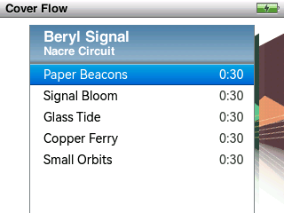
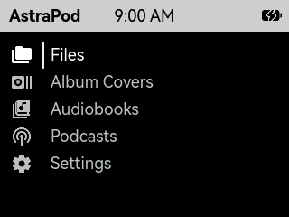
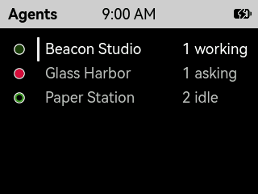

# AstraPod
Rockbox specifically and deeply optimized for iPod Classic.

本页适用于第六代 iPod classic（S5L8702，构建目标 `ipod6g`）。安装前必须确认型号，并备份音乐和 `.rockbox`。

## 已实现

| 功能 | 当前实现 |
| --- | --- |
| 原生界面 | 四款[内置原生主题](#原生主题)。Scrim 的「正在播放」是无状态栏的全屏界面。Classic 和 Fruit Company 系列采用原厂样式的播放布局，并保留状态栏。 |
| Cover Flow | 支持立体和平面浏览。相册翻面显示曲目，后台优先预取居中相册。翻面板与「正在播放」共享模糊封面缓存。 [轮播导航](docs/podbox/covers-navigation.md) |
| 歌词 | 支持 TTML、LRC、逐字时间、对唱和背景人声。可以手动浏览和按行定位。Classic 和 Fruit Company 系列默认用蓝色选中条标出当前歌词行。 [歌词说明](docs/podbox/lyrics.md) |
| 字体 | Scrim 使用 HarmonyOS Sans，并以 Noto 等字体补字。Classic 和 Fruit Company 系列优先使用原厂 Helvetica 和中日韩点阵字形。 |
| 远程播放 | HerdRemote 提供 Cider 播放控制、远程资料库和带时间的歌词。支持播放交接。 [远程协议](docs/podbox/cider-remote-protocol.md) |
| Agents 和 Usage | 用点击轮查看 herdr 工作区、代理和用量。可以回答问题，也支持经主机配置的录音和键盘操作。 [HerdRemote](https://github.com/gfhdhytghd/AstraPod-Desktop/blob/master/herdremote/README.md) |
| PodLink 与稳定性 | PodLink 使用 USB CDC 串行链路。主线程栈和线程容量经过加固。字形与模糊任务共享后台线程。iAP 创建线程失败后可以重试。 |
| SM1 DSP | 支持部分 FLAC 和 ALAC 的硬件解码。 |

## 原生主题

- **Scrim（默认）**采用 AstraPod 的菜单和全屏「正在播放」布局。
- **Classic**保留 AstraPod 的菜单，使用 iPod classic 原厂字体、图标和播放布局。分栏菜单左侧显示选项，右侧显示图片预览。
- **Fruit Company**沿用 Classic 的外观，主菜单采用原厂布局。默认项目为「音乐」「视频」「照片」「播客」「附加功能」「设置」「随机乐曲」。可以在「设置 → 主菜单」调整这些项目。
- **Fruit Company Ultra**沿用 Fruit Company 的菜单和分栏布局。选中条带有回弹，页面叠放时投下阴影，Cover Flow 的封面滑入时带有反光。关闭「外观 → 动画」后，界面动效与 Fruit Company 一致。Agents 始终使用常规动效。

Fruit Company 系列的「附加功能」提供时钟、日历、通讯录、闹钟、备忘录、屏幕锁和秒表。也可以从这里打开游戏、其他应用、文件和系统菜单。在「照片」中可以浏览同步的相册和缩略图，也可以播放幻灯片。「视频 → 影片」打开电影列表。播放 H.264 影片时，Fruit Company 使用原厂样式的控制浮层，Ultra 使用 AstraPod 的浮层。

在 Fruit Company 系列的菜单和浏览列表中，转动滚轮选择项目，按 **Select** 打开，按 **Menu** 返回。**Previous** 和 **Next** 短按切歌，长按快退或快进。短按 **Play/Pause** 切换播放状态。应用内按键随当前界面而定，例如在照片查看器中转动滚轮换照片。

在 Classic 和 Fruit Company 系列中，长按 **Menu** 打开全屏控制中心。默认用 **Previous** 和 **Next** 分别切换随机播放和重复播放。按 **Menu** 调高亮度，按 **Play/Pause** 调低亮度。转动滚轮调节音量，按 **Select** 关闭。

在「设置 → 主题设置 → 原生主题」切换主题。使用 Fruit Company 系列时，路径为「设置 → 高级设置 → 主题设置 → 原生主题」。更新固件时请解压完整发行包，以安装主题字体和图片。

## 本地音频采样率

受 iPod classic 音频输出硬件限制，AstraPod 的本地播放最高支持 **48 kHz**。固件已移除高于 48 kHz 曲目的直接播放解码路径。尝试播放时，设备会提示先转换为 **48 kHz 或 44.1 kHz FLAC**。

在「设置 → 播放设置 → 将曲库高采样率曲目转换为 48 kHz FLAC」可扫描曲库并批量转换。转换保留原文件。生成转换件后，从原曲入口播放会自动使用转换件。

## 界面演示

### Fruit Company 系列

### Scrim

\
在 Cover Flow 中滚动封面，翻面查看曲目，再合上面板。

\
歌词随播放逐词点亮，左右分列对唱，显示和声与间奏圆点。

\
从首页进入文件列表，列表行错峰滑入，按 MENU 返回首页。

\
快速滚动打开字母索引，每拨一格跳到下一组，松开滚轮关闭索引。

\
在 Scrim 中从 Cover Flow 选曲后，进入无状态栏的全屏播放页。

\
用模拟的 HerdRemote 显示 Agents 工作区，并横向切换到 Usage 页面。

## 快捷键与组合键

仅列出不说明很难自行发现的组合键与快捷手势；完整按键说明见 [默认按键表](apps-ipod/input/keymap_ipod.c) 和 [SDL 按键映射](uisimulator/buttonmap/ipod.c)。

### 全局与恢复组合键

| 场景 | 按键 | 动作 |
| --- | --- | --- |
| 全局 | `Select + Menu` | 开关 Cover Flow（远程来源可用时优先打开远程相册）。 |
| 「正在播放」／歌词／Agents | `Select + Play` | 从「正在播放」或歌词进入 Agents，从 Agents 返回「正在播放」。 |
| 菜单和浏览列表 | `Select + Play` | Fruit Company 系列跳到「正在播放」。Scrim 和 Classic 在连接 PodLink 主机时打开 Agents，否则跳到「正在播放」。 |
| 硬件 | 长按 `Menu + Select` | 强制重启。 |
| 引导程序 | 重启后按住 `Select + Play` | 进入 Apple 磁盘模式。 |
| 引导程序 | 启动时按住 `Select + Left`／`Select + Right` | 分别进入 Apple 诊断模式和 Rockbox 引导程序 USB 模式。 |
| 引导程序 | 启动时按住 `Menu` | 尝试启动 Apple 固件（大于 128 GB 的盘必须检查 LBA48 兼容性）。 |

[引导程序安装和 DFU](tools/bootloader-installer/README.txt) · [引导程序按键源码](bootloader/ipod-s5l87xx.c)

### 隐藏手势与底座遥控器

| 场景 | 按键 | 动作 |
| --- | --- | --- |
| 常规页面 | 长按 `Menu`／长按 `Select` | 长按 `Menu` 打开快捷设置（Scrim）或控制中心（Classic 和 Fruit Company 系列）。长按 `Select` 打开上下文菜单。 |
| 「正在播放」／歌词 | 按住 `Play` 一秒后松开 | 在「正在播放」和歌词之间切换。 |
| 多选列表 | 按住 `Select` 并转动滚轮 | 连续勾选（反转取消）。Scrim 和 Classic 短按 `Play` 打开批量操作菜单。Fruit Company 系列长按 `Menu` 打开批量操作菜单。 |
| 文本输入 | 长按 `Left`／`Right` 或 `Menu` | Scrim 和 Classic 用 `Left`／`Right` 向左或向右删除字符。Fruit Company 系列用 `Menu` 向左删除字符。 |
| Cover Flow | 长按 `Play` | 随机转动封面。 |
| Agents | 按住 `Play` | 按住录音，松手结束（需主机开启语音功能）。 |
| Usage／代理详情（Scrim 或 Classic 连接 Herdr 工作区） | 滚轮（快转按词跳）／`Left`（可长按） | 发送主机方向键／发送 Backspace。 |
| 底座遥控器 | `Play` 双击／三击 | 双击切换 Agents 和「正在播放」；三击开关 Cover Flow。 |
| 底座遥控器 | 长按 `Play` | 播放页开关歌词。在 Scrim 和 Classic 的 Agents 中按住说话。 |

[底座和主机的按键归属](docs/podbox/covers-navigation.md) · [Agents 按键及语音](https://github.com/gfhdhytghd/AstraPod-Desktop/blob/master/herdremote/README.md)

## 连接电脑

### USB 磁盘模式、安装和更新

1. 运行 AstraPod 后接数据线。出现 USB 询问时，按 **Select** 授权磁盘访问，或按 **Menu** 保持非磁盘连接。纯充电 USB 模式不启动 PodLink。手动磁盘模式见上表。
2. **FU114 之前的固件不得带着 USB 线启动。** 必须先启动，再接线。
3. 初次安装按 Rockbox 安装手册安装对应型号的引导程序。正式发行包中，Classic 使用 `rockbox-ipod6g.zip`。选择本机型号对应的 ZIP；同时更新已启用的额外主题。 [Rockbox 安装手册](https://www.rockbox.org/manual.shtml) · [发布包](https://github.com/gfhdhytghd/AstraPod/releases)
4. 备份 `.rockbox` 和重要文件。把 ZIP 解压到磁盘根目录，用包中同名文件更新 `/.rockbox/rockbox.ipod` 及其他 `/.rockbox/` 资源。保留包外的设置、资料库和音乐。电脑弹出磁盘后再断线。

开发包可以用报告中的 `fast_swap.py` 完整命令。参数依次为新 ZIP、ZIP SHA-256、基线 ZIP、旧固件 SHA-256 和新固件 SHA-256。工具核对基线，备份差异文件，写入并校验后弹出磁盘。有删除项的包用报告指定的 `fast_swap_rm.py`。

兼容的 HerdRemote 服务运行时，可以在 AstraPod-Desktop 仓库运行 `python3 herdremote/podlink_disk.py --timeout 20` 请求磁盘模式。磁盘模式下长按机身 Menu，可以请求主机先卸载磁盘，再恢复非磁盘连接。 [Disk Mode](https://github.com/gfhdhytghd/AstraPod-Desktop/blob/master/docs/herdremote-usage.md#disk-mode-control-fu42)

### PodLink 和 HerdRemote

PodLink 是 USB CDC 串行消息链路。打开「系统 → PodLink」，接线后选择非磁盘连接。Linux 通常显示 `/dev/ttyACM*`。诊断脚本与 HerdRemote 分时占用串口。

[PodLink 使用说明](docs/podlink.md)

电脑端应用、PodLink 命令行、HerdRemote 和输入插件见 [AstraPod-Desktop](https://github.com/gfhdhytghd/AstraPod-Desktop)。
运行 HerdRemote 后接线，在 iPod 打开「系统 → Agents」。使用 Fruit Company 系列时，从「附加功能 → 系统」进入。
[远程协议](docs/podbox/cider-remote-protocol.md)

### 故障排查

| 现象 | 要记录的内容 |
| --- | --- |
| 崩溃屏 | 版本、原始报错、PC。重新启动后保留成功写出的 `/.rockbox/crash-native.txt`。 |
| 翻面板等待 | 在 `/.rockbox/podbox/` 放置空文件 `perf.enable` 并重启。翻面数据写入同目录的 `perf.log`。移除开关并重启可以停止记录。 |
| 主机找不到 iPod | 检查非磁盘 USB 连接、串口权限和 HerdRemote 服务日志。 |

[设置指南](docs/podbox/settings-guide.md) · [音乐菜单](docs/podbox/music-menu-guide.md) · [封面设置](docs/podbox/artwork-guide.md) · [连接测试](docs/podbox/connectivity-testing-guide.md)

## Credits and licence

## Licence

Rockbox, RockPod and additions by AstraPod are licensed under the [GNU General Public License v2.0](https://www.gnu.org/licenses/old-licenses/gpl-2.0.html).

See [licences for imported code](docs/LICENSES) and the theme and font credits below.

## Development credits

This project has been developed with extensive AI assistance. I am a software developer, 
although C is not my primary language. I have driven the project's architecture, feature 
design, specifications, implementation approach, testing, debugging, and iteration. AI 
has been used as a development tool to assist with the C implementation, generate and 
explore solutions, and accelerate development. The resulting code is reviewed, tested, 
and iterated by me rather than being accepted as unreviewed generated output.

This is a hobby project, built because I wanted a version of Rockbox that better suited 
how I use my iPod. I'm sharing it in the hope that others might find it useful too.

Built on the work of:
- the [Rockbox](https://www.rockbox.org/) project
- the [RockPod](https://github.com/nuxcodes/rockpod) project (Nux Li: aka [@nuxcodes](https://github.com/nuxcodes)),
  the starting point for the app layer, the iPod hardware work in `firmware/`, and much of
  the serial accessory protocol
- the [Spun](https://github.com/majorsiebe/Stats_for_iPod) project (Siebe Majoor: aka [@majorsiebe](https://github.com/majorsiebe))

## Other credits

### Themes

- Classic, Fruit Company and Fruit Company Ultra use interface artwork and
  Helvetica and CJK glyphs from Apple's iPod classic firmware.
- Themify 2
  - Created by: Evan Kenny aka [Dook](https://d00k.net/)
  - License: CC BY-SA 3.0 (https://creativecommons.org/licenses/by-sa/3.0/deed.en)
- Obsede' 2
  - Created by: Serge Fahnenstell
  - License: CC BY-SA 3.0 (https://creativecommons.org/licenses/by-sa/3.0/deed.en)
- Bony
  - Based on BONES created by: Chuck Lardo
  - License: CC BY-SA 4.0 (https://creativecommons.org/licenses/by-sa/4.0/deed.en)
- iClassic Square (and its Dark and Light versions)
  - Created by: Humberto Santana
  - License: CC BY-SA 3.0 (https://creativecommons.org/licenses/by-sa/3.0/deed.en)
- Jive
  - Created by: James Stevenson
  - License: CC BY-SA 3.0 (https://creativecommons.org/licenses/by-sa/3.0/deed.en)

### Fonts

Font licence files and notices ship with the corresponding fonts.

- HarmonyOS Sans and HarmonyOS Sans SC
  - Copyright 2021–2024 Huawei Device Co., Ltd.
  - [Font terms](https://github.com/openharmony/global_system_resources/blob/master/LICENSE_Fonts)
- Material Design Icons
  - Created by Google (https://fonts.google.com/icons)
  - Licensed under the Apache License Version 2.0 —
    [full text](apps-ipod/fonts/LICENSE-Material-Design-Icons.txt)
- Noto Sans/Serif Font
  - Copyright 2022 The Noto Project Authors (https://github.com/notofonts/latin-greek-cyrillic)
  - Noto Sans built from MicroNotoSans - a fork of Noto Sans by Evan Kenny aka [Dook](https://d00k.net/)
  - Copyright 2026 Micro Noto Sans Authors (https://github.com/D0-0K/MicroNotoSans)
  - Licensed under the SIL Open Font License, Version 1.1 —
    [full text](apps-ipod/fonts/LICENSE-Noto.txt)
- Seven Fifteen Font
  - Copyright Douglas Vautour (https://burpyfresh.itch.io/seven-fifteen-font)
  - Bundled together with UnifontEX, a fork of GNU Unifont maintained by stgiga
    (https://github.com/stgiga/UnifontEX), which draws the scripts Seven Fifteen
    does not cover
  - Seven Fifteen licensed under CC BY-SA 4.0; UnifontEX under the GNU General
    Public License version 2 or later with the GNU font embedding exception, or
    the SIL Open Font License version 1.1 —
    [full text](apps-ipod/fonts/LICENSE-Seven-Fifteen.txt)
### Docks, receivers and remotes (iAP)

Thank you to the following, whose code or findings the dock and remote support is built on.
Which came from where is in [`iap-sources.md`](docs/podbox/iap-sources.md).

- RockPod by Nux Li aka [@nuxcodes](https://github.com/nuxcodes) (https://github.com/nuxcodes/rockpod)
  - The serial accessory protocol overhaul: identification, playback control, notifications,
    volume, chapters, authentication and album art
- Paul Sauro's Rockbox changes 7900, 7906, 7938 and 7940 (https://gerrit.rockbox.org)
  - Digital audio to docks: rate changes, charge-only mode and seeking from a remote
- libiap by mojyack (https://github.com/mojyack/libiap)
  - The USB accessory protocol core
- ipod-gadget and ipod by Andrew Onyshchuk aka [@oandrew](https://github.com/oandrew)
  (https://github.com/oandrew/ipod-gadget)
  - How cars behave, and the identities behind `Identify As`

### Modern cars (iAP2)

Thank you to the following sources, which supplied facts about the protocol - message numbers,
layouts and behaviour to support the iAP2 development. Which fact came from where is in
[`iap2-sources.md`](docs/podbox/iap2-sources.md).

- carplayd by lvalen91 (https://github.com/lvalen91/carplayd)
  - The message table and the order of authentication and identification
- Nocturne by the Nocturne team (https://github.com/usenocturne/nocturne)
  - Now playing, the car's buttons and file transfers
- carplay-wifi-extractor by HaToan (https://github.com/HaToan/carplay-wifi-extractor)
  - The phone's side of the conversation
- JJTech0130's iAP2 gists (`carkit_iap2.py`, the `iap2.lua` Wireshark dissector)
  - The message names, and how to talk iAP2 to a real iPhone
- Adam Bell, "McLarens and CarPlay" (https://blog.adambell.ca)
  - Showed that a device can stand in for an iPhone in a car
- usbmuxd from libimobiledevice (https://github.com/libimobiledevice/usbmuxd)
  - Apple's USB mode requests
- pymobiledevice3 by doronz88 (https://github.com/doronz88/pymobiledevice3)
  - Fetched the iPhone's logs of its conversation with the car

### iPod Video display

- ProkBox5g by prokopto-dev (https://github.com/prokbox/prokbox5g), GPL v2 or later
  - The PP5022's second DMA engine, which sends the 5G's screen to its video chip while
    the CPU decodes music

### Speech

- NV Speech Player by NV Access (https://github.com/nvaccess/NVSpeechPlayer), GPL v2
  - The synthesiser and its rules for rhythm, ported to whole-number arithmetic for the iPod;
    based on Dennis Klatt's formant synthesiser
- The CMU Pronouncing Dictionary by Carnegie Mellon University
  (https://github.com/cmusphinx/cmudict), BSD licence, shipped as
  `.rockbox/speech/LICENSE-cmudict.txt`
  - How the words it holds are said
- "Automatic Translation of English Text to Phonetics by Means of Letter-to-Sound Rules", NRL
  Report 7948 (Elovitz, Johnson, McHugh and Shore, 1976), in John A. Wasser's public-domain
  transcription
  - How the words the dictionary lacks are said

### Spike Video

- Song: Gabriawll - Recall
- Music provided by NoCopyrightSounds
- Free Download/Stream: http://ncs.io/Recall
- Watch: http://ncs.lnk.to/RecallAT/youtube

### Album Artwork

- Angine de Poitrine - Vol.II - [Website](https://anginedepoitrine.com/)
  - Artwork: Arielle Corbeau - [Website](https://www.instagram.com/ariellecorbeau)
- Battles - Glass Drop - [Website](https://battles.warp.net/)
  - Artwork: Lesley Unruh - [Website](http://www.unruhphoto.com)
- Everything Everything - Get To Heaven - [Website](https://everything-everything.co.uk/)
  - Artwork: Andrew Archer - [Website](https://www.andrewarcher.com)
- Kowloon - Come Over - [Website](https://www.kowloonkowloon.com/)
  - Artwork: Ram Han - [Website](https://www.instagram.com/ram__han/)
- POLKADOT STINGRAY - 全知全能 - [Website](https://polkadot-stingray.jp/)
  - Artwork: Shizuku (雫) - [Website](https://www.instagram.com/plkshizuku/)
- Sabrina Carpenter - Man's Best Friend - [Website](https://www.sabrinacarpenter.com/)
  - Artwork: Bryce Anderson - [Website](https://www.instagram.com/brvceanderson)
- Spoon - Hot Thoughts - [Website](http://spoontheband.com/)
  - Artwork: Christine Messersmith
- Vampire Weekend - Contra - [Website](http://vampireweekend.com/)
  - Artwork: Complicated  

## English summary

Rockbox specifically and deeply optimized for iPod Classic.

### Built-in native themes

- **Scrim (default)** gives you AstraPod's menus and full-screen Now Playing.
- **Classic** keeps AstraPod's menus and uses the original iPod classic fonts,
  artwork and Now Playing layout. Split menus show options on the left and a
  preview on the right.
- **Fruit Company** pairs that look with the original main menu layout. The
  default rows are Music, Videos, Photos, Podcasts, Extras, Settings and Shuffle
  Songs. Choose which rows appear in **Settings → Main Menu**.
- **Fruit Company Ultra** shares Fruit Company's menus and adds springy
  selection, layered page transitions and animated Cover Flow. Turn off
  **Appearance → Animations** to give Ultra the same motion as Fruit Company
  with animations off.
  Agents uses standard motion in either theme.

In the Fruit Company family, **Extras** includes Clocks, Calendars, Contacts,
Alarms, Notes, Screen Lock and Stopwatch. It also gives you access to files,
games, other apps and system tools. Use **Photos** to browse synced albums
and thumbnails or play a slideshow. Open **Videos → Movies** to watch films.
For H.264 movies, Fruit Company uses the original-style overlay and Ultra
uses AstraPod's overlay.

In Fruit Company and Ultra menus and browsing lists, use the wheel, Select
and Menu to navigate. Tap Previous or Next to skip tracks, or hold either
button to seek. Tap Play/Pause to toggle playback. Each app has its own
controls. In the photo viewer, for example, turn the wheel to move between
photos.

In Classic and the Fruit Company family, hold **Menu** to open Control Centre.
With the default controls, Previous changes Shuffle and Next changes Repeat.
Use Menu and Play/Pause to raise and lower brightness, turn the wheel to adjust
volume, and press Select to close. On Now Playing, hold **Play** for one second
and release to open Lyrics. Repeat to return.

Press **Select + Play** on Now Playing, Lyrics or Agents to switch between
playback and Agents. In Fruit Company and Ultra menus, the same shortcut
opens Now Playing.

Switch themes in **Settings → Theme Settings → Native theme**. In the Fruit
Company family, use **Settings → Advanced Settings → Theme Settings → Native
theme**. Extract the full release ZIP when updating to install the theme fonts
and artwork.
