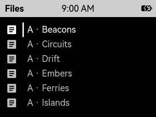

# AstraPod
Rockbox specifically and deeply optimized for iPod Classic.

本页适用于第六代 iPod classic（S5L8702，构建目标 `ipod6g`）。安装前必须确认型号，并备份音乐和 `.rockbox`。

## 已实现

| 功能 | 当前实现 |
| --- | --- |
| 原生界面 | 原生列表、页面和动画。动画以每秒 60 帧为计时基准。状态栏显示居中的时钟、电池和播放状态。「正在播放」使用全屏界面。 [动画说明](docs/podbox/animation-engine.md) |
| Cover Flow | 支持立体和平面浏览。相册翻面显示曲目，后台优先预取居中相册。翻面板与「正在播放」共享模糊封面缓存。 [轮播导航](docs/podbox/covers-navigation.md) |
| 歌词 | TTML、LRC、逐字时间、对唱和背景人声。可以手动浏览和按行定位。歌词性能记录采用 30 fps 预算。 [歌词说明](docs/podbox/lyrics.md) |
| PBF1 字体 | 主机合并 HarmonyOS Sans 与同字号 Noto 补字。覆盖整套 CJK 字符集，支持字偶距、字形缓存和预取。点阵按原生尺寸绘制。 [字体说明](tools/fonts/README.md) |
| 远程播放 | HerdRemote 提供 Cider 播放控制、远程资料库和带时间的歌词。支持播放交接。 [远程协议](docs/podbox/cider-remote-protocol.md) |
| Agents 和 Usage | 用点击轮查看 herdr 工作区、代理和用量。可以回答问题，也支持经主机配置的录音和键盘操作。 [HerdRemote](tools/herdremote/README.md) |
| PodLink 与稳定性 | PodLink 使用 USB CDC 串行链路。主线程栈和线程容量经过加固。字形与模糊任务共享后台线程。iAP 创建线程失败后可以重试。 |
| sm1 DSP | 研发阶段。发行包的音频播放路径未启用 sm1 DSP。 |

## 界面演示

\
在 Cover Flow 中滚动封面，翻面查看曲目，再合上面板。

\
歌词随播放逐词点亮，左右分列对唱，显示和声与间奏圆点。

\
从首页进入文件列表，列表行错峰滑入，按 MENU 返回首页。

\
快速滚动打开字母索引，每拨一格跳到下一组，松开滚轮关闭索引。

\
从 Cover Flow 选曲后过渡到全屏播放页，画面顶部没有状态栏。

\
用模拟的 HerdRemote 显示 Agents 工作区，并横向切换到 Usage 页面。

## 按键与点击轮

**Select** 是中央键。**Menu、Play、Left、Right** 是点击轮上的按键。以下是默认按键。顺时针通常向下或向前，逆时针向上或向后。

### 首页和列表

| 场景 | 按键 | 动作 |
| --- | --- | --- |
| 首页、标准列表 | 转动点击轮 | 移动光标。 |
| 首页、标准列表 | Select 或 Right | 打开选中项。 |
| 首页、标准列表 | Left 或短按 Menu | 返回上层。 |
| 首页、标准列表 | 长按 Menu | 打开 QuickScreen。 |
| 首页、标准列表 | 长按 Select | 打开选中项的上下文菜单。 |
| 首页、支持播放跳转的列表 | 短按 Play | 进入「正在播放」。有续播记录时可以恢复播放。 |
| 树形列表 | 长按 Left 或 Right | 启用左右键翻页时，向前或向后翻页。Left 的首次长按也可以返回根目录。 |
| 至少 51 项的列表 | 10 个动画帧内快速移动至少 8 项 | 自动显示快速索引。停止快速移动后约 20 帧关闭。 |
| 多选列表 | Select、按住 Select 转轮、Play、Menu | 勾选单行、连续勾选或反向取消、打开批量操作、退出。 |
| 文本输入 | 转轮、Left 或 Right、Select、Play、Menu | 选字符、移动光标、插入、确认、取消。长按 Left 向左删除，长按 Right 向右删除，长按 Select 读出字符。 |
| QuickScreen | Menu、Play、Left、Right | 调整上、下、左、右槽位。转轮调节音量，Select 退出。 |

### Cover Flow、正在播放和歌词

| 场景 | 按键 | 动作 |
| --- | --- | --- |
| Cover Flow | 转轮 | 逐张浏览。底座遥控器的 Left 和 Right 也可以逐张浏览。 |
| Cover Flow | Left 或 Right，支持长按重复 | 按当前排序跳到上一组或下一组。 |
| Cover Flow | Select | 翻到曲目面板。艺人卡进入其相册列表。 |
| Cover Flow | 长按 Select | 打开本地相册或艺人的上下文菜单，视页面支持而定。 |
| Cover Flow | 短按 Play、长按 Play | 分别进入「正在播放」和随机转动封面。 |
| Cover Flow | 短按 Menu、长按 Menu | 分别返回进入轮播的页面和打开 QuickScreen。 |
| 翻面板 | 转轮、Select、短按 Menu | 分别选曲、播放选中曲目、翻回封面。 |
| 翻面板 | 短按 Play、长按 Menu | 分别进入「正在播放」和打开 QuickScreen。 |
| 正在播放 | 转轮、短按 Play | 分别调节音量和播放或暂停。 |
| 正在播放 | 短按 Left 或 Right | 上一首或回到曲首，或切到下一首。 |
| 正在播放 | 长按 Left 或 Right | 快退或快进。松手提交。 |
| 正在播放 | Select、长按 Select 或长按 Play | Select 打开歌词。长按打开当前播放来源的上下文菜单。 |
| 正在播放 | 短按 Menu、长按 Menu | 分别返回上一层（含翻面板）和打开 QuickScreen。 |
| 歌词 | 转轮 | 手动浏览。停止约 4 秒后恢复跟唱。 |
| 歌词 | Select | 手动浏览带时间的歌词时跳到选中行。其余情况退出歌词。 |
| 歌词 | Menu、Play、短按或长按 Left／Right | 分别退出、播放或暂停、切曲或快退快进。 |
| 歌词 | 底座遥控器音量键 | 本地模式浏览歌词。远程播放接管时调节远程音量。 |

[默认按键表](apps-ipod/input/keymap_ipod.c) · [快速索引](apps-ipod/widgets/list_render.c) · [Cover Flow](apps-ipod/screens/covers/carousel.c) · [正在播放](apps-ipod/screens/playback/wps.c) · [歌词](apps-ipod/viewers/lyric_viewer/lyric_viewer.c)

### Agents、Usage、遥控器和交接

| 页面 | 点击轮 | Select | Left／Right | Menu |
| --- | --- | --- | --- | --- |
| Agents 工作区列表 | 选工作区 | 进入工作区 | 任一键打开 Usage | 确认退出 |
| 工作区内 | 选代理 | 打开代理详情 | 上／下一个标签页 | 回工作区列表 |
| Usage | 主机方向键，快转按词跳 | 主机 Enter | Left 发送 Backspace，支持长按。Right 回工作区列表。 | 确认退出 |
| 代理详情 | 主机方向键，快转按词跳 | 主机 Enter | Left 发送 Backspace，支持长按。 | 回工作区 |
| 问题 | 选选项 | 选择、勾选或提交 | — | 返回 |
| 交接确认 | 选择继续或离开 | 确认选项 | 选择继续或离开 | 取消 |

Agents 中按住 Play 录音，松手结束。短按会丢弃短录音。主机必须开启相应语音功能。长按 Menu 可以打开 QuickScreen。 [Agents 按键及语音](tools/herdremote/README.md)

| 场景 | 按键 | 动作 |
| --- | --- | --- |
| 底座遥控器 | Play 单击 | 在播放页播放或暂停。在 Agents、Cover Flow 及其曲目列表相当于 Select。在 QuickScreen 中退出。 |
| 底座遥控器 | Play 双击或三击 | 双击切换 Agents 和「正在播放」。三击打开或退出 Cover Flow。 |
| 底座遥控器 | 长按 Play | 播放页打开歌词，歌词中返回。Agents 中按住说话。 |
| 底座遥控器 | Left、Right、Menu、Select | 按当前页面导航。播放时长按 Left 或 Right 快退或快进。 |
| 底座遥控器 | 音量键 | 播放时调音量。列表和轮播中滚动。Usage 可由主机转成编辑方向键。 |
| Cider 资料库 | 转轮、Select 或 Right、Left 或 Menu、短按 Play | 分别选择、进入或播放、返回、打开「正在播放」。长按 Menu 打开 QuickScreen。 |

[底座和主机的按键归属](docs/podbox/covers-navigation.md) · [Usage 遥控器](tools/herdremote/README.md)

### 全局组合键、Hold 和恢复

| 来源 | 按键 | 动作 |
| --- | --- | --- |
| AstraPod | Select + Menu | 开关 Cover Flow。远程来源可用时，优先打开远程相册。 |
| AstraPod | Select + Play | 有 PodLink 主机时切换 Agents 和「正在播放」。无主机时跳到「正在播放」。录音或已开始的 Select 手势优先。 |
| AstraPod | Hold 开关 | 锁定机身按钮和点击轮。关掉 Hold 后恢复输入。 |
| AstraPod | 持续按住 Play | 在允许软件关机的页面关机。轮播和 Agents 会接管此手势。 |
| 硬件 | 长按 Menu + Select | 强制重启。 |
| 引导程序 | 重启后放开重启组合，再按住 Select + Play | 进入 Apple 磁盘模式。 |
| 引导程序 | 启动时按住 Select + Left 或 Select + Right | 分别进入 Apple 诊断模式和 Rockbox 引导程序 USB 模式。 |
| 引导程序 | 启动时按住 Menu | 尝试启动 Apple 固件。大于 128 GB 的盘必须检查 LBA48 兼容性。 |
| 引导程序 | Hold 开启时启动 | 可选的项目引导程序仍启动 AstraPod。 |
| 硬件 DFU | 按引导程序安装说明进入 | 用于恢复引导程序。DFU 中屏幕保持黑色。 |

[引导程序安装和 DFU](tools/bootloader-installer/README.txt) · [引导程序按键源码](bootloader/ipod-s5l87xx.c)

### SDL 模拟器键盘

| iPod 控件 | 电脑键盘 |
| --- | --- |
| 逆时针／顺时针转轮 | ↑／↓ 或小键盘 8／2 |
| Left／Right | ←／→、小键盘 4／6 或 F7／F9 |
| Select | Enter 或小键盘 5 |
| Menu | Esc、Backspace、Insert 或小键盘小数点键 |
| Play | 空格、小键盘 + 或 F8 |
| Select + Play | F6 |

[SDL 按键映射](uisimulator/buttonmap/ipod.c)

## 连接电脑

### USB 磁盘模式、安装和更新

1. 运行 AstraPod 后接数据线。出现 USB 询问时，按 **Select** 授权磁盘访问，或按 **Menu** 保持非磁盘连接。纯充电 USB 模式不启动 PodLink。手动磁盘模式见上表。
2. **FU114 之前的固件不得带着 USB 线启动。** 必须先启动，再接线。
3. 初次安装按 Rockbox 安装手册安装对应型号的引导程序。正式发行包中，Classic 使用 `rockbox-ipod6g.zip`。选择本机型号对应的 ZIP；同时更新已启用的额外主题。 [Rockbox 安装手册](https://www.rockbox.org/manual.shtml) · [发布包](https://github.com/gfhdhytghd/AstraPod/releases)
4. 备份 `.rockbox` 和重要文件。把 ZIP 解压到磁盘根目录，用包中同名文件更新 `/.rockbox/rockbox.ipod` 及其他 `/.rockbox/` 资源。保留包外的设置、资料库和音乐。电脑弹出磁盘后再断线。

开发包可以用报告中的 `fast_swap.py` 完整命令。参数依次为新 ZIP、ZIP SHA-256、基线 ZIP、旧固件 SHA-256 和新固件 SHA-256。工具核对基线，备份差异文件，写入并校验后弹出磁盘。有删除项的包用报告指定的 `fast_swap_rm.py`。

兼容的 HerdRemote 服务运行时，可以用 `python3 tools/herdremote/podlink_disk.py --timeout 20` 请求磁盘模式。磁盘模式下长按机身 Menu，可以请求主机先卸载磁盘，再恢复非磁盘连接。 [Disk Mode](docs/podbox/herdremote-usage.md#disk-mode-control-fu42)

### PodLink 和 HerdRemote

PodLink 是 USB CDC 串行消息链路。打开「系统 → PodLink」，接线后选择非磁盘连接。Linux 通常显示 `/dev/ttyACM*`。诊断脚本与 HerdRemote 分时占用串口。

[PodLink 使用说明](docs/podlink.md)

| 工具 | 用法 |
| --- | --- |
| `tools/podlink.py` | `python3 tools/podlink.py info` 查看状态。另有 `ping`、`echo`、`bench`、`latency` 和 `serve`。串行操作依赖 pyserial，WebSocket 服务依赖 websockets ≥14。 |
| `tools/herdremote/herdremote.py` | 可直接运行，或用随附的 `herdremote.service` 启动。使用 Python 3.9+。依赖清单包括 pyserial、websockets 和 Pillow。 |
| `tools/herdremote/podlink_disk.py` | 通过运行中的 HerdRemote 请求磁盘模式。 |

主机依赖可以用 `python3 -m pip install -r tools/herdremote/requirements.txt` 安装。运行 HerdRemote 后接线，在 iPod 打开「系统 → Agents」。主机运行 herdr 时可以查看工作区。Cider 后端可用时，首页出现远程资料库入口，「正在播放」也可显示主机提供的歌词。播放交接按屏幕提示确认。 [主机配置](tools/herdremote/README.md) · [远程协议](docs/podbox/cider-remote-protocol.md)

### 故障排查

| 现象 | 要记录的内容 |
| --- | --- |
| 崩溃屏 | 版本、原始报错、PC。重新启动后保留成功写出的 `/.rockbox/crash-native.txt`。 |
| 翻面板等待 | 在 `/.rockbox/podbox/` 放置空文件 `perf.enable` 并重启。翻面数据写入同目录的 `perf.log`。移除开关并重启可以停止记录。 |
| 主机找不到 iPod | 检查非磁盘 USB 连接、串口权限和 HerdRemote 服务日志。 |

[设置指南](docs/podbox/settings-guide.md) · [音乐菜单](docs/podbox/music-menu-guide.md) · [封面设置](docs/podbox/artwork-guide.md) · [连接测试](docs/podbox/connectivity-testing-guide.md)

## Credits and licence

## Licence

Rockbox, RockPod and additions by AstraPod are licensed under the [GNU General Public License v2.0](https://www.gnu.org/licenses/old-licenses/gpl-2.0.html).

Imported code governed by a previous licence is listed in
[`docs/LICENSES`](docs/LICENSES); the fonts and themes this fork adds are
credited below, each with a link to its full licence text.

## Development credits

This project has been developed with extensive AI assistance. I am a software developer, 
although C is not my primary language. I have driven the project's architecture, feature 
design, specifications, implementation approach, testing, debugging, and iteration. AI 
has been used as a development tool to assist with the C implementation, generate and 
explore solutions, and accelerate development. The resulting code is reviewed, tested, 
and iterated by me rather than being accepted as unreviewed generated output.

This is a hobby project, built because I wanted a version of Rockbox that better suited 
how I use my iPod. I'm sharing it in the hope that others might find it useful too.

Built on the work of:
- the [Rockbox](https://www.rockbox.org/) project
- the [RockPod](https://github.com/nuxcodes/rockpod) project (Nux Li: aka [@nuxcodes](https://github.com/nuxcodes)),
  the starting point for the app layer, the iPod hardware work in `firmware/`, and much of
  the serial accessory protocol
- the [Spun](https://github.com/majorsiebe/Stats_for_iPod) project (Siebe Majoor: aka [@majorsiebe](https://github.com/majorsiebe))

## Other credits

### Themes

- Themify 2
  - Created by: Evan Kenny aka [Dook](https://d00k.net/)
  - License: CC BY-SA 3.0 (https://creativecommons.org/licenses/by-sa/3.0/deed.en)
- Obsede' 2
  - Created by: Serge Fahnenstell
  - License: CC BY-SA 3.0 (https://creativecommons.org/licenses/by-sa/3.0/deed.en)
- Bony
  - Based on BONES created by: Chuck Lardo
  - License: CC BY-SA 4.0 (https://creativecommons.org/licenses/by-sa/4.0/deed.en)
- iClassic Square (and its Dark and Light versions)
  - Created by: Humberto Santana
  - License: CC BY-SA 3.0 (https://creativecommons.org/licenses/by-sa/3.0/deed.en)
- Jive
  - Created by: James Stevenson
  - License: CC BY-SA 3.0 (https://creativecommons.org/licenses/by-sa/3.0/deed.en)

### Fonts

Font licences ship beside the fonts in `.rockbox/fonts/`.

- Material Design Icons
  - Created by Google (https://fonts.google.com/icons)
  - Licensed under the Apache License Version 2.0 —
    [full text](apps-ipod/fonts/LICENSE-Material-Design-Icons.txt)
- Noto Sans/Serif Font
  - Copyright 2022 The Noto Project Authors (https://github.com/notofonts/latin-greek-cyrillic)
  - Noto Sans built from MicroNotoSans - a fork of Noto Sans by Evan Kenny aka [Dook](https://d00k.net/)
  - Copyright 2026 Micro Noto Sans Authors (https://github.com/D0-0K/MicroNotoSans)
  - Licensed under the SIL Open Font License, Version 1.1 —
    [full text](apps-ipod/fonts/LICENSE-Noto.txt)
- Seven Fifteen Font
  - Copyright Douglas Vautour (https://burpyfresh.itch.io/seven-fifteen-font)
  - Bundled together with UnifontEX, a fork of GNU Unifont maintained by stgiga
    (https://github.com/stgiga/UnifontEX), which draws the scripts Seven Fifteen
    does not cover
  - Seven Fifteen licensed under CC BY-SA 4.0; UnifontEX under the GNU General
    Public License version 2 or later with the GNU font embedding exception, or
    the SIL Open Font License version 1.1 —
    [full text](apps-ipod/fonts/LICENSE-Seven-Fifteen.txt)
### Docks, receivers and remotes (iAP)

Thank you to the following, whose code or findings the dock and remote support is built on.
Which came from where is in [`iap-sources.md`](docs/podbox/iap-sources.md).

- RockPod by Nux Li aka [@nuxcodes](https://github.com/nuxcodes) (https://github.com/nuxcodes/rockpod)
  - The serial accessory protocol overhaul: identification, playback control, notifications,
    volume, chapters, authentication and album art
- Paul Sauro's Rockbox changes 7900, 7906, 7938 and 7940 (https://gerrit.rockbox.org)
  - Digital audio to docks: rate changes, charge-only mode and seeking from a remote
- libiap by mojyack (https://github.com/mojyack/libiap)
  - The USB accessory protocol core
- ipod-gadget and ipod by Andrew Onyshchuk aka [@oandrew](https://github.com/oandrew)
  (https://github.com/oandrew/ipod-gadget)
  - How cars behave, and the identities behind `Identify As`

### Modern cars (iAP2)

Thank you to the following sources, which supplied facts about the protocol - message numbers,
layouts and behaviour to support the iAP2 development. Which fact came from where is in
[`iap2-sources.md`](docs/podbox/iap2-sources.md).

- carplayd by lvalen91 (https://github.com/lvalen91/carplayd)
  - The message table and the order of authentication and identification
- Nocturne by the Nocturne team (https://github.com/usenocturne/nocturne)
  - Now playing, the car's buttons and file transfers
- carplay-wifi-extractor by HaToan (https://github.com/HaToan/carplay-wifi-extractor)
  - The phone's side of the conversation
- JJTech0130's iAP2 gists (`carkit_iap2.py`, the `iap2.lua` Wireshark dissector)
  - The message names, and how to talk iAP2 to a real iPhone
- Adam Bell, "McLarens and CarPlay" (https://blog.adambell.ca)
  - Showed that a device can stand in for an iPhone in a car
- usbmuxd from libimobiledevice (https://github.com/libimobiledevice/usbmuxd)
  - Apple's USB mode requests
- pymobiledevice3 by doronz88 (https://github.com/doronz88/pymobiledevice3)
  - Fetched the iPhone's logs of its conversation with the car

### iPod Video display

- ProkBox5g by prokopto-dev (https://github.com/prokbox/prokbox5g), GPL v2 or later
  - The PP5022's second DMA engine, which sends the 5G's screen to its video chip while
    the CPU decodes music

### Speech

- NV Speech Player by NV Access (https://github.com/nvaccess/NVSpeechPlayer), GPL v2
  - The synthesiser and its rules for rhythm, ported to whole-number arithmetic for the iPod;
    based on Dennis Klatt's formant synthesiser
- The CMU Pronouncing Dictionary by Carnegie Mellon University
  (https://github.com/cmusphinx/cmudict), BSD licence, shipped as
  `.rockbox/speech/LICENSE-cmudict.txt`
  - How the words it holds are said
- "Automatic Translation of English Text to Phonetics by Means of Letter-to-Sound Rules", NRL
  Report 7948 (Elovitz, Johnson, McHugh and Shore, 1976), in John A. Wasser's public-domain
  transcription
  - How the words the dictionary lacks are said

### Spike Video

- Song: Gabriawll - Recall
- Music provided by NoCopyrightSounds
- Free Download/Stream: http://ncs.io/Recall
- Watch: http://ncs.lnk.to/RecallAT/youtube

### Album Artwork

- Angine de Poitrine - Vol.II - [Website](https://anginedepoitrine.com/)
  - Artwork: Arielle Corbeau - [Website](https://www.instagram.com/ariellecorbeau)
- Battles - Glass Drop - [Website](https://battles.warp.net/)
  - Artwork: Lesley Unruh - [Website](http://www.unruhphoto.com)
- Everything Everything - Get To Heaven - [Website](https://everything-everything.co.uk/)
  - Artwork: Andrew Archer - [Website](https://www.andrewarcher.com)
- Kowloon - Come Over - [Website](https://www.kowloonkowloon.com/)
  - Artwork: Ram Han - [Website](https://www.instagram.com/ram__han/)
- POLKADOT STINGRAY - 全知全能 - [Website](https://polkadot-stingray.jp/)
  - Artwork: Shizuku (雫) - [Website](https://www.instagram.com/plkshizuku/)
- Sabrina Carpenter - Man's Best Friend - [Website](https://www.sabrinacarpenter.com/)
  - Artwork: Bryce Anderson - [Website](https://www.instagram.com/brvceanderson)
- Spoon - Hot Thoughts - [Website](http://spoontheband.com/)
  - Artwork: Christine Messersmith
- Vampire Weekend - Contra - [Website](http://vampireweekend.com/)
  - Artwork: Complicated  

## English summary

Rockbox specifically and deeply optimized for iPod Classic.
