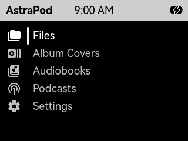
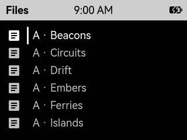
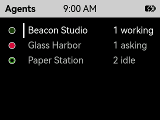

## 界面演示

\
在 Cover Flow 中滚动封面，翻面查看曲目，再合上面板。

\
歌词随播放逐词点亮，左右分列对唱，显示和声与间奏圆点。

\
从首页进入文件列表，列表行错峰滑入，按 MENU 返回首页。

\
快速滚动打开字母索引，每拨一格跳到下一组，松开滚轮关闭索引。

\
从 Cover Flow 选曲后过渡到全屏播放页，画面顶部没有状态栏。

\
用模拟的 HerdRemote 显示 Agents 工作区，并横向切换到 Usage 页面。
