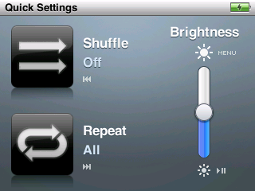
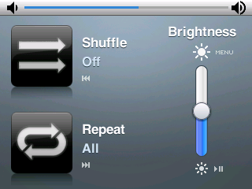
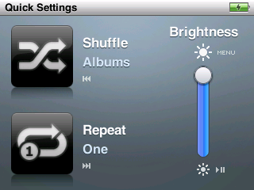
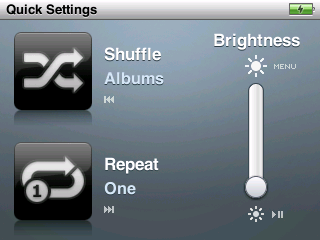

# Control Centre — Classic, Fruit Company, Fruit Company Ultra

Holding **MENU** opens the Control Centre. In the three stock-styled themes
(`style.quick_screen=hud`) it is a full page of the iPod Classic as Apple drew
it in firmware 2.0 (2007–2009). Scrim keeps its own tiles.

## The question

Apple never shipped a control centre on the iPod Classic. The question is what
the iPod team would have drawn if they had: a page that sits among the stock
Settings, Now Playing and Cover Flow screens and looks as if it was always
there. The rejected designs answered with borrowed parts — iPhone OS switches,
Mac OS X pop-up menus, blue spinner caps, keyboard-style key caps, tiles with
drop shadows. Each part is from 2007, but from three different products, and
each one says *touch me* on a device that has no touch screen. That is what
made them look incoherent.

## Where the answer comes from

The stock firmware already has a page about exactly these settings. In
**Settings**, the right half of the split screen previews the selected row:
the steel-blue backdrop, and a glossy black tile with a white glyph standing on
its own reflection. Shuffle, Repeat and Brightness each have one, and Shuffle
and Repeat change their glyph with the value (arrows straight or crossed;
repeat off, one, all). These pictures are in `stock-art.bin` already.

So the Control Centre is that preview pane, opened out to the whole screen and
showing the three things at once. Every element on it is one the stock
firmware draws elsewhere:

| Element | Stock source |
|---|---|
| Backdrop | The Settings preview pane's steel-blue background |
| Shuffle and Repeat pictures | The Settings preview tiles, 78 × 78, with their reflections |
| Names and values | White Helvetica Bold, as the preview pane writes its captions |
| Brightness bar | The Now Playing scrubber — white track, blue fill — turned upright |
| Brightness knob | The round chrome knob of the stock sliders |
| Volume | The status bar's own volume bar, unchanged |
| Key hints | The legends printed on the click wheel |

Nothing new is invented except the arrangement.

## Layout

The page is 320 × 220 below the 20 px status bar, in two columns.

- **Left column, 192 px:** Shuffle above Repeat, 110 px each. Each row is the
  stock tile and a short reflection on the left, then the name (17 px bold,
  white) over the value (16 px bold, pale blue-white): *Off*, *Songs*,
  *Albums*; *Off*, *One*, *All*. The value is words, not a control. The tile
  shows the same value as a picture, as it does in Settings.
- **Right column, 128 px:** Brightness, the full height. Its name at the top, a
  large sun, the upright scrubber with its knob, a small sun at the foot. The
  bar is the value; no percentage, as the stock Brightness page shows none.

The reflections are cut to 16 rows and fade out, so each tile stands on the
same glass floor as Cover Flow's covers without reaching the row below.

## Keys

The Control Centre is a page of controls, not a list to navigate, so it keeps
one keymap in all three themes:

| Key | Action |
|---|---|
| Wheel | Volume. The status bar turns into its volume bar while you turn, and turns back about 2.7 s after the last step. The page does not change. |
| ⏮ (Previous) | Steps Shuffle |
| ⏭ (Next) | Steps Repeat |
| MENU | Raises Brightness a sixteenth of its range a press, stopping at the top |
| ▶❙❙ (Play/Pause) | Lowers Brightness, stopping at the bottom |
| SELECT | Closes the page |
| SELECT, held | Opens Shortcuts |

MENU is at the top of the wheel and Play/Pause at the bottom, so the bar moves
the way the key sits. The hold of MENU that opens the page does not also raise
Brightness.

Each item carries the legend of its key, drawn small and half-transparent
beside it: the click wheel's own printed glyphs, not a button picture. They are
there because ⏮ for Shuffle cannot be guessed, and they are quiet because the
user who knows does not need them.

## Movement

The page pushes in from the right like any stock page (320 px, about 270 ms,
quadratic ease-out) and pops back the same way. Closing restores the screen
underneath from its saved picture, so it does not flash or redraw.

## Other settings in the slots

`qs left`, `qs right`, `qs top` and `qs bottom` still choose the items:

- Left and right show any setting. A setting without a stock picture shows its
  name and value from the left edge.
- When top and bottom name the same setting with a range, the right column is
  one tall item with the bar. Players that had Brightness in both slots get
  this page unchanged.
- When top and bottom differ, the right column holds two half-height items,
  each with its name, value and key legend.

## Pictures

Classic, Fruit Company and Fruit Company Ultra draw the same page, status bar
included; the picture at the top serves all three. These are simulator
captures at 320 × 240.

| | |
|---|---|
|  The wheel turned: the volume bar replaces the status bar; the page is still |  About 2.7 s after the last step, the status bar is back |
|  MENU pressed to the end: Brightness at the top; Shuffle on Albums, Repeat on One |  Play/Pause pressed to the end: Brightness at the bottom |
