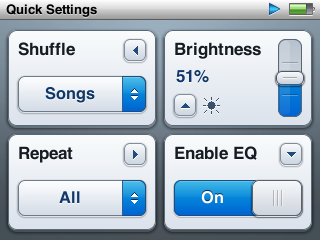
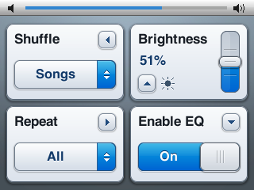
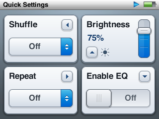

# Control Centre — Full-Screen Four-Tile Page (Classic, Fruit Company, Fruit Company Ultra)

## Overview

Holding **MENU** opens the Control Centre as a full-screen 320×240 iPod Classic-era skeuomorphic page under the stock 20 px white status bar for **Classic**, **Fruit Company**, and **Fruit Company Ultra** (`style.quick_screen=hud`). **Scrim** keeps its existing tiles unchanged.

## Layout and Typography (320×240)

- **Status bar (`y = 0..19`):** Stock 20 px brushed-silver status bar (`Quick Settings`, playback indicator, battery). Turning the click wheel displays the existing status-bar volume overlay (speaker icons and blue volume bar) without altering the page body.
- **Backdrop (`y = 20..239`, 320×220):** Full-bleed stock steel-blue backdrop (`STOCK_ART_BACKGROUND_LIGHTBLUE`, gradient fallback `#8597a4 → #454f56`).
- **Four-tile 2×2 grid:** Four `148×96 px` convex pearl-white glossy tiles (`8 px` outer margins horizontally, `10 px` top/bottom margins, `8 px` gutters, `9 px` corner radius, soft drop shadow, upper-half glass specular highlight).
  - **Top-Left (`LEFT` key, `◀` cap):** `Shuffle` — Aqua pop-up pill (`Off`, `Songs`, `Albums`) with stock glossy blue right-hand `▴/▾` chevron cap.
  - **Top-Right (`MENU` key, `▲` cap):** `Brightness` — merged single tile containing a tall vertical glossy Aqua brightness slider (`24×78 px` recessed tube, blue fill from bottom, three quartile stop ticks, 3D brushed-chrome thumb), sun glyph, and live percentage readout.
  - **Bottom-Left (`RIGHT` key, `▶` cap):** `Repeat` — Aqua pop-up pill (`Off`, `All`, `One`, `Shuffle`, `A-B`).
  - **Bottom-Right (`PLAY` key, `▼` cap):** `Enable EQ` (`eq enabled`) — freed by merging the two brightness slots into one vertical slider tile. Rendered as a glossy iPhone OS `On`/`Off` slide switch with a 3D chrome thumb.
- **Fonts:** Stock `UI_FONT_TITLE` (`17-helvetica-bold`) for tile headings and brightness percentage; stock `UI_FONT_LIST` (`16-helvetica-bold`) for choice pill values, switch labels, and generic numeric readouts. Both carry CJK fallback coverage.

## Freed Tile Choice (`Enable EQ`)

Merging the legacy top/bottom `brightness` pair into the top-right vertical slider frees the bottom-right (`PLAY`) tile. **Enable EQ** (`eq enabled`) occupies it by default in `default-config.cfg` (and automatically replaces a legacy duplicate `qs bottom: brightness` pair in existing configs while honouring any user-chosen custom bottom slot):

- Immediate single-tap toggle (`On`/`Off`) useful during playback when switching headphones, speakers, or line-out without leaving playback.
- Live DSP callback (`eq_enabled_option_callback`), short 17 px title (`83 px` wide), and works in both local and Cider playback.

## Controls (Classic, Fruit Company, Fruit Company Ultra)

The Control Centre is a quick-control modal rather than a navigation list, so all three stock-styled themes share one direct keymap:

| Input | Action |
|---|---|
| **Click Wheel** | Adjusts **Volume** (`ACTION_QS_VOLUP` / `ACTION_QS_VOLDOWN`), updating only the status-bar volume overlay. |
| **MENU** | Operates the Top-Right tile (`Brightness`): each short tap cycles through five clean stops (`Min → 25% → 50% → 75% → Max → Min`, wrapping from Max back to Min); holding **MENU** smoothly ramps brightness upward and stops at Max until released. |
| **LEFT** | Steps Top-Left tile (`Shuffle`). |
| **RIGHT** | Steps Bottom-Left tile (`Repeat`). |
| **PLAY** | Steps/toggles Bottom-Right tile (`Enable EQ`). |
| **SELECT (tap)** | Closes the Control Centre. |
| **SELECT (hold)** | Opens the Shortcuts menu (non-Cider). |

## Transitions and Close Behaviour

- **Push / Pop:** Full-screen 320 px horizontal slide matching stock page transitions (`UI_MOTION_PUSH` / `UI_MOTION_POP` = 18 frames ≈ 270 ms at 67 Hz, quadratic ease-out via `ui_theme_easing()`).
- **Zero-flash close:** The caller's framebuffer snapshot is preserved before entry, slides back intact on close, and returns `QUICKSCREEN_RESTORED` so menus, Now Playing, and Cover Flow resume without an extra redraw or flash.

## Mockups (320×240)

-  — [default.png](default.png): Default state (`Shuffle: Songs`, `Brightness: 51%`, `Repeat: All`, `Enable EQ: On`)
-  — [volume-overlay.png](volume-overlay.png): Click wheel turned — existing volume bar shown only in the 20 px status bar
-  — [brightness-and-off.png](brightness-and-off.png): `Brightness` at `75%`, `Shuffle: Off`, `Repeat: Off`, `Enable EQ: Off`
