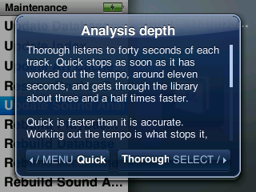
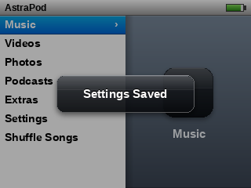
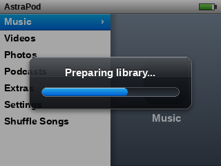

# Classic / Fruit Company Dialogs (2009 iPhone OS 3 UIAlertView Style)

Under `style.dialog=classic` (set by `classic()`, so inherited by Classic, Fruit Company, and Fruit Company Ultra), interactive modal prompts adopt the visual language of the 2009 iPhone OS 3 `UIAlertView`, translated for AstraPod's 320×240 screen and Click Wheel. Long list pickers stay full-screen stock 2.0.5 pages; transient splashes and quick-adjust overlays keep the dark smoked glossy glass panel. Scrim keeps `style.dialog=flat` and stays pixel-identical.

## Reference Study: iPhone OS 3 (2009) `UIAlertView` → 320×240 Click Wheel

All shapes, gradients, gloss domes, rims, and shadows are rendered procedurally in C (no Apple assets, logos, or wordmarks).

| Element | 2009 iPhone OS 3 `UIAlertView` (320×480) | AstraPod 320×240 Translation |
|---|---|---|
| **Backdrop** | Dimmed modal scrim (~40–50% black) keeping the screen underneath visible | Full-screen `ui_sheet_dim()` (~35% dim) keeping underlying menu, split pane, and status bar intact and visible |
| **Container width & radius** | 284 px wide on 320 px display (18 px side margins), ~10–12 px corner radius | 272–282 px wide on 320×240 (19–24 px side margins), `r = 10`, vertically centred with dimmed margins on all four sides |
| **Panel material** | Translucent midnight-navy glass (`#1a325c` → `#0c1b3a`, ~86–90% opacity) | Procedural translucent midnight-navy gradient (`0xdc1a325c` → `0xe80c1b3a`) over the dimmed backdrop |
| **Top specular gloss** | Signature curved elliptical white gloss dome sweeping across the upper ~26–30 px | Procedural parabolic/elliptical specular dome clipped to the `r = 9` top corners (18 px edge depth dipping to 28 px at centre, fading ~43% → 12% white with 1 px antialiased edge) |
| **Border & drop shadow** | Crisp ~2 px translucent light silver-blue rim + outer dark hairline over a deep drop shadow | `gloss_shadow(..., r=10, depth=8, drop=4, alpha=165)` + dark outer hairline + 2 px translucent silver-blue glass rim (`0xd8dce8f8` / `0x70c6d8f2`) |
| **Typography** | Centred white Helvetica Bold title + regular message text with `0, -1 px` dark text shadow | Centred white `17-helvetica-bold` title + `#eaf0fa` `13-helvetica` message lines (left-aligned for scrollable prose), all with `dy = -1` `#040a18` shadow |
| **Buttons (2 vs 3 choices)** | 2009 HIG: two choices sit side-by-side (**Cancel** darker navy on left, **Default** lighter steel-blue on right, ~43–44 px tall on 320×480); 3+ choices stack vertically full-width | Scaled to 320×240: `h = 28 px`, `r = 5`, matching navy split-gloss capsules with an 8 px gap. USB consent stacks the same full-width capsules for Connect, Charge Only and Remote Control when available |
| **Pop-in & dismiss motion** | `CAKeyframeAnimation` on `transform.scale` (~0.3 s): rapid pop-in with elastic overshoot then settle (`~0.6 → 1.07 → 0.97 → 1.0`), quick fade-out on dismiss | `ui_sheet_paint_zoom()` with `sheet.bounce = true`: 20 frames (~300 ms at 67 Hz) scaling `0.62 → 1.07 → 0.97 → 1.00` with fast opacity ramp; 9-frame (~135 ms) fade-out + shrink (`1.00 → 0.94`) restoring exact underlying pixels with zero flash |

### Click Wheel Translation & Tactile Balance

Direct-action buttons use the same navy fill, rim and gloss in every position.
The white action label and muted ice-blue key hint sit inside the capsule.
Their visible ink centres align with the middle of the capsule at the gloss
split. USB rows place the key hint on the left and the action name near the
horizontal centre. Side-by-side buttons group the action and its hint on the
same line. The small arrows identify the left and right hardware keys.

The Click Wheel scrolls the body of a prose dialog. Time, date and colour
pickers show a brighter capsule when their grid focus reaches a button.
The hardware keys in the table below activate direct actions in one press.

## Inventory, Forms & Keys

| Dialog / Splash | Classic / Fruit form | Keys (Classic & Fruit) |
|---|---|---|
| Yes/No confirmations (`yesno.c`) | Centred 2009 navy glass alert pop-up over dimmed screen, bounce pop-in | **LEFT** / **MENU** = No (left capsule); **RIGHT** / **SELECT** = Yes (right capsule). Custom labels (`back_cancels`): **LEFT** = left option, **RIGHT** / **SELECT** = right option, **MENU** = cancel. **PLAY** = playback |
| USB Disk Mode consent (`usb_confirm.c`) | Centred 2009 navy glass alert pop-up + stacked full-width capsules, bounce pop-in | **SELECT** = Connect (top row), **MENU** = Charge Only, **RIGHT** = Remote Control (when playing + handoff capable), **PLAY** = playback |
| Prose show (`dialog_prose_show`) | Centred 2009 navy glass alert pop-up + centred navy `OK` capsule with its key hint + a separate wheel hint when text scrolls | Wheel scrolls text; **SELECT** / **MENU** / **LEFT** / **RIGHT** dismiss; **PLAY** = playback |
| Prose confirm (`dialog_prose_confirm`) | Centred 2009 navy glass alert pop-up + side-by-side capsules & quiet key legends | Wheel scrolls text; **LEFT** / **MENU** = left option (cancel); **RIGHT** / **SELECT** = right option (accept); **PLAY** = playback |
| Single-line text input (`keyboard.c`) | Centred 2009 navy glass alert pop-up + white recessed text field + `Cancel` / `OK` capsules (`MENU` / `SELECT` legends) | Wheel cycles character; **LEFT** / **RIGHT** move caret (hold = backspace / delete); **SELECT** = OK; **MENU** = Cancel |
| Time/date & colour pickers (`time_set.c`, `color_picker.c`) | Centred 2009 navy glass alert pop-up, bounce pop-in | Grid navigation (>3 choices): wheel edits value, **LEFT** / **RIGHT** / **MENU** / **PLAY** move cells, **SELECT** confirms, hold **MENU** cancels |
| Search dialog (`search_dialog.c`) | Full-screen white stock page + 20 px silver status bar + top recessed search band + blue selection rows, horizontal slide | Standard search keyboard + list navigation |
| Folder selector (`folder_select.c`) | Full-screen white stock page + 20 px silver status bar + blue selection rows, horizontal slide | Wheel moves row, **SELECT** expands/collapses, hold **SELECT** includes/excludes, **MENU** exits |
| Timed & progress splashes (`splash.c`, `sound_scan.c`) | Centred dark smoked glossy glass pop-up over dimmed screen, calm fade + zoom | Transient / any key dismisses result |
| Star rating overlay (`rating_dialog.c`) | Centred dark smoked glossy glass pop-up over dimmed screen, calm fade + zoom | Wheel adjusts half-stars, **SELECT** saves, hold **SELECT** clears, **MENU** cancels |
| Extras Clocks action overlay (`extras_clock.c`) | Stock `System_Overlay` + `OptionBar_Black` bitmaps (unchanged) | Stock Clocks keys |
| Control Centre / Quick Screen (`quick_screen.c`) | Leopard HUD (`style.quick_screen=hud`, unchanged) | Quick Screen keys |

## 320×240 Design Previews

