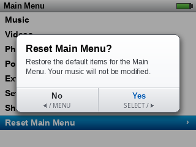
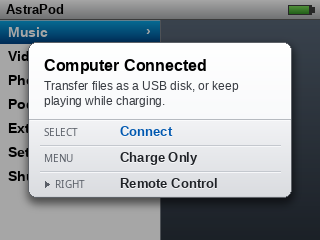

# Classic / Fruit Company Dialogs (iPod Classic 2.0.5 Style)

Under `style.dialog=classic` (set by `classic()`, so inherited by Classic, Fruit Company, and Fruit Company Ultra), modal prompts, confirmations, splashes, and pickers use iPod Classic 2.0.5's visual system. Scrim keeps `style.dialog=flat` and stays pixel-identical.

## Inventory & Forms

| Dialog / Splash | Classic / Fruit form | Keys (Classic & Fruit) |
|---|---|---|
| Yes/No confirmations (`yesno.c`) | Centred silver-and-white modal pop-up over dimmed screen, fade + zoom | **LEFT** / **MENU** = No (left); **RIGHT** / **SELECT** = Yes (right). Custom labels (`back_cancels`): **LEFT** = left option, **RIGHT** / **SELECT** = right option, **MENU** = cancel. **PLAY** = playback |
| USB Disk Mode consent (`usb_confirm.c`) | Centred silver-and-white modal pop-up over dimmed screen, fade + zoom | **SELECT** = Connect, **MENU** = Charge Only, **RIGHT** = Remote Control (when playing + handoff capable), **PLAY** = playback |
| Prose show (`dialog_prose_show`) | Centred silver-and-white modal pop-up over dimmed screen, fade + zoom | Wheel scrolls text; **SELECT** / **MENU** / **LEFT** / **RIGHT** dismiss; **PLAY** = playback |
| Prose confirm (`dialog_prose_confirm`) | Centred silver-and-white modal pop-up over dimmed screen, fade + zoom | Wheel scrolls text; **LEFT** / **MENU** = left option (cancel); **RIGHT** / **SELECT** = right option (accept); **PLAY** = playback |
| Single-line text input (`keyboard.c`) | Centred silver-and-white modal pop-up over dimmed screen, fade + zoom | Wheel cycles character; **LEFT** / **RIGHT** move caret (hold = backspace / delete); **SELECT** = OK; **MENU** = Cancel |
| Time/date & colour pickers (`time_set.c`, `color_picker.c`) | Centred silver-and-white modal pop-up over dimmed screen, fade + zoom | Grid navigation (>3 choices): wheel edits value, **LEFT** / **RIGHT** / **MENU** / **PLAY** move cells, **SELECT** confirms, hold **MENU** cancels |
| Search dialog (`search_dialog.c`) | Full-screen white stock page + 20 px silver status bar + top recessed search band + blue selection rows, horizontal slide | Standard search keyboard + list navigation |
| Folder selector (`folder_select.c`) | Full-screen white stock page + 20 px silver status bar + blue selection rows, horizontal slide | Wheel moves row, **SELECT** expands/collapses, hold **SELECT** includes/excludes, **MENU** exits |
| Timed & progress splashes (`splash.c`, `sound_scan.c`) | Centred dark smoked glossy glass pop-up over dimmed screen, fade + zoom | Transient / any key dismisses result |
| Star rating overlay (`rating_dialog.c`) | Centred dark smoked glossy glass pop-up over dimmed screen, fade + zoom | Wheel adjusts half-stars, **SELECT** saves, hold **SELECT** clears, **MENU** cancels |
| Extras Clocks action overlay (`extras_clock.c`) | Stock `System_Overlay` + `OptionBar_Black` bitmaps (unchanged) | Stock Clocks keys |
| Control Centre / Quick Screen (`quick_screen.c`) | Leopard HUD (`style.quick_screen=hud`, unchanged) | Quick Screen keys |

## Visual Forms & Transitions

### 1. Interactive modal pop-up (`yesno.c`, `usb_confirm.c`, `dialog_prose.c`, `keyboard.c`, `time_set.c`, `color_picker.c`)

Short interactive prompts float over the current screen rather than replacing it with a full-screen page:

- **Backdrop & motion:** the underlying screen stays visible, dimmed smoothly via `ui_sheet_dim()`, while the panel enters and leaves with `ui_sheet_paint_zoom()` (12 frames ~180 ms open, 9 frames ~135 ms close, gentle scale + fade — matching the glass splashes). Dismissal restores the exact pixels underneath with no status bar rewrite or flash.
- **Panel chrome:** rounded porcelain-white panel (`r = 8`), soft drop shadow, crisp `1 px` `#5e6268` outer rim with an inner white highlight. Titled dialogs carry a `24 px` brushed-silver title strip at the top.
- **Quiet key-hint footer:** a brushed-silver footer band with hairline dividers displays each option and its Click Wheel key (`◀ / MENU` on the left, `SELECT / ▶` on the right for two-choice prompts; aligned `SELECT`, `MENU`, `▶ RIGHT` rows for USB consent). Labels use crisp typography (charcoal for secondary/No, deep Classic Aqua blue `#0058b0` for primary/Yes) with no raised pills or movable focus bars that look tappable.

### 2. Full-screen stock list pickers (`search_dialog.c`, `folder_select.c`)

Long list pickers take the full screen below the 20 px silver status bar (`UI_MOTION_PUSH` / `UI_MOTION_POP` horizontal slide) with full-width `UI_GRADIENT_SELECTION` bars and wheel-to-select list behaviour.

### 3. Centred dark glossy glass panel (`splash.c`, `rating_dialog.c`, `sound_scan.c`, rotated `d->fb` prose)

Brief transient notices, progress meters, and quick-adjust overlays use the smoked translucent dark glass panel (`r = 10`, specular gloss top band, white shadow text, glossy Aqua progress bar) with the same fade + zoom transition.

## One-Press Key Rules

- Every dialog with two or three choices answers in **one key press**, never wheel-then-SELECT.
- Two-choice side-by-side prompts place **No / Cancel** on the **LEFT** and **Yes / Accept** on the **RIGHT**: **LEFT** activates the left choice, **RIGHT** activates the right choice, and **SELECT** / **MENU** keep their direct accept / cancel bindings.
- Dialogs are modal prompts rather than navigation pages, so **LEFT** and **RIGHT** act on the dialog in Fruit Company and Fruit Company Ultra as well as Classic; **PLAY** remains playback control (play/pause).
- Dialogs with more than three choices (lists, search, grid pickers, star rating) keep wheel-to-select plus **SELECT**.
