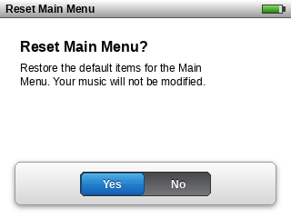
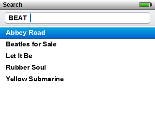

# Classic / Fruit Company Dialogs (iPod Classic 2.0.5 Style)

Under `style.dialog=classic` (set by `classic()`, so inherited by Classic, Fruit Company, and Fruit Company Ultra), modal prompts, confirmations, splashes, and pickers replace the flat Scrim box with iPod Classic 2.0.5's visual system. Scrim keeps `style.dialog=flat` and stays pixel-identical.

## Inventory & Stock 2.0.5 Classification

| Dialog / Splash | Code path | Stock 2.0.5 status | Classic / Fruit form |
|---|---|---|---|
| Yes/No confirmations (`gui_syncyesno_run*`, `yesno_pop`, `yesno_pop_confirm`) | `widgets/yesno.c` | **Stock equivalent** — *Settings → Reset Settings* (local QEMU 2.0.5 capture `05_reset_settings_dialog.png`) | Full-screen white page + bottom frosted silver dock with glossy segmented option bar |
| USB Disk Mode consent (`gui_usb_confirm_run`) | `widgets/usb_confirm.c` | **AstraPod-only** (stock enters Disk Mode automatically) | Full-screen white page + bold heading, explanation, and normal stock 24 px choice list rows |
| Scrollable prose dialogs & confirmations (`dialog_prose_show`, `dialog_prose_confirm`) | `widgets/dialog_prose.c` | **AstraPod-only** (combines stock *Notes* text page + *Reset Settings* bottom dock) | Full-screen white page + scrollable black text + bottom frosted silver dock (`OK` or `Cancel \| Accept`) |
| Search dialog (`search_dialog_run`) | `widgets/search_dialog.c` | **Stock equivalent** — *Music → Search* (local QEMU 2.0.5 capture `04_search.png`) | Full-screen white page + top recessed search input band + full-width stock blue-bar result rows |
| Folder selector (`folder_select_in_buffer`) | `widgets/folder_select.c` | **AstraPod-only** (follows stock *Settings → Main Menu* list `09_main_menu_bottom.png`) | Full-screen white page + full-width stock blue-bar tree rows |
| Single-line text input (`dialog_input`) | `widgets/keyboard.c` | **AstraPod-only** | Full-screen white page + recessed rounded input field + bottom frosted silver `Cancel \| OK` dock |
| Time/date & colour pickers (`set_time_screen`, `set_color`) | `screens/system/time_set.c`, `widgets/color_picker.c` | **AstraPod-only** | Full-screen white page + glossy Aqua blue selected field + bottom glossy `Cancel \| OK` pills |
| Timed & instant splashes (`splash()`, `splashf()`, `splashf_in()`) | `widgets/splash.c` | **AstraPod-only** (brief transient notice; matches stock *Extras → Clocks* dark glass `04_clocks_overlay.png`) | Centred dark glossy glass rounded panel over dimmed screen, fade + zoom |
| Progress splashes (`splash_progress()`, `splash_progress_in()`) & Sound Scan (`ss_draw`, `ss_result`) | `widgets/splash.c`, `screens/system/sound_scan.c` | **AstraPod-only** (brief transient progress / notice) | Centred dark glossy glass rounded panel + recessed track with glossy Aqua progress fill |
| Star rating overlay (`rating_dialog`) | `widgets/rating_dialog.c` | **Stock equivalent** (stock rates inline on Now Playing; brief quick-adjust overlay uses *Clocks* dark glass `04_clocks_overlay.png`) | Centred dark glossy glass rounded panel with white bold title and stars, fade + zoom |
| Extras Clocks action overlay | `screens/extras/extras_clock.c` | **Stock equivalent** — *Extras → Clocks* (`04_clocks_overlay.png`) | Already uses stock `System_Overlay` + `OptionBar_Black` bitmaps (unchanged) |
| Control Centre / Quick Screen | `screens/playback/quick_screen.c` | **AstraPod-only** (Leopard HUD) | Already uses `style.quick_screen=hud` (unchanged) |

## Design Reasoning & Visual Forms

Stock 2.0.5 almost never floats a modal box over a white menu: full interactive choices take the whole screen below the 20 px silver status bar and slide horizontally like normal navigation (`UI_MOTION_PUSH` / `UI_MOTION_POP`), reserving dark glossy rounded panels for brief overlays.

### 1. Full-screen confirmation page (`yesno.c`, `dialog_prose.c`, `keyboard.c`, `time_set.c`, `color_picker.c`)
Matches stock 2.0.5 *Reset Settings*:
- Stock 20 px silver status bar at top with title and battery/play indicators.
- Crisp `#ffffff` full-screen canvas (`y = 20..239`), bold `17-helvetica-bold` heading at `x = 22, y = 42`, regular `13-helvetica` detail below.
- Bottom frosted silver rounded dock (`x = 16, y = 178, w = 288, h = 48, r = 6`, soft drop shadow) holding a glossy segmented option bar (`h = 27, r = 5`): dark charcoal well and glossy Aqua blue selection pill from `UI_GRADIENT_SELECTION`, white `13-helvetica-bold` labels with a `-1 px` shadow.
- Enters and leaves with a horizontal stock page slide below the status bar.

### 2. Full-screen stock choice & list page (`usb_confirm.c`, `search_dialog.c`, `folder_select.c`)
Matches stock 2.0.5 full-screen choice lists and *Search*:
- Stock 20 px silver status bar (`USB`, `Search`, or picker title) on `#ffffff` background.
- For USB consent: bold heading `"Computer Connected"` + short explanation above a `#d0d0d0` rule, followed by full-width 24 px stock choice rows (`Connect`, `Charge Only`, and `Remote Control` when playing with handoff) highlighted with `UI_GRADIENT_SELECTION`.
- For Search and Folder Selector: full-screen white list with full-width `UI_GRADIENT_SELECTION` bars (and a recessed white search field band at top for Search).
- Enters and leaves with a horizontal stock page slide.

### 3. Centred dark glossy glass panel (`splash.c`, `rating_dialog.c`, `sound_scan.c`, rotated `d->fb` prose)
Reserved strictly for brief transient notices, progress bars, and quick-adjust overlays:
- Dimmed backdrop (`ui_sheet_dim()`) with a smoked translucent rounded panel (`r = 10`), soft drop shadow (`depth = 6, drop = 3`), top specular gloss highlight ending in a crisp horizon line, and a `1 px` translucent light rim.
- Crisp white bold text (`-1 px` dark shadow) and glossy Aqua blue progress fill (`UI_GRADIENT_PROGRESS`).
- Enters and leaves with `ui_sheet_paint_zoom()` (fade + gentle scale).

## Controls under Fruit themes

Under Fruit themes (`UI_MENU_TREE_STOCK`), all dialogs are operated strictly with the click wheel, **SELECT**, and **MENU**; **LEFT**, **RIGHT**, and **PLAY** remain playback controls only.
