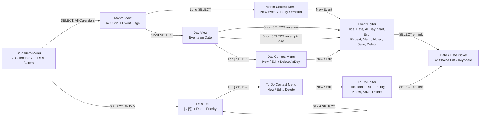
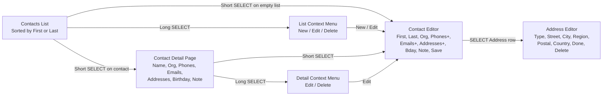
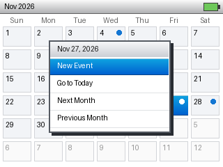
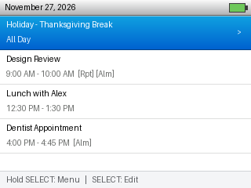
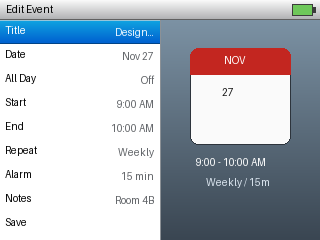
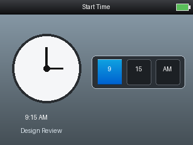
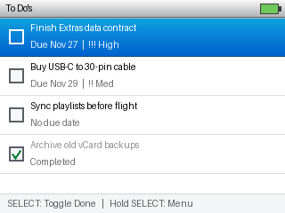
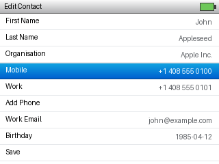
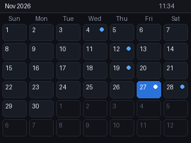

# Extras Editing — Calendars, Reminders (To Do's) & Contacts

## 1. Overview & Provenance

This design brings full on-device create, edit, and delete support to **Extras > Calendars** (`VEVENT` events and `VTODO` reminders) and **Extras > Contacts** (`VCARD` 3.0/4.0), backed by the standard RFC 5545 / vCard storage contract in [extras-data-format.md](../../extras-data-format.md).

Interaction patterns are adapted from Rockbox's original plugins and AstraPod's native widgets:

| Source | Pattern Adopted | AstraPod Adaptation |
|---|---|---|
| `apps/plugins/calendar.c` | Month grid with per-day event flags; SELECT opens the day's events (or add/edit menu on an empty day); repeat types (Weekly/Monthly/Yearly/Once + Daily); item context menu (`Remove`, `Edit`, `New ...`). | Stock 2.0.5 6×7 calendar cells (`STOCK_ART_CALENDAR_*`) in Classic / Fruit Company / Fruit Company Ultra, and dark rounded cells in Scrim. Native `gui_synclist` for Day events, To Do's, editors, and context menus; long-press `SELECT` opens the context menu. |
| `apps/plugins/text_editor.c` | List-of-items editing model with per-item context menu (`Edit`, `Insert/New`, `Delete`) and explicit save/discard protection. | Native form lists (`gui_synclist`) with inline value summaries, `Save` action, and unsaved-changes confirmation (`gui_syncyesno_run_labels`) on `MENU`. |
| `apps-ipod/widgets/keyboard.c` | Single-line click-wheel text editor (`dialog_input()`) with OK/Cancel confirmation; works seamlessly with `t3/era-dialogs` glossy dialog styling. | All free-text fields (Event title/notes, To Do title/notes, Contact names/phones/emails/address fields/organisation/note) invoke `dialog_input()`. |
| `apps-ipod/screens/extras/extras_alarms.c` | Stock 2.0.5 split-pane editor list + light-blue 3-well Date & Time Picker (`STOCK_ART_DATETIMEPICKER_*`). | Shared `extras_picker.c` Date & Time Picker used by Event Date/Start/End, To Do Due Date, and Contact Birthday (with a native dark variant for Scrim). |

## 2. Navigation & Theme Rules

### 2.1 Fruit Navigation Rule (`style.menu_tree=stock`)
In **Fruit Company** and **Fruit Company Ultra**, physical `LEFT`, `RIGHT`, and `PLAY` remain strictly playback-only on all navigation screens (intercepted before screen action dispatch). Every Extras navigation and editing flow is 100% operable with **Click Wheel**, **SELECT** (short tap / long press / hold + wheel), and **MENU**:

- **Click Wheel:** Move selection / adjust date or time well / scroll detail page.
- **SELECT (short tap):** Primary action (open Day view, edit item, toggle To Do completed, advance picker slot, activate field).
- **SELECT (long press):** Open item/screen Context Menu (`New`, `Edit`, `Delete`, jump actions).
- **Hold SELECT + Wheel:** Step ±1 month on Month view; step ±1 day on Day view.
- **MENU:** Go back (prompting `Save` / `Discard` if an editor has unsaved edits).

In **Classic** and **Scrim** (`style.menu_tree=astrapod`), `Calendars` and `Contacts` are also exposed on the Home menu (`root_menu.c`), and `LEFT`/`RIGHT` additionally step months/days/picker slots where standard Rockbox conventions apply.

### 2.2 Visual Appearance by Theme
- **Classic, Fruit Company, Fruit Company Ultra (`UI_STYLE_ART == UI_ART_PLASTIC`):**
  - Stock 2.0.5 white list canvas, blue gradient selection bar (`ui_art_selection`), 44 px two-line rows (`ROW_H`), split-pane calendar preview on the Calendars menu and Event Editor, stock 6×7 calendar cells + event flag, stock light-blue 3-well Date/Time picker with black status bar.
- **Scrim (`UI_STYLE_ART == UI_ART_NONE`):**
  - Keeps Scrim's dark theme (`UI_COLOR_BACKGROUND`, `UI_COLOR_FOREGROUND`, `UI_COLOR_MUTED`, `UI_COLOR_ACCENT`, `UI_COLOR_SELECTION`), standard native list rows with left selection marker, dark rounded calendar cells with accent event dots, and a dark 3-well Date/Time picker — with identical functionality.

## 3. Navigation Flows

### 3.1 Calendars & Reminders (To Do's)

### 3.2 Contacts

## 4. Key Map per Screen

| Screen | Click Wheel | Short SELECT | Long-Press SELECT | Hold SELECT + Wheel | MENU |
|---|---|---|---|---|---|
| **Calendars Menu** | Move row | Open All Calendars / To Do's / cycle Alarms | — | — | Back |
| **Month View** | Move ±1 day | Open Day View | Context Menu (`New Event`, `Go to Today`, `Next Month`, `Previous Month`) | Step ±1 month | Back to Calendars Menu |
| **Day View** | Move between events | Edit selected event (or New Event if day is empty) | Context Menu (`New Event`, `Edit Event`, `Delete Event`, `Next Day`, `Previous Day`, `Go to Today`) | Step ±1 day | Back to Month View |
| **Event Editor** | Move between fields | Edit field (Keyboard / Date / Time / Choice / Toggle All Day) or `Save` / `Delete Event` | — | — | Back (prompts `Save` / `Discard` if modified) |
| **To Do's List** | Move between To Do's | **Toggle Completed in place** (writes atomically); if empty, opens New To Do | Context Menu (`New To Do`, `Edit To Do`, `Delete To Do`) | — | Back to Calendars Menu |
| **To Do Editor** | Move between fields | Edit field (Keyboard / Due Date / Priority / Toggle Completed) or `Save` / `Delete To Do` | — | — | Back (prompts `Save` / `Discard` if modified) |
| **Contacts List** | Move between contacts | Open Contact Detail (or New Contact if empty) | Context Menu (`New Contact`, `Edit Contact`, `Delete Contact`) | — | Back |
| **Contact Detail** | Scroll page vertically | Open Contact Editor | Context Menu (`Edit Contact`, `Delete Contact`) | — | Back to Contacts List |
| **Contact Editor** | Move between fields | Edit field / Add Phone, Email, Address / `Save` / `Delete Contact` | On Phone/Email row: `Edit`, `Change Type`, `Delete` | — | Back (prompts `Save` / `Discard` if modified) |
| **Date / Time Picker** | Increment / decrement active well | Advance to next well; confirm on final well | — | — | Cancel (discard picker change) |
| **Keyboard (`dialog_input`)** | Pick character / button | Fruit: commit character; on OK/Cancel row: confirm | Fruit: move focus to OK/Cancel row | — | Cancel / back to input (Long MENU: backspace in Fruit) |

## 5. 320×240 Mockups

### Stock 2.0.5 Look (Classic / Fruit Company / Fruit Company Ultra)

-  — [month-context-stock.png](month-context-stock.png): Month grid with event flags and long-press `SELECT` context sheet.
-  — [day-view-stock.png](day-view-stock.png): Day event list with all-day and timed rows, repeat/alarm badges.
-  — [event-editor-stock.png](event-editor-stock.png): Split-pane Event Editor with live calendar icon preview.
-  — [datetime-picker-stock.png](datetime-picker-stock.png): Stock light-blue 3-well Date/Time Picker.
-  — [todo-list-stock.png](todo-list-stock.png): Reminders / To Do's list with in-place completion checkboxes, due dates, and priority badges.
-  — [contact-editor-stock.png](contact-editor-stock.png): Contact Editor list with typed phone numbers, email, birthday, and save action.

### Scrim Look

-  — [scrim-month-view.png](scrim-month-view.png): Scrim dark-theme Month View preserving native dark palette and accent dots.
