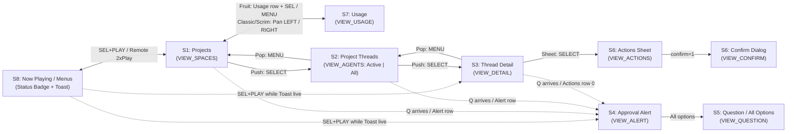

# T3 Code Pocket Remote — AstraPod Interaction & UI Design

> **Audience:** Firmware and desktop pairing developers implementing T3 Code remote control on AstraPod (`apps-ipod/screens/system/agents_screen.c`, `herdremote_model.c`, `apps-ipod/ui/`). This is an internals specification: it names source files, `ui_theme` tokens, pixel geometry, RAM budgets, and wire framing directly.

---

## 1. Scope, Goals & Hardware Constraints

AstraPod is a **casual pocket remote** for T3 Code, not a primary input or thread-management device. Every interaction is designed for 2–5 second pocket use: glance at project/thread state, choose an option (approve/deny, pick a question answer, fire a preset quick reply, interrupt with confirmation), or trigger computer-side voice input. There is no wheel text entry, no compose/review editor, and no thread-creation or archive workflow.

| Constraint | Value / Rule |
|---|---|
| Display | 320×240 RGB565 LCD, no touch screen |
| Physical controls | Capacitive click wheel (CW/CCW + acceleration), `SELECT` (centre), `MENU` (top), `PLAY` (bottom), `LEFT` (prev), `RIGHT` (next), hardware Hold switch |
| Remote / Dock controls | Serial iAP dock + USB EP0 remote bridge (`apps-ipod/input/agents_remote.c`, `apps-ipod/iap/agents_volume.c`) |
| Motion timeline | Shared 60 Hz `USEC_TIMER` (`ui/animation.h`, `ui/scene.h`, `ui/sheet.h`); 30 fps sustained minimum on `ipod6g` |
| Memory budget | Static `hr_model` ≤ 32 KiB, `detail_layout` ≤ 6,400 B; transient transition surfaces via `core_alloc_free_space` only (never shrink audio buffer; degrade to instant draw on OOM) |
| Audio continuity | Music playback is primary. `SELECT+PLAY` swaps Agents ↔ Now Playing without stopping audio or resetting PodLink. Under Fruit Company themes, `LEFT`, `RIGHT`, and `PLAY` stay pure playback controls everywhere; under Classic/Scrim, short `PLAY` (< 150 ms) pauses/resumes audio. |
| Link transport | Resident PodLink USB session (`PLFG` 0/1/2) keeps `W`, `S`, `Q`, `X`, `T` live in `background_link()` while the user is elsewhere on the player |
| Branding & user wording | Brand is always **AstraPod** (never Apple logos or iPod wordmarks). Every user-facing string refers to the **"computer"** (e.g., `"Waiting for computer…"`, `"Computer not connected"`), never `"HerdRemote"` or `"herdr"`. |

### Theme Input Profiles

AstraPod enforces two distinct button profiles in Agents depending on the active native theme (`agents_fruit_nav()`):

1. **Fruit Company & Fruit Company Ultra (Wheel / `SELECT` / `MENU` only):**
   - Navigation uses **only** the scroll wheel, `SELECT`, and `MENU`.
   - `LEFT`, `RIGHT`, and `PLAY/PAUSE` are **playback controls only** (previous/rewind, next/fast-forward, play/pause) and must **never** page, choose Allow/Deny, switch `Active`/`All`, open Usage, focus dialog buttons, or start voice input.
   - All actions are reachable through the wheel, `SELECT`, and `MENU`: `Usage` is a list row in S1, `Active`/`All` is toggled via a selectable filter bar in S2, Detail scrolls with the wheel, Approvals pick `Allow` / `Deny` / `All options…` with the wheel + `SELECT`, and voice input starts from **`Voice reply`** in the Actions sheet (or long-press `SELECT`).
2. **Classic, Scrim & Light (Full Click-Wheel Remote):**
   - Adds `LEFT`/`RIGHT` horizontal shortcuts (Usage ◄──► Projects, `Active` ◄──► `All`, local Page Up/Down in Detail, `LEFT` Allow / `RIGHT` Deny on Approvals) and long-press `PLAY` (≥ 150 ms) for hold-to-talk voice input, while short `PLAY` (< 150 ms) remains music Play/Pause.

### Core Ergonomics (Both Profiles)

1. **Glance first, choose second.** Status dots, thread previews, and the summary-first detail reader let the owner check progress in a glance, then act in one or two clicks.
2. **`MENU` is always safe.** `MENU` steps back one level, closes the current sheet, or defers an approval/question locally — never submits, denies, or triggers a destructive action.
3. **No accidental approvals or interrupts.** Auto-popped approvals apply a 250 ms grace window (and under Fruit Company start focus safely on `All options…`, never on `Allow` or `Deny`). Confirmation dialogs focus **`Cancel`** by default.
4. **Theme-native surfaces.** Every surface — alerts, action sheets, confirmation cards, voice/status toasts, and detail readers — resolves colours and fonts from `ui_theme` (`apps-ipod/ui/native_theme.h`) so **Fruit Company**, **Fruit Company Ultra**, **Classic**, **Scrim**, and **Light** stay cohesive. Never hardcode `LCD_BLACK` or raw RGB fills for modal/band backgrounds.

---

## 2. Information Architecture & Navigation Map



### Spatial & Temporal Hierarchy

- **Depth axis (Push 18 f / Pop 15 f):**
  - Both profiles: `S1 Projects → S2 Project Threads → S3 Thread Detail`
  - Fruit Company / Ultra additionally pushes `S1 Projects → S7 Usage` from the bottom `Usage` row (`MENU` pops back).
- **Horizontal axis (Classic / Scrim / Light only — Pan 14 f beneath fixed status bar):**
  - Top level: **S7 Usage (`VIEW_USAGE`)** ◄──► **S1 Projects (`VIEW_SPACES`)** (clamped at ends)
  - Project level: **Active** ◄──► **All** (`sub <project> active|all`, clamped at ends)
  - Detail level: local **Page Up (`LEFT`)** ◄──► **Page Down (`RIGHT`)**
- **Overlay axis (Sheet / Modal, 16 f in / 12 f out, `UI_COLOR_DIM` 35% backdrop):**
  - `S4 Approval Alert`, `S6 Actions Sheet`, `S6 Confirm Dialog`, voice/status toast band, `S8 Background Toast`

---

## 3. Visual Language Across Themes

| Role / Surface | `ui_theme` Token(s) | Fruit Company / Ultra | Scrim (Default) | Light |
|---|---|---|---|---|
| **Status Bar** | `UI_COLOR_STATUS_BG`, `UI_COLOR_STATUS_FG`, `UI_METRIC_STATUS_HEIGHT` | 26 px silver-grey vertical gradient (`#F5F6F8 → #C8CDD4`), 1 px `#9AA1AA` divider, `#181C22` title, green battery pill | 35 px `UI_BG_COVER_TINT` (`#162430` album-tinted), `#E8F4FA` title, clock, 24 px icons | 35 px solid `#DDDCD7`, `#181818` text |
| **List Canvas** | `UI_BG_LIST`, `UI_COLOR_BACKGROUND`, `UI_COLOR_FOREGROUND`, `UI_COLOR_SEPARATOR` | Solid `#FFFFFF`, `#E4E8EE` 1 px dividers, 27–29 px rows | Blurred album art (`UI_BG_BLURRED_COVER`) + dark scrim | Solid `#F6F5F2` |
| **Selection Style** | `UI_COLOR_SELECTION`, `UI_COLOR_SELECTED_TEXT`, `UI_COLOR_SELECTED_SECONDARY` | Full-width blue gradient (`#4C9DF8 → #186AD8`), `#FFFFFF` text & chevron `›` | 3 px vertical rounded accent bar (`UI_COLOR_SELECTION`, album vivid) between icon and text; `#FFFFFF` selected text, muted unselected | 3 px vertical `#12588E` bar, `#181818` text |
| **Preview / Notes Strip** | `UI_COLOR_LIST_TINT`, `UI_METRIC_LIST_NOTES_HEIGHT` | `#F1F4F8` surface, 1 px `#D2D8E2` top rule, `#181C22` body, `#667080` meta | Translucent dark album-tinted strip (`list_tint_alpha`), `#FFFFFF` body, accent meta | `#DDDCD7` solid strip |
| **Modal / Bottom Sheet / Toast** | `UI_COLOR_MODAL_BG`, `UI_COLOR_MODAL_FG`, `UI_COLOR_MODAL_BORDER`, `UI_COLOR_MODAL_ACCENT`, `UI_COLOR_DIM` | `#F8F9FC` rounded card (6 px radius), 1 px `#B0B8C6` border, 35% dim, `#1C6CDA` accent | Square-edged `#12161A` card, 2 px `#626C76` border, 35% dim, album-vivid accent | `#FFFFFF` card, 2 px `#73706C` border, `#12588E` accent |
| **Fonts** | `UI_FONT_LIST`, `UI_FONT_TITLE`, `UI_FONT_BODY`, `UI_FONT_STATUS` | 14–15 px list/body, 13–14 px bold title, 11–12 px metadata | Same (`18-noto-sans`, `18-noto-sans-bold`, `12-noto-sans`) | Same |

### Semantic Status Dots

Consistent across all themes. Every dot draws a 1.5 px high-contrast halo so it stays legible over selection gradients and blurred album artwork:

| Code | State | Priority | Shape & Colour | Motion (10 Hz, backlight on only) |
|---|---|---|---|---|
| `b` | Waiting (approval / question) | 1 (highest) | Filled disc, crimson `#D20F39` | Blink: 0.6 s on / 0.4 s off |
| `f` | Failed / Error | 2 | Filled disc with crisp `!` glyph, `#E04F33` | Static (1.5 s pulse on initial arrival) |
| `w` | Working / Running | 3 | Filled disc, emerald `#40A02B` | 24-step cosine breath (`40%..100%`) |
| `d` | Done (completed) | 4 | Filled disc, teal `#179299` | Static |
| `i` | Idle / Settled | 5 | Hollow ring (1.5 px stroke), `#40A02B` | Static |
| `u` / `-` | Unknown / Empty | 6 | Small dot (5 px), `#9CA0B0` | Static |

In `VIEW_SPACES`, if a project's highest-priority state is only in non-active/background threads (`other` in `S`), keep `SHAPE_BADGE` (`…` mini-pill on the dot).

---

## 4. Screen-by-Screen Specification

### S1 — Projects (`VIEW_SPACES`)

**Mockups:** [Fruit Company](mockups/fruit-company/01_projects.png) · [Scrim](mockups/scrim/01_projects.png)

**Purpose:** Entry dashboard of all T3 projects (`t3p<n>`), sorted by urgency (`b` > `f` > `w` > `d` > `i`).

**Layout (320×240):**
- **Status bar:** Title **`Agents`**, clock, agent badge (when waiting/failed/working), playback icon, battery.
- **Conditional top rows:**
  1. `ROW_STATUS` + `ROW_HINT` (only when a connection/T3 problem exists; non-selectable).
  2. `ROW_ALERT` (only when `model.nquestions > 0`; **selectable**): crimson `!` badge, oldest pending summary (or `"N waiting"` if > 1), right-hand project label. Pressing `SELECT` opens **S4**.
- **Project rows (`ROW_SPACE`, up to 32):**
  - Omit `ROW_T3_HEADER` when all workspaces in `W` are T3 projects so no row is wasted.
  - Left: 24×24 status dot (`draw_dot`).
  - Middle: project label (`ws.label`), marquee-scrolls when selected if wider than available cell.
  - Right (`RIGHT_CELL = 86 px`): compact highest-priority count (`1 ask`, `1 err`, `2 run`, `done`, or blank when idle), plus chevron `›` in Fruit Company / Classic.
- **Theme-specific Usage entry & footer:**
  - **Fruit Company / Ultra:** Appends a selectable **`Usage`** row (`ROW_USAGE`, right label `7d stats ›`) at the bottom of the list — pressing `SELECT` pushes to **S7 Usage**. Bottom hint bar: `SEL Open  ·  Hold SEL Voice`.
  - **Classic / Scrim / Light:** `LEFT` pans horizontally to **S7 Usage**. Bottom hint bar: `◀ Usage  ·  Hold PLAY Voice`.
- **Selection persistence:** Tracked by `ws.id` (`t3p<n>`), never list index, so live priority reordering never jumps the cursor.
- **Focus policy:** Moving the wheel in `VIEW_SPACES` does not send `fw` for T3 projects.

---

### S2 — Project Threads (`VIEW_AGENTS`)

**Mockups:** [Fruit Company](mockups/fruit-company/02_threads.png) · [Scrim](mockups/scrim/02_threads.png)

**Purpose:** Browse threads (`t3t<n>`) inside one project, switch between `Active` and `All`, and preview the selected thread's latest progress without opening it.

**Layout (320×240):**
- **Status bar & `Active` / `All` switch:**
  - **Fruit Company / Ultra:** Status title **`<project>`** + selectable 22 px top filter row **`[Active]  All`** (right cue **`SEL Switch`**; no `◀/▶` arrows). Initial selection lands on thread 0; scrolling CCW one notch highlights the filter row and pressing `SELECT` toggles `Active` ↔ `All`. When `Active` is empty, the filter row is selected by default so one `SELECT` switches to `All`.
  - **Classic / Scrim / Light:** Status title **`<project> · Active ›`** (or **`‹ All`**). `LEFT` pans to `Active`, `RIGHT` pans to `All` (clamped at ends).
- **Scrollable thread list (top ~130 px, 4–5 rows visible):**
  - Left: status dot (`b`, `f`, `w`, `d`, `i`, `u`).
  - Middle: thread title (`hr_agent.name`).
  - Right: concise status + optional age (`ask`, `err`, `run 2m`, `done 8m`, `idle`).
- **Bottom Preview Strip (fixed 62 px, using `list_render.c`'s notes panel / `%LD`):**
  - Line 1 (11–12 px muted/accent): **`<model> · <branch>`** (`hr_agent.title`, truncated with `…`).
  - Lines 2–3 (13–14 px foreground, max 2 wrapped lines): latest assistant message snippet (`hr_agent.last`).
- **Empty `Active` filter:** Centred **`No active threads`** + muted hint (`"Select All above"` under Fruit Company; `"Press RIGHT for All"` under Classic/Scrim).
- **Computer follow:** Wheel selection sends debounced `fp <req> <thread>` (single in-flight coalescing via `focus_want`; silent on `ok`, error in bottom toast band) when desktop follow is enabled.

---

### S3 — Thread Detail (`VIEW_DETAIL`) & Voice Input

**Mockups:** [Fruit Company](mockups/fruit-company/03_detail.png) · [Scrim](mockups/scrim/03_detail.png)

**Purpose:** Glanceable summary reader for one thread's live activity, latest assistant message, and recent tool steps, plus one-click entry to **Actions** and computer-side **Voice Input**.

**Layout (320×240):**
1. **Compact Thread Meta Header (36 px, fixed):**
   - Status bar shows thread title (`a->name`, clamped to `TITLE_CELL`).
   - Top body row (11–12 px): Left = `model · branch` (`a->title`, muted); Right = status dot (8 px) + state & local-ticked age (`working 2m`, `failed`, `done 8m`, `asking`).
   - 1 px separator rule (`UI_COLOR_SEPARATOR`).
2. **Conditional Pending Request Callout (24 px, pinned below header when `det->input[0]` or `hr_model_question_for(detail_pane)` is present):**
   - High-contrast tinted bar: `! Approval needed — open Actions` (Classic/Scrim also allow hold `SELECT` to jump straight to **S4**).
3. **Scrollable Summary-First Body (remaining viewport above 20 px keybar; ~6–7 lines at 17–19 px pitch):**
   - **Live activity line** (shown only while `working` or `failed`; omitted when `done`/`idle` since the header already displays state):
     - Working: emerald dot + `det->now` (e.g., `Running: python3 render_mockups.py`).
     - Failed: coral `!` + error summary.
   - **Latest assistant message (`det->say`, up to 300 code points / 900 bytes from `D`):**
     - Wrapped cleanly on word/punctuation boundaries (`text_wrap_next_punct`), with 4 px vertical gap between paragraphs (`\n`).
   - **Recent tool steps (`det->step[0..2]`):**
     - Muted single-line rows prefixed with `› `, rendered below the message.
     - Streaming stability: tool rows never shift the reader's scroll offset while reading above the bottom (`detail_layout.c`).
   - **Scrolling:**
     - **Fruit Company / Ultra:** Scroll with the wheel only (1 line per tick; fast wheel spin accelerates to 3–5 lines per tick). `LEFT` and `RIGHT` remain track Previous/Next/Seek.
     - **Classic / Scrim / Light:** Wheel scrolls 1 line (fast spin: 3 lines); `LEFT`/`RIGHT` tap performs local Page Up/Down (`detail_page_lines`), hold jumps to top/bottom.
   - **Right-edge scroll track (3 px):** Shown whenever wrapped content exceeds viewport height.
   - **Live-streaming anchor:** Auto-follows at bottom (`detail_scroll >= detail_scroll_max`); freezes when scrolled up and displays a compact bottom-right **`↓ New`** pill until the user scrolls to the bottom.
4. **Bottom Key Bar (20 px):**
   - **Fruit Company / Ultra:** `Wheel Scroll  ·  SEL Actions  ·  Hold SEL Voice`
   - **Classic / Scrim / Light:** `SEL Actions  ·  ◀/▶ Page  ·  Hold PLAY Voice`

#### Voice Input (Existing `vd` / `vu` / `vc` Path)

Both profiles use the same computer-side voice protocol (`vd <req> <target>`, `vu <req>`, `vc <req>`) and the same 30 px theme-native bottom band (`draw_talk()`, using `UI_COLOR_MODAL_BG`, 1 px `UI_COLOR_MODAL_BORDER`, `UI_COLOR_MODAL_FG`), differing only in how the user starts and ends recording:

- **Classic / Scrim / Light — Hold-to-talk on `PLAY`:**
  - Short `PLAY` (< 150 ms native; < 300 ms remote): always toggles music Play/Pause (`BUTTON_MULTIMEDIA_PLAYPAUSE`) and discards any speculative `vd` before showing the band.
  - Long-press `PLAY` (≥ 150 ms) in S1, S2, S3, or S7: shows red mic + **`Talking… 3s`**; release sends `vu <req>` (`Sending…` → `Sent` 2 s); `MENU` while holding sends `vc <req>` (discard).
  - Keep `button_set_sw_poweroff_state(false)` active inside Agents and wait for `PLAY` release on exit so holding `PLAY` never powers off the player.
- **Fruit Company / Fruit Company Ultra — Wheel / `SELECT` / `MENU` only (`PLAY` stays music Play/Pause):**
  1. **Discoverable toggle path (`Voice reply` row in S6 Actions Sheet):** Selecting **`Voice reply`** closes the Actions sheet, sends `vd <req> <thread>`, and displays the themed band **`Listening… 3s  ·  SEL Send  ·  MENU Cancel`**. Pressing **`SELECT`** sends `vu <req>` (stop & send); pressing **`MENU`** sends `vc <req>` (discard). No button hold required.
  2. **Fast hold-to-talk shortcut (long-press `SELECT` ≥ 300 ms in S1 / S2 / S3 / S7):** Holding `SELECT` past the 300 ms repeat threshold (`select_held` in `agents_shortcut.c`) sends `vd <req> <target>` and displays **`Talking… 3s`**; releasing `SELECT` sends `vu <req>`; pressing `MENU` while holding sends `vc <req>`. Short `SELECT` tap (< 300 ms) retains its normal activate/enter action on release.
- **When Voice Is Unavailable (Both Profiles):**
  - If the computer is not connected or returns `R <req> err …` (e.g., voice service not running or T3 voice target unsupported), show a **short themed toast** (2.5 s) in the same 30 px band with a coral accent stripe and concise copy (`"Voice unavailable"`, `"Voice input busy"`, or `"Computer not connected"`). Never block navigation or show a modal splash.

---

### S4 — Approval Alert (`VIEW_ALERT`)

**Mockups:** [Fruit Company](mockups/fruit-company/04_approval.png) · [Scrim](mockups/scrim/04_approval.png)

**Purpose:** Fast, safe decision overlay for T3 tool/command approvals (`t3a*`) and binary questions (`yes != 0 && no != 0`).

**Trigger:** Auto-pops when a new un-popped `Q` arrives inside Agents (deferred while voice is active or inside Actions/Confirm/QuickScreen), or opens manually from `ROW_ALERT`, S6 Actions row 0, or Background Toast deep-link.

**Shared Card Layout (320×240, native modal card inset 8×10–12 px over dimmed backdrop):**
- **Top 3 px accent stripe:** Crimson `#D20F39` for approvals (`t3a*`), amber `#E69A26` for binary questions (`t3q*`).
- **Header (24 px):** Crimson dot + bold **`T3 · <project>`** on left; muted thread title on right; 1 px divider.
- **Category chip (optional, when `q->nlines > 1` and line 0 < 60% width):** Tinted pill (e.g., `RUN COMMAND`, `WRITE FILE`).
- **Command / Question preview box (42–46 px, up to 2–3 wrapped lines):** High-contrast monospace for commands / UI font for questions; truncates with `…` if longer (full text readable in **S5**).

**Theme-Specific Controls & Footer:**
- **Fruit Company / Fruit Company Ultra (Wheel + `SELECT` + `MENU` only):**
  - Two side-by-side buttons **`Allow`** and **`Deny`** (no `◀`/`▶` arrows) plus a wheel-selectable **`All options… ›`** row directly beneath them.
  - **Safe default focus:** Opens with focus on **`All options…`** so an in-flight `SELECT` tap when an alert auto-pops can never approve or deny accidentally (plus 250 ms pop-in grace window on `SELECT`).
  - Turning the wheel moves focus cleanly across **`Allow` ↔ `Deny` ↔ `All options…`**; pressing **`SELECT`** activates the focused item; `LEFT`, `RIGHT`, and `PLAY` remain playback controls.
  - Bottom key bar (24 px): `Wheel Select  ·  SEL Choose  ·  MENU Later`.
- **Classic / Scrim / Light:**
  - Two large tactile buttons **`◀ Allow`** (`LEFT` tap) and **`Deny ▶`** (`RIGHT` tap), with 250 ms pop-in grace window and `ACTION_REPEAT` ignored.
  - Pressing `SELECT` opens **S5 All Options**; wheel is a no-op to prevent accidental slips.
  - Bottom key bar (24 px): `SELECT All options  ·  MENU Later`.

**Local Deferral Rule (Both Profiles):**
- Pressing `MENU` closes `VIEW_ALERT`, records `qid` in `popped` so it does not auto-pop again, and leaves the request pending on T3 and reachable from `ROW_ALERT` / Detail. Never sends `-2` or denies.

---

### S5 — Question & All Options (`VIEW_QUESTION`)

**Mockups:** [Fruit Company](mockups/fruit-company/05_question.png) · [Scrim](mockups/scrim/05_question.png)

**Purpose:** Full choice list for multi-option questions, multi-select checklists, full approval policy choices (`Allow once` / `Allow for session` / `Deny`), reading wrapped question text, and explicitly dismissing a question on T3.

**Layout (320×240, identical navigation in both profiles — Wheel + `SELECT` + `MENU`):**
- **Status bar:** Title **`T3 · <project>`** (`q->agent`), clock, agent badge, play icon, battery.
- **Question header & list viewport (`gui_synclist` with non-selectable `ROW_TEXT` rows at top):**
  - `ROW_TEXT`: Full wrapped question (`join_question`, up to 24 lines). Scrolling CCW past the first option brings scrolled-off question lines back into view.
  - `ROW_OPTION` (`1..8`):
    - **T3 custom-row filter:** Skip/hide any option with `o->custom == true` in T3 mode so no text-entry dead end is shown.
    - Single-select: boxed digit `1`..`8`.
    - Multi-select (`q->multi`): checkbox `☐` / `☑` (`c` / `x`).
    - Option label + right-hand detail (after ` — ` if ≤ 86 px, else inline marquee when selected).
  - `ROW_SUBMIT` (multi-select only): **`Submit`** with right-hand count (`2 chosen`); sends `a <req> <qid> 0`.
  - `ROW_DISMISS` (`t3q*` user-input questions): Explicit **`Dismiss`** row at the bottom with a boxed `×` icon; sends `a <req> <qid> -2` to dismiss the request on T3 and returns to the previous view.
- **Bottom key bar (20 px):** `SEL Choose  ·  Wheel Scroll  ·  MENU Later`.
- **Deferral & input rules:**
  - `MENU` always **defers locally only** (calls `leave_question()` without sending `-2`), leaving the question pending on T3.
  - Wheel + `SELECT` chooses any row (`LEFT`/`RIGHT` never answer on this page; under Fruit Company they remain playback controls).
  - Multi-question sequences: when `a <req> <qid> <n>` succeeds and a new `Q` for the same `pane` arrives within 1.5 s, stay in `VIEW_QUESTION` and show the next question directly.

---

### S6 — Actions & Confirm Sheet (`VIEW_ACTIONS` + `VIEW_CONFIRM`)

**Mockups:**
- Actions Sheet: [Fruit Company](mockups/fruit-company/06_actions.png) · [Scrim](mockups/scrim/06_actions.png)
- Confirm Dialog: [Fruit Company](mockups/fruit-company/07_confirm.png) · [Scrim](mockups/scrim/07_confirm.png)

**Purpose:** Zero-keyboard action hub for interrupting a running turn, focusing a thread on the computer, triggering voice reply (Fruit Company), or sending a preset quick reply.

**Trigger:** Tap `SELECT` in **S3 Thread Detail** (sends `ks <thread>`, slides up `ui_sheet` over 35%-dimmed Detail once `K` arrives; if no `K` arrives within 2 s, shows `"Actions unavailable"` in Detail's bottom toast band).

**Actions Sheet Layout (Bottom Sheet, 192 px tall):**
- **Header (26 px):** Bold **`Actions`** on left; muted state (`working · 2m` / `idle`) on right; 1 px divider.
- **Scrollable rows (opaque items from `K`, max 12; T3 host populates the pocket-remote subset):**
  1. *(Conditional, if thread has a pending `t3a`/`t3q`)* **`Answer pending request…`** — jumps directly to **S4** / **S5**.
  2. *(Fruit Company / Ultra)* **`Voice reply`** (with mic icon) — closes sheet and starts toggle-mode voice recording (`vd <req> <thread>`, `SELECT` sends `vu`, `MENU` cancels `vc`).
  3. **Minimal controls (from `K`):**
     - **`Interrupt turn`** (`confirm=1`, shown while working)
     - **`Open on computer`** (`fp` focus action)
  4. *(Divider)* **Preset Quick Replies (up to 7 canned prompts from `K`, prefixed with `↳` vector glyph):**
     - e.g., `"Run unit tests"`, `"Continue"`, `"Fix the failing test"`, `"Summarize changes"`.
- Selecting a non-confirm row sends `act <req> <thread> <action_id>`, closes the sheet (12 f), and shows the computer's `R` text (`Sent`, `Queued`, `Interrupted`, or error) in Detail's themed bottom band for 2–3 s.

**Confirm Dialog Layout (`VIEW_CONFIRM`, triggered for any action with `confirm=1`):**
- Native centred modal card (`276×132 px`) over dimmed Actions sheet, with a 3 px coral/crimson top accent stripe.
- **Headline:** Uses the selected action's actual label (`a->label`, e.g., **`Interrupt turn?`**) — never hardcodes `"Interrupt %s?"`.
- **Subtitle (1 line muted):** `<thread title> · <project>`.
- **Two buttons (`Cancel` focused by default):**
  - Left: **`Cancel`** (accent focus highlight on open).
  - Right: **`Interrupt`** (crimson highlight when focused).
- **Controls & footer:**
  - **Fruit Company / Ultra:** Wheel toggles `Cancel` ↔ `Confirm`; `SELECT` activates; `MENU` cancels (`LEFT`/`RIGHT` stay playback controls). Footer: `Wheel Select  ·  SEL Confirm  ·  MENU Cancel`.
  - **Classic / Scrim / Light:** Wheel or `LEFT`/`RIGHT` toggles `Cancel` ↔ `Confirm`; `SELECT` activates; `MENU` cancels. Footer: `◀/▶ Select  ·  SEL Confirm  ·  MENU Cancel`.

---

### S7 — Usage (`VIEW_USAGE`)

- **Entry / exit:**
  - **Fruit Company / Ultra:** Pushed by selecting the **`Usage`** row at the bottom of **S1 Projects**; `MENU` pops back to **S1**. `LEFT`, `RIGHT`, and `PLAY` remain playback controls; long-press `SELECT` triggers voice input (target `-`).
  - **Classic / Scrim / Light:** Panned via `LEFT` from **S1 Projects** (`-1`); `RIGHT` or `MENU` pans back (`+1`); long-press `PLAY` triggers voice input (target `-`).
- Keeps the existing 4-provider layout (`Codex`, `Claude`, `Grok`, `Gemini`) with 5h / week bars, pace warning (`USE_PACE`), full (`USE_FULL`), 7-day tokens + USD cost, and `Total` row.
- **T3-mode input rule:** Never sends desktop keyboard taps (`k left/right/bs/enter`). Wheel scrolls vertically if content overflows; `SELECT` tap requests an immediate refresh (`us`).

---

### S8 — Background Notifications & Status Badge (Outside Agents)

**Mockups:** [Fruit Company](mockups/fruit-company/08_now_playing_toast.png) · [Scrim](mockups/scrim/08_now_playing_toast.png)

Because `podlink_open_agents(background_link)` keeps the resident PodLink session open while `PLFG=0`, AstraPod receives `W`, `S`, `Q`, `X`, `T` (and `E`) in the background while the user plays music or browses menus.

#### 1. Background Summary (`agents_bg_summary`)

Maintained in `agents_screen.c` (updated by `background_link()`, read lock-free by `native_chrome.c` and `native_wps.c`, 16 bytes static RAM):

```c
struct agents_bg_summary {
    bool connected;          /* PodLink + HR hello + T3 reachable */
    uint8_t waiting;         /* active approvals + questions (Q count) */
    uint8_t failed;          /* threads currently in 'f' state */
    uint8_t working;         /* threads currently in 'w' state */
    uint8_t unread_done;     /* w->d completions while outside Agents */
    uint32_t event_serial;   /* increments on new toast-worthy event */
};
```

`unread_done` clears when the user enters Agents (`agents_run()`).

#### 2. Status-Bar Indicator (`native_chrome.c` / `native_wps.c`)

- **Standard status bar (Fruit Company, Ultra, Classic, Light, and Scrim lists):** 14–22 px slot immediately left of the playback icon group, reserved only when `connected && (waiting || failed || working || unread_done)`.
  1. `waiting > 0`: blinking crimson dot (7 px) + bold count (`1`..`9`).
  2. `failed > 0`: solid coral-red `!` dot (7 px).
  3. `working > 0`: breathing emerald dot (7 px).
  4. `unread_done > 0`: solid teal dot (7 px).
  5. Idle or disconnected: hidden (0 px).
- **Scrim Now Playing (`native_wps.c`):** Minimal translucent pill at `x = 36, y = 5` (38×17 px, beside the play triangle in the left transport column, clear of the 240×240 album cover at `x = 80`).

#### 3. Notification Policy & Toast Banner

| Background Event (`PLFG=0`) | Toast Banner | Screen Wake | Soft Tone | Status Dot |
|---|---|---|---|---|
| **Approval / Question (`Q`)** | Show themed toast (**6 s**) | **Yes** (`backlight_on()`) | **Yes** (soft double-tick; never interrupts DAC audio) | Blinking crimson + count |
| **Thread Failed (`w → f` / `E fail`)** | Show themed toast (**5 s**) | **Yes** (`backlight_on()`) | **Yes** (soft single low tick; never interrupts DAC audio) | Coral `!` dot |
| **Normal Completion (`w → d` / `E done`)** | Show themed toast (**4 s**) **only if screen is already on** (`is_backlight_on(true)`) | **No** | **No** | Teal dot (`unread_done`) |
| **Working / Progress update** | Never | No | No | Breathing emerald dot |

**Toast Geometry (44 px tall, slides 12 f in / 10 f out, zero backdrop dim):**
- **Position:** Bottom edge (`y = 190..234`) in Fruit Company Now Playing; top edge (`y = 26..70`, above Scrim's title band at `y = 77`) in Scrim Now Playing.
- **Content:**
  - Left 3 px vertical accent bar (crimson for approval/failed, teal for done).
  - Line 1 (12 px bold): **`Approval needed · podbox`** / **`Failed · podbox`** / **`Done · podbox`**.
  - Line 2 (11 px muted): concise 1-line summary on left; **`SEL+PLAY`** pill on right.
- **Zero Input Hijacking:** Wheel, `LEFT`, `RIGHT`, `PLAY`, and `MENU` retain their normal Now Playing / menu actions. Pressing **`SELECT+PLAY`** (or remote Play 2× tap) while the toast is visible — or within 3 s after it fades — switches to Agents and deep-links straight to the event's `qid` (**S4**) or `thread_id` (**S3**).
- **Suppression:** Never draw toasts over `rock_ui_raw()` (games/viewers), USB Disk Mode, active modal dialogs/QuickScreen, or during active Cover Flow spinning (defer until spin settles).

---

### S9 — Connection, Offline & Empty States

**Mockups:** [Fruit Company](mockups/fruit-company/09_offline.png) · [Scrim](mockups/scrim/09_offline.png)

Every user-facing string uses **"computer"**, never `"HerdRemote"`, `"herdr"`, or shell commands:

| State | Detection | Presentation | Recovery |
|---|---|---|---|
| **USB Unplugged / Charge-Only** | `podlink_state() == PODLINK_WAIT_USB` | Centred icon + **`Connect USB to computer`** + muted hint `"Plug into your computer to use T3 remote"` | Automatic on USB attach (non-disk mode) |
| **Computer Not Connected** | `PODLINK_OPENING` | Centred icon + **`Computer not connected`** + muted hint `"Open the AstraPod app on your computer"` | Automatic when link opens |
| **Waiting for Computer** | `PODLINK_CONNECTED && !model.hello` | Centred icon + **`Waiting for computer…`** + muted hint `"Check the AstraPod app on your computer"` | Automatic when `HR 1` arrives |
| **T3 Code Not Running** | `HR 1` received, `t3_ok == 0` | Status pill `USB: Connected · Computer: Ready` + centred icon + **`T3 Code not running`** + `"Open T3 Code on your computer"` | Automatic when T3 opens; `SELECT` retries `hr 1` (Fruit Company footer: `SELECT Retry · MENU Exit`; Classic/Scrim adds `LEFT Usage`) |
| **Stale Link (> 6 s silence)** | `current_tick > last_message + 6*HZ` | Non-destructive top strip (`"No update for 14 s"`); current list or Detail stays readable in muted ink | Mutating actions show `"Computer not responding"`; auto-clears on next frame |
| **No T3 Projects** | `t3_ok == 1 && nws == 0` | Centred **`No T3 projects`** + `"Open a project in T3 Code"` | Automatic on next `W` |
| **Empty Active Filter** | `VIEW_AGENTS && active && nagents == 0` | Centred **`No active threads`** + `"Select All above"` (Fruit) / `"Press RIGHT for All"` (Classic/Scrim) | Switch filter to `All` |
| **Action / Voice Error** | `R <req> err <reason>` or 8 s timeout | 30 px themed bottom toast (2.5–3 s): e.g., `"Voice unavailable"`, `"Request expired"`, `"No reply from computer"` | Non-blocking; stays on current view |

---

## 5. Complete Button Maps (Per Theme Profile)

### 5.1 Fruit Company & Fruit Company Ultra (Wheel / `SELECT` / `MENU` Only)

> **Playback invariant (strict across every screen):**
> - **`LEFT` tap / hold:** Previous track / Rewind (`BUTTON_MULTIMEDIA_PREV`) — **never** navigates, pages, chooses Allow/Deny, or switches tabs.
> - **`RIGHT` tap / hold:** Next track / Fast-Forward (`BUTTON_MULTIMEDIA_NEXT`) — **never** navigates, pages, chooses Allow/Deny, or switches tabs.
> - **`PLAY` tap / hold:** Music Play / Pause (and normal playback/power behavior) — **never** triggers voice input.
> - **Global system chords:** `SELECT+PLAY` toggles Agents ↔ Now Playing silently; `SELECT+MENU` short press toggles Cover Flow *(hardware reset if held ~6 s)*; `MENU` long-press opens QuickScreen (except inside `VIEW_CONFIRM`).
> - **Dock/PC Remote `Vol+` / `Vol-`:** Moves prev/next row in lists (`S1`, `S2`, `S5`, `S6`); scrolls in `S3` Detail and `S7` Usage.

| Screen | Wheel CW / CCW | `SELECT` Tap | `SELECT` Long-Press (≥ 300 ms) | `MENU` Tap | `LEFT` / `RIGHT` / `PLAY` |
|---|---|---|---|---|---|
| **S1: Projects** (`VIEW_SPACES`) | Next / prev project or **`Usage`** row (skips status rows; no `fw`) | Enter project (**S2**), open Alert (**S4**), or open **S7 Usage** | Hold-to-talk voice (`vd`/`vu` to computer; themed toast if unavailable) | Exit Agents (+ S1 USB Disk Mode prompt if connected) | Playback only (Prev/Next/Seek, Play/Pause) |
| **S2: Project Threads** (`VIEW_AGENTS`) | Next / prev thread; CCW past top highlights `[Active] All` filter row (debounced `fp` on threads) | Open **S3 Detail**, open **S4 Alert**, or toggle `Active` ↔ `All` on filter row | Hold-to-talk voice (`vd`/`vu` for selected thread; toast if unavailable) | Pop to **S1 Projects** | Playback only |
| **S3: Thread Detail** (`VIEW_DETAIL`) | Scroll body 1 line (fast spin: 3–5 lines); freezes auto-follow above bottom | Open **S6 Actions Sheet** (`ks <thread>`); while toggle-recording (`Voice reply`), sends `vu` | Hold-to-talk voice (`vd`/`vu` for current thread; toast if unavailable) | Pop to **S2 Threads** (or cancels active voice `vc`) | Playback only |
| **S4: Approval Alert** (`VIEW_ALERT`) | Move focus: **`Allow` ↔ `Deny` ↔ `All options…`** | Activate focused item (default focus: **`All options…`**; 250 ms grace) | No-op | **Defer locally** (stays pending on T3 & in Alert row) | Playback only |
| **S5: Question / All Options** (`VIEW_QUESTION`) | Move option; CCW past top scrolls question text | Choose option / toggle checkbox / Submit / **Dismiss** (`-2` on `t3q*`) | No-op | **Defer locally** → return to previous view | Playback only |
| **S6: Actions Sheet** (`VIEW_ACTIONS`) | Move between **`Voice reply`**, controls & preset quick replies | Start **`Voice reply`**, run action (`act`), or open **Confirm** (`confirm=1`) | No-op | Close sheet → **S3 Detail** | Playback only |
| **S6: Confirm Dialog** (`VIEW_CONFIRM`) | Toggle **`Cancel` ↔ `Confirm`** | Activate focused button (`Cancel` default) | No-op | Cancel → **S6 Actions** (same row) | Playback only |
| **S7: Usage** (`VIEW_USAGE`) | Scroll vertically (no desktop keys) | Manual refresh (`us`) | Hold-to-talk voice (`vd`/`vu` target `-`; toast if unavailable) | Pop back to **S1 Projects** | Playback only |
| **S8: Now Playing + Toast** | Normal volume / seek | Normal WPS action | Normal WPS context menu | Normal WPS exit | Normal playback (`SELECT+PLAY` chord deep-links to toast target) |

---

### 5.2 Classic, Scrim & Light (Full Click-Wheel Remote)

> **Global invariants:**
> - **Short `PLAY` tap (< 150 ms native):** Music Play/Pause (`BUTTON_MULTIMEDIA_PLAYPAUSE`), never leaves Agents. *(Dock/IR remote single Play tap maps to `SELECT` in Agents per `agents_remote.c`; remote Play 2× switches Agents ↔ Now Playing; remote Play 3× toggles Cover Flow.)*
> - **`SELECT+PLAY` chord (or Remote Play 2× tap):** Toggle Agents ↔ Now Playing silently (no USB Disk Mode popup; preserves cached view).
> - **`SELECT+MENU` short chord (or Remote Play 3× tap):** Toggle Cover Flow silently. *(Hardware reset occurs if held ~6 s.)*
> - **`MENU` long-press:** Opens native QuickScreen (`agents_quickscreen()`), except inside `VIEW_CONFIRM`.
> - **Dock/PC Remote `Vol+` / `Vol-`:** Moves prev/next row in lists (`S1`, `S2`, `S5`, `S6`); local Page Up/Down in `S3` Detail and `S7` Usage (never sends desktop arrow keys in T3 mode).

| Screen | Wheel CW / CCW | `SELECT` Tap | `SELECT` Long-Press | `LEFT` Tap / Hold | `RIGHT` Tap / Hold | `MENU` Tap | `PLAY` Long-Press (≥ 150 ms) |
|---|---|---|---|---|---|---|---|
| **S1: Projects** (`VIEW_SPACES`) | Next / prev project (skips status rows; no `fw`) | Enter project (**S2**) or open Alert (**S4**) | No-op | Pan to **S7 Usage** / — | No-op (clamped) / — | Exit Agents (+ S1 USB Disk Mode prompt if connected) | Voice input (`vd`/`vu` to computer; themed toast if unavailable) |
| **S2: Project Threads** (`VIEW_AGENTS`) | Next / prev thread (updates bottom preview; debounced `fp`) | Open **S3 Thread Detail** (or **S4** on Alert row) | No-op | Pan to **Active** (clamped) / — | Pan to **All** (clamped) / — | Pop to **S1 Projects** | Voice input (`vd`/`vu` for selected thread; themed toast if unavailable) |
| **S3: Thread Detail** (`VIEW_DETAIL`) | Scroll body 1 line (fast spin: 3 lines); freezes auto-follow above bottom | Open **S6 Actions Sheet** (`ks <thread>`) | Jump to pending **S4/S5** (if any); else open **S6 Actions** | Local **Page Up** / **Jump to Top** | Local **Page Down** / **Jump to Bottom** | Pop to **S2 Threads** | Voice input (`vd`/`vu` for current thread; themed toast if unavailable) |
| **S4: Approval Alert** (`VIEW_ALERT`) | No-op | Open **S5 All Options** | No-op | **Allow** (`q->yes`, 250 ms grace, no repeat) / — | **Deny** (`q->no`, 250 ms grace, no repeat) / — | **Defer locally** (stays pending on T3 & in Alert row) | No-op |
| **S5: Question / All Options** (`VIEW_QUESTION`) | Move option; CCW past top scrolls question text | Choose option / toggle checkbox / Submit / **Dismiss** (`-2` on `t3q*`) | No-op | No-op / — | No-op / — | **Defer locally** → return to previous view | No-op |
| **S6: Actions Sheet** (`VIEW_ACTIONS`) | Move between controls & preset quick replies | Run action (`act`) or open **Confirm** (`confirm=1`) | No-op | No-op / — | No-op / — | Close sheet → **S3 Detail** | No-op |
| **S6: Confirm Dialog** (`VIEW_CONFIRM`) | Toggle `Cancel` ↔ `Confirm` | Activate focused button | No-op | Focus `Cancel` / — | Focus `Confirm` / — | Cancel → **S6 Actions** (same row) | No-op |
| **S7: Usage** (`VIEW_USAGE`) | Scroll vertically (no desktop keys) | Manual refresh (`us`) | No-op | No-op (clamped) / — | Pan back to **S1 Projects** / — | Pan back to **S1 Projects** | Voice input (`vd`/`vu` target `-`; themed toast if unavailable) |
| **S8: Now Playing + Toast** | Normal volume / seek | Normal WPS action | Normal WPS context menu | Normal prev / rewind | Normal next / FF | Normal WPS exit | Normal Play/Pause (`SELECT+PLAY` deep-links to toast target) |

---

## 6. Transitions, Animations & Timing

All transitions run on AstraPod's 60 Hz `USEC_TIMER` (`ui/scene.h`, `ui/sheet.h`, `widgets/list_render.c`) and scale with `theme.motion_scale` (instant when `global_settings.animations == false`):

| Transition | Primitive | Duration (60 Hz) | Visual Spec |
|---|---|---|---|
| `S1 → S2`, `S2 → S3`, Fruit `S1 → S7` (Push) | `ui_scene_capture(..., true)` | **18 f** (300 ms) | Cubic ease-out; incoming slides from right; outgoing shifts left 30% & dims to 70% |
| `S3 → S2`, `S2 → S1`, Fruit `S7 → S1` (Pop) | `ui_scene_capture(..., false)` | **15 f** (250 ms) | Cubic ease-in; top page slides right; underlying restores from −30% / 70% |
| Classic/Scrim `S1 ↔ S7`, `Active ↔ All` (Pan) | `ui_scene_capture_pan(..., dir, status_h)` | **14 f** (233 ms) | Adjacent views pan 1:1 horizontally beneath fixed status bar |
| `S6 Actions`, `S6 Confirm`, `S4 Alert` | `ui_sheet_begin(..., open)` | **16 f in / 12 f out** | Vertical slide over 35% `UI_COLOR_DIM` backdrop |
| `S8 Background Toast` | `ui_sheet` strip / retained slide | **12 f in / 10 f out** | Slides from top (Scrim WPS) or bottom (Fruit Company); zero backdrop dim |
| List selection glide & settle | `list_render.c` native motion | **8 f glide / 10 f settle** | Native bar / accent stripe glide; ≤ 0.5 row overscroll |
| Status dot breath / blink | `agents_screen.c` `ANIM_TICKS` | **10 Hz** (24-step breath; 0.6 s/0.4 s blink) | Repaints dot cell only; paused whenever `is_backlight_on(true)` is false |
| Long title marquee in Detail | `tick_task()` | **1.5 s rest**, 2 px / 100 ms | Repaints title strip only |

---

## 7. Edge Cases & Concurrency Rules

1. **Question arrives while in Actions / Confirm / QuickScreen / Voice Recording:**
   - Inside `VIEW_ACTIONS`, `VIEW_CONFIRM`, or QuickScreen: defer auto-popup until the sheet/overlay closes; update `ROW_ALERT` silently so buttons never swap beneath the user's thumb.
   - While hold-to-talk or toggle-mode voice recording is active (`talk_held || talk_req[0]`): retain deferral in `pop_question()`.
   - `poll_link()` continues draining frames inside QuickScreen (`agents_quickscreen_poll()`) so the link never times out.
2. **Question resolved on computer (`X`) while open on AstraPod:**
   - Close `VIEW_ALERT` / `VIEW_QUESTION` immediately, restore previous view + selection, and show a 2 s themed toast `"Handled on computer"`.
3. **Multi-question T3 sequence (`t3q1 → t3q2`):**
   - When `a <req> t3q1 <n>` succeeds and a new `Q` for the same `pane` arrives within 1.5 s, stay in `VIEW_QUESTION` and advance directly to the new `qid` without flashing back to the parent list.
4. **Thread list reorders mid-scroll:**
   - `show_same()` tracks selection by `r->id` (`t3t<n>` / `t3p<n>`). If the selected thread moves, selection follows it; if it disappears (e.g., settled while viewing `Active`), select the nearest neighbour.
5. **Streaming `D` updates while scrolled up in Detail:**
   - `detail_layout_update(..., frozen=true)` freezes wrapped lines and tool rows so text never jumps mid-read. Display `↓ New` pill; unfreeze once `detail_scroll == detail_scroll_max`.
6. **Rapid wheel spinning in `VIEW_AGENTS` (`T3_FOLLOW_IPOD=on`):**
   - Retain single in-flight `fp` coalescing (`focus_want` overwrites pending target; next `fp` sends after current `R`). Suppress `Err: Focus superseded` noise.
7. **USB disconnect mid-read or mid-voice:**
   - In `VIEW_DETAIL`: keep the last rendered message visible with a muted top banner `"Computer disconnected"` so the user can finish reading before pressing `MENU`.
   - If a voice recording (hold or toggle) is active on disconnect, stop cleanly and show `"Computer disconnected"` in the bottom toast band.
8. **Backlight & power management:**
   - Wake backlight (`backlight_on()`) only on **Approvals (`Q`)** and **Failures (`w → f` / `E fail`)**. Normal completions (`w → d` / `E done`) never wake a dark screen.
   - Under Classic/Scrim, keep `button_set_sw_poweroff_state(false)` active inside Agents and wait for `PLAY` release on exit (`agents_screen.c:3818`). Under Fruit Company, `PLAY` keeps its normal playback/power handling.

---

## 8. Protocol Baseline & Slim Additions (Developer Notes)

> *Developer-only section: wire protocol names (`HerdRemote v1`, `hr`, `tc`, `qx`, `vd`/`vu`/`vc`) appear here for firmware and desktop-daemon alignment (`docs/podbox/herdremote-protocol.md`). None of these names appear in user-facing UI.*

### 8.1 Works Today on HerdRemote v1 + `tc 1` + `qx 1` (Zero Wire Changes)

- Handshake & foreground state: `hr 1`, `qx 1`, `tc 1`, `PLFG 0/1/2`
- Project list & status dots: `W` (`#\tT3`, `t3p<n>`), `S`
- Project thread filters: `sub <t3p> active|all`, `T` tabs, `A` (up to 16 threads with model/branch + latest snippet)
- Computer focus follow: `fp <req> <t3t>`
- Typed detail snapshot: `det <t3t>` → `D` (11/12 fields: title, status/model, 900 B latest assistant text, 3 steps, oldest pending request, revision)
- Approvals & multi-choice questions: `Q` (9-field FU21 header `t3a*`/`t3q*`), `X`, `a <req> <qid> <n>`, `0` submit, `-2` dismiss (`t3q*`)
- Actions & preset quick replies: `ks <t3t>` → `K` (up to 12 opaque records with `confirm:0|1`), `act <req> <t3t> <action>`
- Usage dashboard: `us` → `U`/`P`/`N`
- Background approval awareness: `Q` and `X` already arrive in `background_link()` while `PLFG=0`
- Voice wire frames: `vd <req> <target>`, `vu <req>`, `vc <req>`, `R <req> <ok|err> [<text>]` (works for both hold-to-talk and Fruit Company toggle-mode `Voice reply`)

### 8.2 Slim Protocol Additions Needed for This Design

Only three small additions extend `HerdRemote v1` (wire version stays `1`; negotiated with `tc\t2` immediately after `hr\t1`, ignored safely by older peers):

#### 1. T3 Voice Input Routing on Existing `vd` / `vu` / `vc` (No New Frame Tags)

Currently the desktop daemon rejects `vd <req> <t3t<n>>` with `R <req> err Voice cannot reach T3`. To support voice input in T3 mode without adding any text editor on the player:

- Accept `t3t<n>` (and `w:<t3p<n>>` / `-`) in `vd <req> <target>`, `vu <req>`, and `vc <req>`.
- Route the computer's existing voice input (`HoldStart` / `HoldStop` / `Cancel`) to the target T3 thread (or active T3 composer on the computer), replying with the existing `R <req> ok Talking`, `R <req> ok Sent` (or `Queued`), or `R <req> err Voice unavailable` / `Voice input busy`.
- Older daemons continue returning `R <req> err …`, which the player surfaces cleanly in its 2.5 s themed toast band.

#### 2. T3 Health Flag (`t3_ok`) & Failed Status Letter (`f`)

- **Tick `T` (4 fields when `tc 2` negotiated; 3 fields legacy):**
  ```text
  T\t<age>\t<herdr_ok>\t<t3_ok>
  ```
  `t3_ok` is `1` while the desktop pairing app has a live connection to T3 Code, `0` otherwise. Enables `"T3 Code not running"` independently of `"Computer not connected"`.
- **Failed status letter `f`:**
  Accepted in `S` (`tab1`/`other`), `T` (`status`), and `A` (`status`). Priority order: `b` > `f` > `w` > `d` > `i` > `u` > `-`.

#### 3. Background Event Frame (`E`) for Failure & Completion Toasts

Approvals (`Q`) already arrive while `PLFG=0`. For **thread failures** and **normal completions** outside Agents (where `A` is not subscribed), the host emits one compact frame under `tc 2`:

```text
E\t<kind:fail|done>\t<project_id>\t<thread_id>\t<project_label>\t<thread_title>\t<summary>
```

| Field | Budget | Notes |
|---|---:|---|
| `kind` | 4 B | `fail` (wake + 5 s toast + soft tone) or `done` (4 s toast only if screen already on; no wake/sound) |
| `project_id`, `thread_id` | 15 B each | `t3p<n>`, `t3t<n>` (used for `SELECT+PLAY` deep-link to **S3**) |
| `project_label` | 40 B | Toast header suffix |
| `thread_title` | 60 B | Display name |
| `summary` | 90 B | First line of error or completion |

---

## 9. Implementation Plan

| Phase | Scope | Protocol Requirement |
|---|---|---|
| **Phase 1 — Core Pocket Remote Polish** | Theme-native `VIEW_ALERT`, `VIEW_CONFIRM` (dynamic `a->label`, `Cancel` default), `ui_sheet` for `VIEW_ACTIONS`, themed `draw_talk()` band/toast, structured `draw_t3_body()` with scroll track, 250 ms approval grace, local-only `MENU` defer + explicit `Dismiss` row in `VIEW_QUESTION` (with `c` custom rows hidden in T3 mode), omit `ROW_T3_HEADER` in T3-only `W`, disable desktop `k` taps in T3 `VIEW_USAGE`, replace all `"HerdRemote"`/`"herdr"` user strings with `"computer"`, background approval toast + status-bar badge from existing `Q`, and **`agents_fruit_nav()` theme input split** (under Fruit Company / Ultra: route `LEFT`/`RIGHT`/`PLAY` strictly to playback, expose `Usage` row in S1, top filter toggle in S2, wheel-selectable `Allow`/`Deny`/`All options…` in S4, `Voice reply` row in S6 + hold-`SELECT` voice) | **None** (`HerdRemote v1` + `tc 1` + `qx 1`) |
| **Phase 2 — Voice Routing, Failures & Completion Toasts** | Enable `t3t<n>` targets in computer-side `vd`/`vu`/`vc`, parse `f` status dot & `T` 4th field `t3_ok`, handle `E` (`fail` wake+toast+tone; `done` screen-on-only 4 s toast) | `tc 2` + desktop `vd` T3 routing |

---

## 10. Visual Mockups Reference

All 9 screens are rendered at exact **320×240 px** in both **Fruit Company** (Wheel / `SELECT` / `MENU` navigation profile) and **Scrim** (Classic/Scrim full click-wheel profile) by [`render_mockups.py`](render_mockups.py):

| # | Screen | Fruit Company | Scrim |
|---|---|---|---|
| 01 | S1: Projects (`VIEW_SPACES`) | [`fruit-company/01_projects.png`](mockups/fruit-company/01_projects.png) | [`scrim/01_projects.png`](mockups/scrim/01_projects.png) |
| 02 | S2: Project Threads (`VIEW_AGENTS`) | [`fruit-company/02_threads.png`](mockups/fruit-company/02_threads.png) | [`scrim/02_threads.png`](mockups/scrim/02_threads.png) |
| 03 | S3: Thread Detail (`VIEW_DETAIL`) | [`fruit-company/03_detail.png`](mockups/fruit-company/03_detail.png) | [`scrim/03_detail.png`](mockups/scrim/03_detail.png) |
| 04 | S4: Approval Alert (`VIEW_ALERT`) | [`fruit-company/04_approval.png`](mockups/fruit-company/04_approval.png) | [`scrim/04_approval.png`](mockups/scrim/04_approval.png) |
| 05 | S5: Question & All Options (`VIEW_QUESTION`) | [`fruit-company/05_question.png`](mockups/fruit-company/05_question.png) | [`scrim/05_question.png`](mockups/scrim/05_question.png) |
| 06 | S6: Actions Sheet (`VIEW_ACTIONS`) | [`fruit-company/06_actions.png`](mockups/fruit-company/06_actions.png) | [`scrim/06_actions.png`](mockups/scrim/06_actions.png) |
| 07 | S6: Confirm Dialog (`VIEW_CONFIRM`) | [`fruit-company/07_confirm.png`](mockups/fruit-company/07_confirm.png) | [`scrim/07_confirm.png`](mockups/scrim/07_confirm.png) |
| 08 | S8: Now Playing + Background Toast | [`fruit-company/08_now_playing_toast.png`](mockups/fruit-company/08_now_playing_toast.png) | [`scrim/08_now_playing_toast.png`](mockups/scrim/08_now_playing_toast.png) |
| 09 | S9: Offline / T3 Not Running | [`fruit-company/09_offline.png`](mockups/fruit-company/09_offline.png) | [`scrim/09_offline.png`](mockups/scrim/09_offline.png) |
