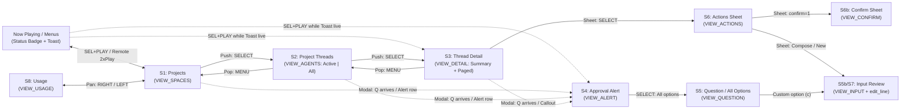

# T3 Code Remote Control — AstraPod Interaction & UI Design

> **Audience:** Firmware and HerdRemote/PodLink developers implementing or extending T3 Code remote control on AstraPod (`apps-ipod/screens/system/agents_screen.c`, `herdremote_model.c`, `apps-ipod/ui/`). This is an internals specification: it names source files, theme tokens, pixel geometry, RAM budgets, and wire framing directly.

---

## 1. Design Goals & Hardware Constraints

AstraPod runs on **iPod Classic 6G/7G** (and 5G/5.5G):

| Constraint | Value / Rule |
|---|---|
| Display | 320×240 RGB565 LCD, no touch screen |
| Physical controls | Capacitive click wheel (clockwise/CCW + acceleration), `SELECT` (centre), `MENU` (top), `PLAY` (bottom), `LEFT` (prev), `RIGHT` (next), plus hardware Hold switch |
| Remote / Dock controls | Serial iAP dock + USB EP0 remote bridge (`agents_remote.c`, `agents_volume.c`) |
| Motion timeline | Shared 60 Hz `USEC_TIMER` (`ui/animation.h`, `ui/scene.h`, `ui/sheet.h`); 30 fps sustained minimum on 6G |
| Memory budget | Static `hr_model` ≤ 32 KiB, `detail_layout` ≤ 6,400 B; transient transition surfaces via `core_alloc_free_space` only (never shrink audio buffer; degrade to instant draw on OOM) |
| Audio continuity | Music playback is primary. Tapping `PLAY` (< 150 ms) pauses/resumes audio; `SELECT+PLAY` swaps Agents ↔ Now Playing without stopping audio or resetting PodLink |
| Link transport | Resident PodLink USB session (`PLFG` 0/1/2) keeps `W`, `S`, `Q`, `X`, `T` live in `background_link()` while the user is elsewhere on the player |
| Branding | Always **AstraPod**; never use Apple logos or the iPod wordmark |

### Core Click-Wheel Ergonomics

1. **Glance first, drill second.** Most interactions are 2–5 seconds: glance at project status, read a 3-line summary, tap `LEFT`/`RIGHT` to approve/deny, or fire a 2-click preset reply.
2. **One consistent mental model.**
   - **Wheel** moves selection (lists) or scrolls text (detail/readers).
   - **`SELECT`** drills in (lists) or opens **Actions** (detail) or confirms (modals/inputs).
   - **`MENU`** always steps back one level / closes the current sheet / defers an alert — never submits, never runs a destructive action.
   - **`LEFT` / `RIGHT`** move horizontally between sibling peers (Usage ↔ Projects, Active ↔ All, Page Up ↔ Page Down in Detail, Allow ↔ Deny on Approvals).
   - **Short `PLAY` tap** always toggles audio Play/Pause.
3. **No accidental approvals.** A newly popped approval/question ignores `LEFT`/`RIGHT` for 250 ms after appearance (`ACTION_REPEAT` is always ignored on binary buttons), preventing a user mid-navigation from accidentally approving a command.
4. **Theme-native surfaces.** Every screen — including alerts, approvals, action sheets, and review modals — resolves colours and fonts from `ui_theme` tokens so **Fruit Company**, **Classic**, **Scrim**, and **Light** remain visually cohesive. Never hardcode `LCD_BLACK` or raw dark RGB fills.

---

## 2. Information Architecture & Navigation Map



### Spatial & Temporal Hierarchy

- **Horizontal axis (Pan, 14 f, below fixed status bar):**
  - Top level: **Usage (`VIEW_USAGE`)** ◄──► **Projects (`VIEW_SPACES`)**
  - Project level: **Active** ◄──► **All** (`sub <project> active|all`, clamped at ends, never wraps)
  - Detail level: **Page Up (`LEFT`)** ◄──► **Page Down (`RIGHT`)**
- **Depth axis (Push 18 f / Pop 15 f):**
  - `Projects → Project Threads → Thread Detail`
- **Overlay axis (Bottom Sheet 16 f in / 12 f out, 35% dim):**
  - `Actions`, `Confirm`, `Approval Alert`, `Input Review`, `Background Toast`

---

## 3. Visual Language Across Themes

| Role / Surface | Fruit Company (Stock-like) | Classic | Scrim (Default) | Light |
|---|---|---|---|---|
| **Status Bar** | 26 px silver-grey vertical gradient (`#F2F3F5 → #C8CCD2`), 1 px `#9DA3AB` divider, bold `#1A1D21` title, green battery pill | Same 26 px crisp header with flat `#DCDFE4` bar | 35 px `UI_BG_COVER_TINT` (`#1D2832` / album-tinted), bold `#FFFFFF` title, clock, 24 px icons | 35 px solid `#DDDCD7`, `#181818` text |
| **List Canvas** | Crisp solid `#FFFFFF`, subtle `#E6E8EC` 1 px dividers, 28–30 px row height | Solid `#F4F5F7` | Blurred album art (`UI_BG_BLURRED_COVER`) + dark tint (`dominant,0,15`) | Solid `#F6F5F2` |
| **Selection Style** | Full-width glossy blue gradient (`#4B9CF7 → #1768D6`), `#FFFFFF` bold/medium text, `#FFFFFF` chevron `›` | Flat `#1E6AD4` bar, `#FFFFFF` text | Signature 3 px vertical rounded accent bar (`UI_COLOR_SELECTION`, album vivid) between icon and text; `#FFFFFF` selected text, muted unselected | 3 px vertical `#12588E` accent bar, `#181818` selected text |
| **Preview / Notes Strip** | Light cool surface `#F1F3F6` with 1 px `#D5DAE2` top hairline, `#1A1D21` body, `#5A6270` meta | Same `#EAECEF` strip | `UI_COLOR_LIST_TINT` (`dominant,0,40`) at `list_tint_alpha=15`, `#FFFFFF` body, album-vivid muted meta | `#DDDCD7` solid strip, `#181818` text |
| **Modal / Bottom Sheet** | Crisp `#F8F9FB` card, 1 px `#B8C0CC` border, 35% dimmed backdrop, solid blue `#1B6FE0` primary highlight | `#FFFFFF` card, 2 px `#73706C` border | Square-edged `UI_COLOR_MODAL_BG` (`#101010`), 2 px `UI_COLOR_MODAL_BORDER` (`#636563`), 35% dim | `#FFFFFF` card, 2 px `#73706C` border, `#12588E` accent |
| **Fonts** | `Noto Sans` (HarmonyOS Sans on device): 15–16 px list/body, 15 px bold title, 12 px metadata/captions | Same | Same (`18-noto-sans`, `18-noto-sans-bold`, `12-noto-sans`) | Same |

### Semantic Status Dots

Consistent across all themes. Every dot renders with a 1.5 px high-contrast halo (`#FFFFFF` on light/blue bars, or dark/white contrast ring on Scrim artwork) so it remains legible on any selection bar or album cover:

| Code | State | Priority | Shape & Colour | Motion (10 Hz, backlight on only) |
|---|---|---|---|---|
| `b` | Waiting (approval / question) | 1 (highest) | Filled disc, crimson `#D20F39` | Blink: 0.6 s on / 0.4 s off |
| `f` | **Failed / Error** *(new)* | 2 | Filled disc with crisp `!` glyph (or coral-red ring+dot), `#E04F33` | Static (subtle 1.5 s pulse on initial arrival) |
| `w` | Working / Running | 3 | Filled disc, emerald `#40A02B` | Smooth 24-step cosine breath (`40%..100%`) |
| `d` | Done (unread/completed) | 4 | Filled disc, teal `#179299` | Static |
| `i` | Idle / Settled | 5 | Hollow ring (1.5 px stroke), `#40A02B` (dimmed on light) | Static |
| `u` / `-` | Unknown / Empty | 6 | Small dot (5 px), `#9CA0B0` | Static |

In `VIEW_SPACES`, if a project's highest-priority state is only in non-active/background threads (`other` in `S`), keep the existing `SHAPE_BADGE` (`…` mini-pill on the dot).

---

## 4. Screen-by-Screen Specification

### S1 — Projects List (`VIEW_SPACES`, T3 Mode)

**Mockups:** [Fruit Company](mockups/fruit-company/01_projects.png) · [Scrim](mockups/scrim/01_projects.png)

**Purpose:** Entry dashboard of all T3 projects (`t3p<n>`), sorted by urgency (`b` > `f` > `w` > `d` > `i`).

**Layout (320×240):**
- **Status bar** (top 26 px Fruit Company / 35 px Scrim): Title **`Agents`** (or **`AstraPod`** when at root), clock, agent status dot, playback icon, battery.
- **Conditional top rows (non-scrollable priority header in list):**
  1. `ROW_STATUS` + `ROW_HINT` (only if link/T3 trouble exists; non-selectable).
  2. `ROW_ALERT` (only when `model.nquestions > 0`; **selectable**): amber/crimson `!` icon, label showing the oldest question's summary (or `"N waiting"` if > 1), right-hand project name. Pressing `SELECT` opens **S4**.
- **Project rows (`ROW_SPACE`, up to 32):**
  - Left: 24×24 status dot cell (`draw_dot`).
  - Middle: project label (e.g. `podbox`, `astrapod-desktop`, `t3-code`), marquee-scrolls when selected if wider than available cell.
  - Right (`RIGHT_CELL = 86 px`): compact highest-priority count: `1 ask`, `1 err`, `2 run`, `3 done`, or empty when idle.
  - Trailing chevron `›` in Fruit Company / Classic.
- **Selection persistence:** Tracked by `ws.id` (`t3p<n>`), never list index, so live priority reordering never jumps the cursor onto a different project.
- **Focus policy:** Moving the wheel in `VIEW_SPACES` does **not** send `fw` for T3 projects (keeps desktop focus calm, matching existing `want_focus()`).

**Long-press `SELECT` on a project row:** Opens a compact **Project Sheet** (`New thread…`, `Focus in T3`, `Switch to All threads`).

---

### S2 — Project Threads List (`VIEW_AGENTS`, T3 Mode)

**Mockups:** [Fruit Company](mockups/fruit-company/02_threads.png) · [Scrim](mockups/scrim/02_threads.png)

**Purpose:** Browse threads (`t3t<n>`) inside one T3 project, switch between `Active` and `All`, and preview each thread's latest progress without opening it.

**Layout (320×240):**
- **Status bar:** Left title shows project + filter cue: e.g. **`podbox · Active ›`** (or **`Active ›`** if narrow, `‹ All` on the All tab).
  - *Implementation note:* When project name + filter exceeds `TITLE_CELL`, abbreviate to `Active ›` / `‹ All` in the title bar and show the project name in the subtle filter sub-bar or retain current `Active ›` / `‹ All` with project name on line 1 of the preview strip. Prefer showing **`podbox`** in title + compact 18 px filter pill bar (`[Active]  All`) directly under the status bar in Fruit Company, or `podbox · Active ›` in Scrim.
- **Scrollable thread list (top ~136 px, ~4–5 rows visible):**
  - Left: status dot (`b`, `f`, `w`, `d`, `i`, `u`).
  - Middle: thread title (`hr_agent.name`, e.g. `T3 remote UI design`).
  - Right: concise status word + optional age (`ask`, `err`, `run`, `done`, `idle`).
- **Bottom Preview Strip (fixed 58–62 px, reusing `list_render.c`'s `notes` panel / `%LD`):**
  - Line 1 (12 px muted): **`<model> · <branch>`** (from `hr_agent.title`, e.g. `claude-4.5 · t3/t3-remote-design`), single line truncated with `…`.
  - Lines 2–3 (14–15 px foreground, 2 wrapped lines max): **Latest assistant message snippet** (from `hr_agent.last`), giving immediate at-a-glance status as the wheel moves.
- **Empty `Active` filter:** Displays centred message `"No active threads"` + muted hint `"Press RIGHT for All threads"`.
- **Desktop follow:** Wheel selection sends debounced `fp <req> <thread>` (single in-flight, silent on `ok`, error in bottom band) when `T3_FOLLOW_IPOD=on`.
- **Long-press `SELECT`:** Opens **Thread Quick Sheet** (`New thread in <project>…`, `Thread actions…`, `Switch Active / All`).

---

### S3 — Thread Detail (`VIEW_DETAIL`, T3 Mode — Summary-First & Paged Reader)

**Mockups:** [Fruit Company](mockups/fruit-company/03_detail.png) · [Scrim](mockups/scrim/03_detail.png)

**Purpose:** Read an agent's current activity, latest message, recent tool steps, and full long output comfortably on 320×240 with zero eye strain.

**Layout (320×240, viewport below status bar = 320×214 in Fruit Company / 300×184 inside list viewport in Scrim):**
1. **Compact Thread Meta Header (36 px, fixed, does not scroll):**
   - Row 1 (12 px): Left = `model · branch` (`a->title`, muted); Right = status dot (8 px) + state & local-ticked age (`working 2m`, `failed`, `done 8m`, `asking`).
   - Row 2 (15 px bold/medium): Thread title (`det->task`, marquee-scrolls horizontally after 1.5 s rest when wider than viewport).
   - 1 px separator rule.
2. **Conditional Pending Request Callout (24 px, pinned when `det->input[0]` or `hr_model_question_for(detail_pane)` is non-null):**
   - High-contrast tinted bar (amber/crimson accent): `⚠ Approval needed — hold SELECT or open Actions` (or dedicated **`PLAY`? No — `PLAY` is audio**; make **`SELECT`** open Actions with `"Answer pending request"` pre-selected as row 0, OR make **Long-press `SELECT`** jump straight to S4/S5!).
3. **Scrollable Summary-First Body (remaining height ~130–160 px, ~7–8 lines at 18–20 px line pitch, with 3 px right-edge scroll track):**
   - **Block A — Live Activity Line** (shown only when `det->now` is active work or error):
     - Working: green accent prefix `● ` + `det->now` (e.g. `Running tests: pytest tools/tests/`).
     - Failed: coral-red prefix `! ` + error summary.
     - Done/Idle: omitted from body (already shown in header to save vertical space!).
   - **Block B — Latest Assistant Message (Summary-First, primary typography):**
     - Wrapped cleanly on word/punctuation boundaries (`text_wrap_next_punct`).
     - Paragraph breaks (`\n`) add a 4 px half-line breathing gap for readability.
     - Inline code spans / bullet lines (`- `, `1. `) are preserved cleanly.
     - **Long-text paging:** Initial `D` delivers up to 300 code points / 900 bytes. When the host indicates more content exists (via `pg`/`M` protocol addition, or truncated `…`), a muted footer cue renders after the summary:
       `─── RIGHT: Read full message (2.4 KB) ───`
       Pressing `RIGHT` at the bottom (or reaching the final 2 lines) fetches the next chunk via `pg <req> <thread> <offset> 2048` into the bounded 4 KiB rolling `detail_layout` window. A compact `1/3` page pill appears at the bottom-right corner of the body while paged.
   - **Block C — Recent Tool Steps (secondary muted typography, below message):**
     - Up to 3 compact single-line rows prefixed with `› ` (`det->step[0..2]`), muted ink.
     - Streaming stability rule (from `detail_layout.c`): tool rows never shift the reader's scroll offset while reading above the bottom.
4. **Live-Streaming Anchor & "New Output" Pill:**
   - If the reader is at the bottom (`detail_scroll >= detail_scroll_max`), new streaming text auto-follows smoothly.
   - If the reader has scrolled up (`detail_scroll < detail_scroll_max`), the viewport freezes (`frozen = true`) and a subtle 18 px pill overlays the bottom-right corner: **`↓ New output`** (tapping `RIGHT` to bottom or long-pressing `RIGHT` jumps to bottom and unfreezes).
5. **Bottom Action Hint / Feedback Band (transient, 24–30 px):**
   - Normally hidden to maximize reading lines (7–8 full lines!).
   - Appears for 2–3 s on command result (`Queued`, `Interrupted`, `Focused`, or error in red), or while voice dictation is recording (`Talking… 3s`).

---

### S4 — Approval & Permission Alert (`VIEW_ALERT`, Theme-Native Overlay)

**Mockups:** [Fruit Company](mockups/fruit-company/04_approval.png) · [Scrim](mockups/scrim/04_approval.png)

**Purpose:** Fast, safe, eyes-free-friendly decision screen for T3 tool/command approvals (`t3a*`) and binary questions (`yes != 0 && no != 0`).

**Trigger:** Pops automatically when a new un-popped `Q` arrives while inside Agents (deferred while `PLAY` is held, `talk_req` pending, or inside `edit_line` / QuickScreen), or manually from `ROW_ALERT` / Detail callout / Background Toast deep-link.

**Layout (320×240, full-screen or framed native sheet):**
- **Top 3 px accent stripe:** Amber (`#E59A28`) for question / Crimson (`#D20F39`) for approval.
- **Header (32 px):** Status dot + bold agent/project (`T3 · podbox`) on left; muted thread title (`t3-remote-design`) on right; 1 px hairline divider.
- **Action / Category Chip (optional, when `q->nlines > 1` and line 0 < 60% width):** Tinted pill (e.g. `RUN COMMAND`, `WRITE FILE`, `APPROVAL`).
- **Question / Command Preview (up to 4 wrapped lines, high-contrast foreground):** e.g. `git commit -m "docs: add t3 remote spec"`. Truncates with `…` on line 4 if longer (full text readable by pressing `SELECT` → **S5**).
- **Two Large Tactile Action Buttons (44 px tall, side-by-side, 10 px gap):**
  - Left button: **`◀ Allow`** (emerald tint fill + border; responds to `LEFT` tap).
  - Right button: **`Deny ▶`** (crimson tint fill + border; responds to `RIGHT` tap).
  - Button labels come from `q->options` matching `q->yes` / `q->no` (clamped cleanly with ellipsis).
- **Bottom Key Bar (24 px):** `SELECT  All options` · `MENU  Later`.

**Safety Guardrails:**
- **250 ms pop-in grace window:** `LEFT` and `RIGHT` are ignored for 250 ms after auto-popup so an in-progress horizontal tap in another view never accidentally approves a command.
- **No repeat fire:** `ACTION_REPEAT` on `LEFT`/`RIGHT` is ignored.
- **Later (`MENU`):** Dismisses the overlay without denying (`t3a*` stays pending in `ROW_ALERT` and on desktop; note: for `t3q*` user-input questions, `MENU` should **defer** locally rather than immediately sending `-2` dismiss on the first tap — only send `-2` via an explicit `"Dismiss question"` option in S5, preventing accidental data loss! *See Open Question #2.*).

---

### S5 — Multiple-Choice Question & All Options (`VIEW_QUESTION`)

**Mockups:** [Fruit Company](mockups/fruit-company/05_question.png) · [Scrim](mockups/scrim/05_question.png)

**Purpose:** Full option list for multi-option questions, multi-select checklists, approval policy choices (`Allow once` / `Allow for session` / `Deny` / `Deny & tell…`), and reading long wrapped questions.

**Layout (320×240):**
- **Status bar:** Left title = `T3 · podbox` (or `Q 1/3 · podbox` for multi-question wizards).
- **List viewport (reuses `gui_synclist` with non-selectable `ROW_TEXT` lines at top):**
  - `ROW_TEXT` rows: full wrapped question text (`join_question`, up to 24 wrapped lines). Turning the wheel CCW past the first selectable option scrolls the question text up into view (existing `agents_screen.c:3589` behaviour).
  - `ROW_OPTION` rows (`1..8`):
    - Single-select: boxed digit icon `1`..`8` (or pencil icon `✎` for `custom=true` row).
    - Multi-select (`q->multi`): checkbox icon `☐` / `☑` (`c` / `x`).
    - Option label + right-hand detail (after ` — ` if ≤ 86 px, else inline marquee when selected).
  - `ROW_SUBMIT` (multi-select only): **`Submit`** with right-hand count (`2 chosen`); sends `a <req> <qid> 0`.
- **Multi-question wizard continuity:** When a T3 request has multiple questions, answering question 1 advances to a new `qid` on the same pane. Keep the user in `VIEW_QUESTION` seamlessly (show brief `"Next question…"` in status title) without flashing back to `VIEW_AGENTS`/`VIEW_DETAIL` between steps.

---

### S6 — Thread Actions & Quick Replies Sheet (`VIEW_ACTIONS` + `VIEW_CONFIRM`)

**Mockups:**
- Actions Sheet: [Fruit Company](mockups/fruit-company/06_actions.png) · [Scrim](mockups/scrim/06_actions.png)
- Confirmation Sheet: [Fruit Company](mockups/fruit-company/07_confirm.png) · [Scrim](mockups/scrim/07_confirm.png)

**Purpose:** Zero-keyboard control hub for starting/stopping/interrupting turns, firing canned quick replies, composing custom prompts, and focusing on desktop.

**Trigger:** Tap `SELECT` in **S3 Thread Detail** (sends `ks <thread>`, opens as native `ui_sheet` rising over 35%-dimmed Thread Detail once `K` arrives; if no `K` within 2 s, shows `"Actions unavailable"` in feedback band).

**Layout (Bottom Sheet, ~196 px tall, full width or 8 px inset in Fruit Company / square-edged full-width in Scrim):**
- **Sheet Header (26 px):** Bold **`Actions`** on left; muted thread state (`working` / `idle`) on right; 1 px divider.
- **Scrollable Action Rows (up to 12 items from `K`, grouped visually with subtle 1 px divider between thread controls and quick replies):**
  1. *(Conditional, only if thread has pending `t3a`/`t3q`)* **`Answer pending request…`** — jumps directly to S4/S5.
  2. **Thread Controls (up to 5 from `K`, state-dependent):**
     - When `working`: **`Interrupt turn`** (`confirm=1`), **`Compose reply (queue)…`**, **`Open on desktop`** (`fp`)
     - When `failed`: **`Retry last turn`**, **`Compose reply…`**, **`Archive thread`** (`confirm=1`), **`Open on desktop`**
     - When `done` / `idle`: **`Compose reply…`**, **`Settle thread`**, **`Archive thread`** (`confirm=1`), **`Open on desktop`**
  3. **Quick Replies (up to 7 canned prompts from `K`, prefixed with subtle `↳` or chat glyph):**
     - e.g. `"Continue"`, `"Run tests"`, `"Fix the failing test"`, `"Summarize changes"`, `"Commit and summarize"`.
     - Selecting any non-confirm item sends `act <req> <thread> <action_id>`, closes the sheet (12 f), and shows host's `R` text (`Sent`, `Queued`, `Interrupted`, etc.) in Detail's bottom feedback band for 2 s.

**S6b — Dynamic Confirmation Sheet (`VIEW_CONFIRM`):**
- Triggered whenever an action has `confirm=1` (e.g., `Interrupt turn`, `Archive thread`, `Cancel run`).
- **Fix over current firmware:** Title/prompt uses the selected action's actual label (`a->label`) rather than hardcoding `"Interrupt %s?"`!
- Layout: Compact centred/bottom native dialog card (~116 px tall) over dimmed backdrop:
  - Headline: **`Interrupt turn?`** (or **`<a->label>?`**)
  - Subtitle (muted, 1 line): Thread title (`T3 remote UI design`)
  - Two buttons (default focus on **`Cancel`** for destructive actions like Archive, or **`Confirm`** for Interrupt — selectable with wheel or `LEFT`/`RIGHT`, activated with `SELECT`; `MENU` always cancels and returns to **S6** on the same row!).

---

### S7 — Custom Text Input, Prompt Compose & Dictation Review (`VIEW_INPUT` + `edit_line`)

**Mockups:** [Fruit Company](mockups/fruit-company/08_compose_review.png) · [Scrim](mockups/scrim/08_compose_review.png)

**Purpose:** Entering freeform text without a keyboard — for (a) custom answers (`c` option in S5), (b) custom follow-up prompts (`Compose reply…` in S6), and (c) starting a new thread (`New thread…` from S1/S2 Project Sheet).

**Three Input Tiers (ordered by speed on click wheel):**

1. **Canned Presets (fastest, 2 clicks):**
   - For follow-ups: the 7 quick replies in **S6 Actions**.
   - For **New Thread** (Project Sheet): host-configured starter templates (e.g., `"Investigate failing tests"`, `"Review git diff"`, `"Fix lint errors"`, `"Custom prompt…"`).
2. **Click-Wheel Character Entry (`dialog_input` / `edit_line.c`, built-in):**
   - Reuses AstraPod's existing single-line editor (`docs/podbox/text-input-guide.md`):
     - Wheel CW/CCW inserts/cycles character (`space A-Z 0-9 - _ . ' &`, fast spin skips 2/4 chars).
     - `LEFT`/`RIGHT` tap commits character and moves caret.
     - `LEFT`/`RIGHT` hold backspaces / forward-deletes.
     - `SELECT` accepts text and moves to **Review Screen (`VIEW_INPUT`)**.
     - `PLAY` moves focus to Cancel/OK row; `MENU` cancels (with discard confirmation if dirty).
   - *Note:* `edit_line` emits uppercase ASCII; LLMs handle uppercase prompts cleanly, so no invasive keyboard rewrite is required for v1. Adding a lowercase cycle or shift toggle is an optional future enhancement.
3. **Host-Side Voice Dictation (optional, gated on `tv 1` capability):**
   - Currently `vd <req> <t3t>` returns `R <req> err Voice cannot reach T3`.
   - **Rule while `tv` is unsupported:** Holding `PLAY` in T3 views shows a calm 2 s info band `"Voice dictation unavailable for T3"` (or is ignored cleanly) rather than a harsh error loop.
   - **Rule when host advertises `TV 1`:** Holding `PLAY` (≥ 150 ms) in **S3 Detail** or **S7 Input Review** sends `vd <req> <thread>`. The bottom talk band shows red mic + `Talking… 3s`. Releasing `PLAY` sends `vu <req>` (`Transcribing…`); sliding/pressing `MENU` while holding sends `vc <req>` (discard). When host returns `VT <req> <thread> <text>`, the player **always lands on `VIEW_INPUT` Review** — never auto-sends raw speech-to-text!

**Review Screen (`VIEW_INPUT`) Layout:**
- **Header:** Context line (`Reply to: T3 remote UI design` or question prompt line, muted).
- **Framed Text Box (up to 5 wrapped lines, auto-scrolled to cursor/end):** Shows composed or transcribed text clearly (`t3_input`, 1–1024 UTF-8 bytes) with character count if > 100 chars.
- **Secondary Hint Row:** `RIGHT: Edit text` (plus `Hold PLAY: Redictate` when `TV 1` active).
- **Bottom Key Bar:** `SELECT  Send` · `MENU  Cancel` (for custom question sends `qi <req> <qid> enter <text>` or `esc`; for thread reply sends `msg <req> <thread> send <text>`).

---

### S8 — Usage Dashboard (`VIEW_USAGE`)

- Reached by pressing `LEFT` from **S1 Projects** (horizontal pan `-1`); `RIGHT` or `MENU` returns (pan `+1`).
- Keeps existing 4-provider layout (`Codex`, `Claude`, `Grok`, `Gemini`) with 5h / week progress bars, pace warning (`USE_PACE` yellow), full (`USE_FULL` red), 7-day tokens + USD cost, and `Total` row.
- **T3-mode input fix:** In `AGENT_CONTROL=t3` mode, `VIEW_USAGE` must **not** send OS keyboard taps (`k left/right/bs/enter`) — the wheel scrolls the usage view vertically if needed, `SELECT` triggers an immediate refresh (`us`), and `RIGHT`/`MENU` returns to Projects.

---

### S9 — Background Notifications & Status-Bar Indication (Outside Agents)

**Mockups:** [Fruit Company](mockups/fruit-company/09_now_playing_toast.png) · [Scrim](mockups/scrim/09_now_playing_toast.png)

Because `podlink_open_agents(background_link)` keeps the resident PodLink session open across screens (`PLFG=0`), AstraPod already receives `W`, `S`, `Q`, `X`, `T` while the user listens to music in Now Playing or browses albums.

#### 1. Compact Background Summary (`agents_bg_summary`)

Maintained in `agents_screen.c` (updated by `background_link()`, read lock-free / IRQ-safe by `native_chrome.c` and `native_wps.c`, ~16 bytes static RAM):

```c
struct agents_bg_summary {
    bool connected;          /* PodLink + HR hello + T3 reachable */
    uint8_t waiting;         /* active approvals + questions (Q count) */
    uint8_t failed;          /* threads currently in 'f' state */
    uint8_t working;         /* threads currently in 'w' state */
    uint8_t unread_done;     /* transitions w->d while outside Agents */
    uint32_t event_serial;   /* increments on new toast-worthy event */
};
```

`unread_done` clears immediately when the user enters Agents (`agents_run()`).

#### 2. Status-Bar Indicator (`native_chrome.c` / `statusbar.c`)

- **Placement:** A 14–22 px compact slot immediately to the left of the busy/playback icon group (`status_layout()` reserves it only when `connected && (waiting || failed || working || unread_done)`).
  - *Layout check:* With `status_clock_numeric_width = 118` and `LCD_WIDTH = 320`, adding a 16 px dot+badge slot shifts `clock_x` right/left within the existing `right_clock` fallback rule without violating `layout_fits()`.
- **Visual states (first match wins):**
  1. `waiting > 0`: blinking crimson dot (7 px) + bold count (`1`..`9`) in status fg/crimson.
  2. `failed > 0`: solid coral-red `!` dot (7 px).
  3. `working > 0`: breathing emerald dot (7 px).
  4. `unread_done > 0`: solid teal dot (7 px).
  5. All idle or disconnected: **hidden** (0 px — keeps the music player uncluttered).
- **In Scrim Now Playing (`native_wps.c`):** Because Scrim WPS hides the standard status bar (`native_wps_active()`), render a minimal 20×16 px translucent pill in the top-left transport column (`x = 52, y = 4`, beside the Play/Pause triangle at `x = 2`, well clear of the 240×240 album cover starting at `x = 80`). In Fruit Company Now Playing, the standard top status bar is always visible and carries the badge natively.

#### 3. Non-Intrusive Toast Banner (Outside Agents)

**Trigger rules (controlled by setting `Settings > System > Agents > Notifications`: `Off` / `Urgent only` / `Urgent & Done` [default]):**

| Event while `PLFG=0` | Urgent only | Urgent & Done | Backlight wake | Optional piezo tone |
|---|---|---|---|---|
| New Approval / Question (`Q`) | Show toast (6 s) | Show toast (6 s) | Yes (5 s) | Gentle double-tick (if beep enabled; never interrupts DAC audio) |
| Thread Failed (`w → f` or `E fail`) | Show toast (5 s) | Show toast (5 s) | Yes (5 s) | Single low tick |
| Thread Finished (`w → d` or `E done`) | Status dot only | Show toast (4 s) | No (only if LCD already on) | None |
| Thread Working / Progress update | Never | Never | No | None |

**Visual Design (44 px tall bottom or top toast card, slides in 12 f / out 10 f):**
- **Position:** Top edge in Scrim Now Playing (below `y = 0`, above cover title panel at `y = 77` — covers `y = 4..48` without obscuring track title/artist/progress!) or bottom edge (`y = 192..236`) in Fruit Company Now Playing (above or overlaying only the bottom scrubber margin cleanly).
- **Content:**
  - Left 3 px vertical accent bar (crimson for approval/failed, teal for done).
  - Line 1 (13 px bold): **`Approval needed · podbox`** (or **`Done · podbox`**, **`Failed · podbox`**)
  - Line 2 (12 px): Left = concise detail (`Run pytest tools/tests…`); Right = pill **`SEL+PLAY`**
- **Zero Input Hijacking:**
  - Wheel, `LEFT`, `RIGHT`, `PLAY`, and `MENU` keep their normal Now Playing / list meanings! The user never accidentally approves or loses track control.
  - Pressing **`SELECT+PLAY`** (or remote Play double-tap) while a toast is visible — or within 3 s after it fades — switches to Agents **and deep-links directly to the event's `qid` (S4) or `thread_id` (S3)**!
- **Suppression Rules:** Never draw toasts over `rock_ui_raw()` (plugins/games), USB Disk Mode, `edit_line` text entry, active modal dialogs/QuickScreen, or during active Cover Flow spinning (defer toast until spin settles).

---

### S10 — Offline, Disconnected & Error States

**Mockups:** [Fruit Company](mockups/fruit-company/10_offline.png) · [Scrim](mockups/scrim/10_offline.png)

Every failure mode has distinct copy, icon, and recovery path — replacing legacy herdr-centric messages when `AGENT_CONTROL=t3`:

| State | Detection | Presentation | User Recovery |
|---|---|---|---|
| **USB Unplugged / Charge-Only** | `podlink_state() == PODLINK_WAIT_USB` | Centred USB-link icon + **`Connect USB to PC`** + muted hint `"Plug into a computer running HerdRemote"` | Automatic on USB attach (non-disk mode) |
| **HerdRemote Not Running** | `PODLINK_OPENING` or connected without `HR` hello | Centred link-waiting icon + **`Start HerdRemote on PC`** + muted mono hint `systemctl --user start herdremote` | Automatic once `HR 1` arrives |
| **T3 Code Not Running** | `HR 1` received, `t3_ok == 0` *(new T field)* | Centred app-offline icon + **`T3 Code is not running`** + muted hint `"Launch T3 Code on your computer"` | Automatic once T3 reconnects; `SELECT` re-sends `hr 1` |
| **Stale Link (> 6 s silence)** | `current_tick > last_message + 6*HZ` | **Non-destructive top warning strip** (`"No update for 14 s"`); existing list or Thread Detail stays readable in muted ink so user does not lose text mid-read | Mutating actions blocked with `"Link stale"`; auto-clears on next frame |
| **No T3 Projects** | `t3_ok == 1 && nws == 0` | Centred empty state: **`No T3 projects`** + `"Open a project in T3 Code"` | Automatic on next `W` |
| **Empty Active Filter** | `VIEW_AGENTS && active && nagents == 0` | **`No active threads`** + `"Press RIGHT for All threads"` | `RIGHT` pans to `All` |
| **Command / Action Failure** | `R <req> err <reason>` or 8 s timeout | 30 px bottom feedback band (crimson accent, 3 s): e.g. `"Request expired"`, `"T3 busy — try again"`, `"No reply from computer"` | Non-blocking; stays on current view |

---

## 5. Complete Button Map (Per Screen)

> **Global invariants across all Agents screens:**
> - **`PLAY` short tap (< 150 ms):** Audio Play/Pause (`BUTTON_MULTIMEDIA_PLAYPAUSE`), never interrupts Agents.
> - **`SELECT+PLAY` chord (or Remote Play 2× tap):** Toggle Agents ↔ Now Playing silently (no USB Disk Mode popup; preserves cached view).
> - **`SELECT+MENU` short chord (or Remote Play 3× tap):** Toggle Cover Flow silently. *(Warning: hardware resets if held ~6 s.)*
> - **`MENU` long-press:** Opens native QuickScreen (`agents_quickscreen()`), except inside `edit_line` and `VIEW_CONFIRM`.
> - **Dock/PC Remote `Vol+` / `Vol-`:** Maps to previous/next item in lists (`S1`, `S2`, `S5`, `S6`), Page Up/Down in `S3` Detail and `S8` Usage (in T3 mode, never sends desktop arrow keys!).

| Screen | Wheel CW / CCW | `SELECT` Tap | `SELECT` Long-Press | `LEFT` Tap / Hold | `RIGHT` Tap / Hold | `MENU` Tap | `PLAY` Long-Press (≥ 150 ms) |
|---|---|---|---|---|---|---|---|
| **S1: Projects** (`VIEW_SPACES`) | Next / prev project (skips status/headers; no `fw`) | Enter project (`S2`) or open Alert (`S4`) | Project Sheet (`New thread…`, `All threads`) | Pan to **S8 Usage** / — | Pan to **S8 Usage** / — | Exit Agents (+ S1 USB Disk Mode prompt if connected) | *(If `TV 1`)* Dictate new thread in selected project; else info band |
| **S2: Project Threads** (`VIEW_AGENTS`) | Next / prev thread (updates bottom preview; sends debounced `fp`) | Open **S3 Thread Detail** (or `S4` on Alert row) | Project/Thread Sheet (`New thread…`, `Actions…`, `Active/All`) | Pan to **Active** (clamped) / — | Pan to **All** (clamped) / — | Pop to **S1 Projects** | *(If `TV 1`)* Dictate follow-up to selected thread; else info band |
| **S3: Thread Detail** (`VIEW_DETAIL`) | Scroll body 1 line (fast spin: 3 lines); freezes auto-follow when above bottom | Open **S6 Actions Sheet** (`ks <thread>`) | Jump straight to pending **S4/S5** (if any); else open **S6 Actions** | **Page Up** (viewport − 1 line) / **Jump to Top** (summary) | **Page Down** (fetches next `pg` chunk at end) / **Jump to Bottom** (live tail) | Pop to **S2 Threads** | *(If `TV 1`)* Hold-to-Talk dictation → lands on **S7 Review**; else info band |
| **S4: Approval Alert** (`VIEW_ALERT`) | No-op (prevents accidental slip) | Open **S5 All Options** | No-op | **Allow** (`q->yes`, 250 ms grace, no repeat) / — | **Deny** (`q->no`, 250 ms grace, no repeat) / — | Defer alert locally (stays in `ROW_ALERT`) | No-op |
| **S5: Question / Options** (`VIEW_QUESTION`) | Move option; CCW past top scrolls long question text | Pick option / toggle checkbox / Submit / open `edit_line` on `c` | No-op | *(Pure 2-opt binary only)* Allow / — | *(Pure 2-opt binary only)* Deny / — | Defer & return to previous view | No-op |
| **S6: Actions Sheet** (`VIEW_ACTIONS`) | Move between controls & quick replies | Run action (`act`) or open **S6b Confirm** (`confirm=1`) or **S7 Compose** | No-op | No-op / — | No-op / — | Close sheet → **S3 Detail** | No-op |
| **S6b: Confirm Sheet** (`VIEW_CONFIRM`) | Toggle `Cancel` ↔ `Confirm` | Activate highlighted button | No-op | Focus `Cancel` / — | Focus `Confirm` / — | Cancel → **S6 Actions** (same row) | No-op |
| **S7: Input Review** (`VIEW_INPUT`) | Scroll preview box if > 5 lines | **Send** (`qi enter` or `msg` or `new`) | No-op | No-op (in T3 mode) / — | Re-open `edit_line` click-wheel editor / — | Cancel (`qi esc` or discard draft) | *(If `TV 1`)* Re-dictate into review box |
| **S8: Usage** (`VIEW_USAGE`) | Scroll vertically (T3 mode; no desktop keys) | Manual refresh (`us`) | No-op | No-op (clamped) / — | Pan back to **S1 Projects** / — | Pan back to **S1 Projects** | No-op |
| **Now Playing + Toast** | Normal volume / seek | Normal WPS action | Normal WPS context menu | Normal prev / rewind | Normal next / FF | Normal WPS exit | Normal Play/Pause (`SELECT+PLAY` deep-links to toast target!) |

---

## 6. Transitions, Animations & Timing

All transitions use AstraPod's existing 60 Hz `USEC_TIMER` primitives (`ui/scene.h`, `ui/sheet.h`, `widgets/list_render.c`) and scale with `theme.motion_scale` (0 when `global_settings.animations == false`):

| Transition | Primitive | Duration (60 Hz) | Curve & Visual Spec |
|---|---|---|---|
| `S1 → S2`, `S2 → S3` (Push) | `ui_scene_capture(..., true)` | **18 f** (300 ms) | Cubic ease-out; incoming slides from right; outgoing shifts left 30% & dims to 70% brightness; 2 px x-alignment |
| `S3 → S2`, `S2 → S1` (Pop) | `ui_scene_capture(..., false)` | **15 f** (250 ms) | Cubic ease-in; top page slides right; underlying page restores from −30% / 70% |
| `S1 ↔ S8`, `Active ↔ All` (Pan) | `ui_scene_capture_pan(..., dir, status_h)` | **14 f** (233 ms) | Adjacent pages move 1:1 horizontally beneath fixed status bar |
| `S6 Actions`, `S6b Confirm`, `S4 Alert` (Sheet) | `ui_sheet_begin(..., open)` | **16 f in / 12 f out** | Vertical slide from bottom; underlying backdrop dims smoothly to 35% `UI_COLOR_DIM` |
| Background Toast (Now Playing / Lists) | `ui_sheet` strip or retained slide | **12 f in / 10 f out** | Slides from top (Scrim WPS) or bottom (Fruit Company); zero dimming of underlying content |
| List selection glide & settle | `list_render.c` native motion | **8 f glide / 10 f settle** | Native selection bar / accent stripe glide; ≤ 0.5 row overscroll |
| Status dot breathing / blinking | `agents_screen.c` `ANIM_TICKS` | **10 Hz** (24-step breath; 0.6 s/0.4 s blink) | Repaints dot cell only; paused whenever `is_backlight_on(true)` is false |
| Long title marquee in Detail | `tick_task()` | **1.5 s rest**, 2 px / 100 ms | Repaints title strip only |

---

## 7. Edge Cases & Concurrency Rules

1. **Question arrives while in Actions / Confirm / `edit_line` / QuickScreen:**
   - Inside `VIEW_ACTIONS` or `VIEW_CONFIRM`: defer auto-popup until the sheet closes; update `ROW_ALERT` silently so no confirmation button is swapped under the user's thumb.
   - Inside `edit_line` or QuickScreen: defer auto-popup; `poll_link()` continues draining incoming frames so the link never times out.
   - While `PLAY` is held or `talk_req` is in flight: existing deferral in `pop_question()` remains intact.
2. **Question resolved on desktop (`X`) while open on iPod:**
   - Immediately close `VIEW_ALERT` / `VIEW_QUESTION` / `VIEW_INPUT`, restore previous view + selection, and show a calm 2 s band `"Handled on desktop"`.
3. **Multi-question T3 wizard (`t3q1 → t3q2`):**
   - When `a <req> t3q1 <n>` succeeds and a new `Q` for the same `pane` arrives within 1.5 s, transition directly into the new question in `VIEW_QUESTION` without popping back to the parent view.
4. **Thread list reorders mid-scroll:**
   - `show_same()` matches rows by `r->id` (`t3t<n>` / `t3p<n>`). If the selected thread moves up/down, keep selection on it without resetting the viewport unnecessarily; if it disappears (e.g. settled while viewing `Active`), select the nearest neighbour and never jump to an unintended destructive row.
5. **Streaming `D` updates while user is reading scrolled up:**
   - `detail_layout_update(..., frozen=true)` freezes existing wrapped lines and tool rows so text never jumps under the reader's eyes. Show `↓ New output` pill; unfreeze once `detail_scroll == detail_scroll_max`.
6. **Rapid wheel spinning in `VIEW_AGENTS` (`T3_FOLLOW_IPOD=on`):**
   - Keep single in-flight `fp` coalescing (`focus_want` overwrites pending target; send only after current `R` arrives). Suppress desktop `Err: Focus superseded` noise.
7. **USB disconnect mid-read or mid-compose:**
   - In `VIEW_DETAIL`: keep last rendered text visible with muted top banner `"USB disconnected"` so the user can finish reading the answer before pressing `MENU`.
   - In `VIEW_INPUT` / `edit_line`: preserve `t3_input` in RAM until `MENU` or reconnect; block `Send` with `"Connect USB to send"`.
8. **Backlight & Power Management:**
   - Wake backlight (`backlight_on()`) only on urgent events (new Approval/Question `Q` or thread `Failed`), never on routine `working` ticks or `done` when the screen is off.
   - Keep `button_set_sw_poweroff_state(false)` active inside Agents so holding `PLAY` never powers off the player; wait for `PLAY` release on exit (`agents_screen.c:3818`).

---

## 8. Protocol Compatibility & Proposed Additions

### 8.1 What Works Today (HerdRemote v1 + `tc 1` + `qx 1` — Zero Wire Changes)

The following already work on the current wire protocol (`docs/podbox/herdremote-protocol.md`):

- Capability handshake: `hr 1`, `qx 1`, `tc 1`, `PLFG 0/1/2`
- Project list & counts (`W` with `#\tT3`, `t3p<n>`, `S` dots)
- Project thread filters (`sub <t3p> active|all`, `T` tabs, `A` up to 16 threads with model/branch + latest snippet)
- Desktop follow (`fp <req> <t3t>`)
- Typed detail snapshot (`det <t3t>` → `D` 11/12 fields: title, status/model, 900 B latest assistant text, 3 steps, oldest pending request, revision)
- Approvals & multi-choice questions (`Q` 9-field header `t3a*`/`t3q*`, `X`, `a <req> <qid> <n>`, `0` submit, `-2` dismiss, `qi <req> <qid> enter <text>` / `esc`)
- Thread actions & quick replies (`ks <t3t>` → `K` up to 12 items with `confirm:0|1`, `act <req> <t3t> <action>`)
- Usage view (`us` → `U`/`P`/`N` from T3 RPC)

### 8.2 Proposed Protocol Additions (Wire Version Stays `1`)

All additions remain tab-separated UTF-8 TEXT frames, negotiated via optional capability flags sent immediately after `hr\t1`:

```text
tc\t2          (enables failed state 'f', 4-field T tick, E events, pg/M paging, msg/new)
tv\t1          (optional: player supports reviewed T3 voice dictation via VT)
```

Old daemons ignore unknown capability lines; old players ignore unknown frame tags and extra fields cleanly.

#### Addition 1 — T3 Health Flag & Failed Status (`f`)

- **Tick `T` (4 fields when `tc 2` negotiated; 3 fields legacy):**
  ```text
  T\t<age>\t<herdr_ok>\t<t3_ok>
  ```
  `t3_ok` is `1` when HerdRemote has a live connection to T3 Code, `0` when T3 Code is closed/unreachable. Lets `trouble()` display `"T3 Code is not running"` instead of `"herdr is not running"`.
- **Failed status letter `f`:**
  Accepted in `S` (`tab1`/`other`), `T` (`status`), and `A` (`status`). Priority order becomes: `b` > `f` > `w` > `d` > `i` > `u` > `-`.
  *(Optional `W` compatibility: `W` keeps its 7-field shape; failed threads are counted in `waiting` or surfaced via `S`'s `f` letter so legacy parsers never reject `W`.)*

#### Addition 2 — Background Event Push (`E`) for Out-of-Agents Toasts

Sent by host when a notable transition occurs (especially while `PLFG=0`):

```text
E\t<kind:ask|done|fail>\t<project_id>\t<thread_id>\t<qid_or_dash>\t<project_label>\t<thread_title>\t<summary>
```

| Field | Budget | Notes |
|---|---:|---|
| `kind` | 4 B | `ask`, `done`, or `fail` |
| `project_id`, `thread_id` | 15 B each | `t3p<n>`, `t3t<n>` |
| `qid_or_dash` | 11 B | `t3a…`/`t3q…` for `ask`, `-` otherwise |
| `project_label` | 40 B | Display name for toast header |
| `thread_title` | 60 B | Display name |
| `summary` | 90 B | First line of question, completion, or error |

Allows `background_link()` to show an accurate toast + deep-link target without diffing 32 projects or subscribing to every project in the background.

#### Addition 3 — On-Demand Long Message Paging (`pg` / `M`)

Extends reading beyond `D`'s 900-byte summary cap without enlarging PodLink frames or static RAM:

```text
Player → Host:  pg\t<req>\t<thread_id>\t<offset_bytes>\t<limit_bytes>
Host → Player:  M\t<req>\t<thread_id>\t<offset_bytes>\t<total_bytes>\t<has_more:0|1>\t<text>
```

- `limit_bytes` requested by player: `2048` (fits well inside `detail_layout`'s 4096 B rolling buffer and even legacy 4096 B PodLink links).
- `text` uses the same `\n` / `\\` escape convention as `D.input` (preserves paragraph breaks and code/list line breaks).
- `D` signals truncation when the full latest assistant message exceeds 900 B (or host appends `…` and player detects `total_bytes` on first `pg` with `offset=0`).

#### Addition 4 — Free-Text Follow-Up (`msg`) & New Thread (`new`)

```text
Player → Host:  msg\t<req>\t<thread_id>\t<mode:send|steer|queue>\t<text>
Host → Player:  R\t<req>\tok\tSent|Queued
                R\t<req>\terr\t<reason>

Player → Host:  new\t<req>\t<project_id>\t<prompt>
Host → Player:  R\t<req>\tok\t<thread_id>|<title>
                R\t<req>\terr\t<reason>
```

- `text` / `prompt`: 1–1024 UTF-8 bytes, no control characters (newlines escaped as `\n`).
- On `new` success, if `R` text contains `<thread_id>|<title>`, the player immediately navigates into **S3 Thread Detail** for `<thread_id>`.
- Project-level action templates can also be queried with existing `ks <t3p<n>>` → `K <t3p<n>> <n>` (reuses `K` with zero new list frame!).

#### Addition 5 — Reviewed T3 Voice Dictation (`tv 1` + `VT`) *(Optional)*

Only active if the host advertises `TV\t1` in response to `tv\t1`:

```text
Player → Host:  vd\t<req>\t<thread_id>       (PLAY held ≥ 150 ms)
Host → Player:  R\t<req>\tok\tTalking
Player → Host:  vu\t<req>                    (PLAY released)
Host → Player:  R\t<req>\tok\tTranscribing
Host → Player:  VT\t<req>\t<thread_id>\t<text>
```

- `vc\t<req>` cancels recording before transcription.
- Host **never** submits `text` directly to T3; `VT` populates `t3_input` and opens **S7 Review (`VIEW_INPUT`)**, where the user confirms via `SELECT` (sending `msg` or `qi`).

#### Addition 6 — Multi-Question Wizard Step Indicator *(Optional)*

Either extend `Q` with an optional 10th header field `<step>` (e.g. `1/3`, `-` when single question) under `tc 2`, or prefix `q->tab` / `q->lines[0]` cleanly on the host side so no parser break occurs.

---

## 9. Phased Implementation Plan

| Phase | Scope | Protocol Requirement |
|---|---|---|
| **Phase 1 — Core T3 Polish** | Theme-native `VIEW_ALERT` / `VIEW_INPUT` / `VIEW_CONFIRM` (remove hardcoded black/amber), structured summary-first `draw_t3_body` with scroll track & `LEFT`/`RIGHT` paging, `ui_sheet` for `VIEW_ACTIONS` + dynamic confirm label, disable desktop `k` taps in T3 `VIEW_USAGE`, 250 ms approval grace window | **None** (works on current `tc 1` + `qx 1` today) |
| **Phase 2 — Background Awareness & Error Clarity** | `agents_bg_summary` in `background_link()`, status-bar agent badge (`native_chrome.c` + `native_wps.c`), non-intrusive toast + `SELECT+PLAY` deep-link, failed state `f`, `t3_ok` offline screen | `tc 2` Additions 1 & 2 (`T` 4th field, `f`, `E`) |
| **Phase 3 — Long Reading, Compose & Dictation** | On-demand full-message paging (`pg`/`M`), custom reply (`msg`) & Project Sheet / New Thread (`new` + `ks <t3p>`), optional reviewed voice dictation (`tv 1` + `VT`) | `tc 2` Additions 3–5 + `tv 1` |

---

## 10. Visual Mockups Reference

All 10 key screens are rendered at exact **320×240 px** in both **Fruit Company** and **Scrim** by [`render_mockups.py`](render_mockups.py):

| # | Screen | Fruit Company | Scrim |
|---|---|---|---|
| 01 | Projects List (`VIEW_SPACES`) | [`fruit-company/01_projects.png`](mockups/fruit-company/01_projects.png) | [`scrim/01_projects.png`](mockups/scrim/01_projects.png) |
| 02 | Project Threads (`VIEW_AGENTS`) | [`fruit-company/02_threads.png`](mockups/fruit-company/02_threads.png) | [`scrim/02_threads.png`](mockups/scrim/02_threads.png) |
| 03 | Thread Detail (`VIEW_DETAIL`) | [`fruit-company/03_detail.png`](mockups/fruit-company/03_detail.png) | [`scrim/03_detail.png`](mockups/scrim/03_detail.png) |
| 04 | Approval Alert (`VIEW_ALERT`) | [`fruit-company/04_approval.png`](mockups/fruit-company/04_approval.png) | [`scrim/04_approval.png`](mockups/scrim/04_approval.png) |
| 05 | Multiple-Choice Question (`VIEW_QUESTION`) | [`fruit-company/05_question.png`](mockups/fruit-company/05_question.png) | [`scrim/05_question.png`](mockups/scrim/05_question.png) |
| 06 | Actions & Quick Replies Sheet (`VIEW_ACTIONS`) | [`fruit-company/06_actions.png`](mockups/fruit-company/06_actions.png) | [`scrim/06_actions.png`](mockups/scrim/06_actions.png) |
| 07 | Confirmation Sheet (`VIEW_CONFIRM`) | [`fruit-company/07_confirm.png`](mockups/fruit-company/07_confirm.png) | [`scrim/07_confirm.png`](mockups/scrim/07_confirm.png) |
| 08 | Custom Answer / Reply Review (`VIEW_INPUT`) | [`fruit-company/08_compose_review.png`](mockups/fruit-company/08_compose_review.png) | [`scrim/08_compose_review.png`](mockups/scrim/08_compose_review.png) |
| 09 | Now Playing + Background Toast | [`fruit-company/09_now_playing_toast.png`](mockups/fruit-company/09_now_playing_toast.png) | [`scrim/09_now_playing_toast.png`](mockups/scrim/09_now_playing_toast.png) |
| 10 | Offline / T3 Not Running | [`fruit-company/10_offline.png`](mockups/fruit-company/10_offline.png) | [`scrim/10_offline.png`](mockups/scrim/10_offline.png) |
